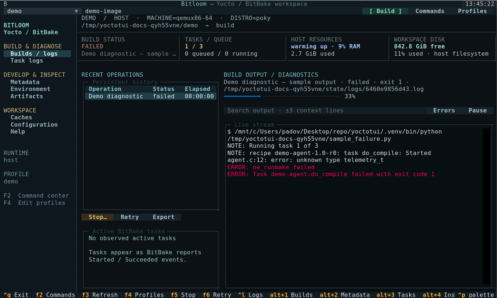

# Bitloom

**A terminal cockpit for everyday Yocto and BitBake development.** Build images, inspect recipes, develop with devtool, follow failures, and manage local caches from one keyboard-friendly interface.

*Weaving layers, recipes and builds into one terminal workspace.*

Python 3.10+ · Textual · Linux / WSL2 · Host · Docker · Podman · kas · kas-container



## Inspiration and thanks

Bitloom is inspired by the idea behind [yoctui](https://github.com/0xbadcaffe/yoctui): bringing everyday Yocto and BitBake work into a terminal interface. Thank you to [0xbadcaffe](https://github.com/0xbadcaffe), the author of yoctui, for the inspiration and for sharing the project with the community. Bitloom has its own implementation and interface.

## Start in one minute

```bash
python3 -m venv .venv
source .venv/bin/activate
pip install -e .
bitloom --demo
```

The executable is `bitloom`; `yoctotui` remains available as a compatibility alias. The Python package and existing `.yoctotui` configuration/state paths retain their names.

The demo creates an isolated sample workspace under `.yoctotui/demo`. Its metadata and screenshots are labelled demo data. It does **not** simulate successful Yocto builds or download Yocto.

For a real project, launch `bitloom`, press **F4**, and configure a profile. Alternatively:

```bash
cp examples/profiles.json .yoctotui/profiles.json
# Replace the example paths before starting.
bitloom --config .yoctotui/profiles.json
```


## What you can do

| Area | Capabilities |
| --- | --- |
| Builds | Serial queue, persistent SQLite history, streaming logs, observed live recipe tasks, task progress, exit status, retries with original profile, cancellation, SDK/eSDK, recipe tasks, forced compile, dry runs, parsing |
| Runtimes | Initialized host environment; kas config composition; fresh Docker/Podman containers; existing containers; official kas-container wrapper |
| Layers | Expandable layer tree, search local layers, priorities through BitBake, add/remove/create, overlays, appends, cross-layer dependencies, edit metadata with backups |
| Recipes | Browse `.bb`, `.bbappend`, `.bbclass` and kas YAML, compile/patch/package individual recipes, list tasks, evaluate environment |
| Development | devtool modify/add/build/build-image/reset/finish/update/upgrade, upstream version checks, device deployment, devshell, kernel menuconfig and config checks |
| Errors and logs | Build and task log browsers, case-insensitive search with context, error-only view, pause/resume, failure notifications, exports, build summary and timestamped slow-task reports |
| Downloads | Fetch a recipe or all target dependencies, size/age inventory, orphan marker and partial-download audit, concrete prune plans |
| Shared state | Local inventory, age-based prune plans, recipe cleansstate, signature dumps/diffs, `-S printdiff` |
| Workbench | Filter evaluated environment variables, compare two snapshots, browse generated dependency edges and transitive/reverse dependency context, buildhistory Git diff |
| Outputs | Discover images, SDKs, manifests, licenses, SBOMs, buildstats and buildhistory files; text preview, read-only tar rootfs inventory (permissions, owners, links), and binary artifact paths |
| Configuration | Multiple named profiles, custom environment/runtime arguments, local.conf and bblayers.conf editor, backups, external-change detection, diagnostics |
| Releases | Local branch/revision/tag report, dirty-tree status and literal layer-series compatibility checks; separate profiles and build directories per release |
| Testing and security | testimage, ptest, CVE and SPDX command entry points when the required classes/configuration exist |
| Utilities | Argument-based custom commands, interactive terminal handoff, command filtering, keyboard shortcuts, command palette, CLI diagnostics |

The [command reference](docs/commands.md) documents every built-in action. The [user guide](docs/guide.md) describes complete workflows and runtime constraints.

## Keyboard

| Key | Action |
| --- | --- |
| F2 | Search and queue a command |
| F3 | Refresh local metadata, logs, diagnostics and artifacts |
| F4 | Edit profiles |
| F5 | Open build interruption options |
| F6 | Retry the selected job |
| Alt+1…5 | Builds, metadata, task logs, workbench, caches |
| Ctrl+L | Focus build log search |
| Ctrl+P | Textual command palette |
| Ctrl+Q | Stop active jobs and exit |
| Enter | Select a build log or open a metadata/task/artifact row |
| Tab / Shift+Tab | Move focus |
| Escape | Close a dialog |

The interface uses compact single-line controls, a terminal navigator, split history/output and syntax-highlighted metadata previews. **140 × 42** shows the complete workspace; below 105 columns it switches to tabs and hides side panes. The [compact terminal capture](docs/assets/compact.png) shows the 90 × 28 layout. Host CPU/RAM and workspace filesystem usage are sampled every two seconds and explicitly labelled as host resources.

## Build interruption and recovery

**Stop…** offers three explicit choices:

- **Let finish** leaves the build running.
- **Graceful stop** sends exactly one SIGINT to the host BitBake client, or to the main process of a fresh container managed by Bitloom. BitBake can finish its currently executing tasks. The TUI does not escalate this request automatically.
- **Force + recovery** terminates the managed process/container and offers `bitbake -c clean` for recipes observed running in the log. Finished tasks are removed from that active set. Recovery is withheld if runtime shutdown is unconfirmed. Work files may contain developer edits: the recovery dialog makes the selection explicit.

kas wrappers and pre-existing containers do not expose a guaranteed client PID. Graceful stop is disabled there; forced client termination requires checking the external build server before manually cleaning. A build interruption does not normally rewrite `.bb` files, and an observed active recipe is **not proof of corruption**. Task detection depends on standard BitBake log messages.

## Real Yocto validation

The reproducible integration configuration is [tests/integration/kas-minimal.yml](tests/integration/kas-minimal.yml): Poky **yocto-5.0.8**, **qemux86-64**, **core-image-minimal**, executed through the same Runner used by the TUI.

```bash
# Install the official wrapper inside the project venv, not system-wide.
curl -fL https://raw.githubusercontent.com/siemens/kas/4.8.1/kas-container \
  -o .venv/bin/kas-container
chmod +x .venv/bin/kas-container
PATH="$PWD/.venv/bin:$PATH" python tools/validate_kas.py \
  --work /tmp/yoctotui-kas-validation --engine docker
```

Docker/Podman must be running. The kas image supplies Yocto build dependencies. The first build downloads sources and can take considerable time/disk space. `.validation/` contains logs, SQLite history and `result.json`; it is ignored by Git. Use a Linux filesystem for work files. Docker installed via Snap has a private `/tmp`; see the [troubleshooting guide](docs/guide.md#troubleshooting).

**Verified on 2026-10-10:** all 4,064 tasks succeeded in 57m 10s through kas-container; the rootfs archive and eight runtime probes passed.


See the [validation report](docs/validation.md) for the actual result and limitations. Screenshots and GIFs show a sample workspace; they are not evidence of a completed Yocto image.

## Development and documentation

```bash
pip install -e . pytest pytest-asyncio
python -m pytest -q
python -m yoctotui --list-actions
python -m yoctotui --doctor

# Regenerate actual UI screenshots and GIF (optional tooling).
pip install pillow cairosvg
python tools/capture_docs.py
```

The static [documentation site](docs/index.html) is ready for GitHub Pages. The workflow uploads `docs/` on pushes to `main` and supports manual dispatch. In the GitHub repository, select **Settings → Pages → Source → GitHub Actions**. A GitHub remote and a push are required to publish; local files alone do not create a public site.

## Practical limits

This is an initial functional release. Each command remains subject to the selected Yocto release, runtime, device access and configuration. Inventory scans are bounded, age-based pruning does not perform signature reachability analysis, and no cache is pruned automatically. External builders sharing a cache cannot be detected reliably. Logs and profiles can contain proprietary paths or credentials; review exports before sharing them. Custom commands accept argv, not shell expressions.

No CI claim implies a full Yocto build: unit/UI tests and the opt-in container integration are separate validations.
