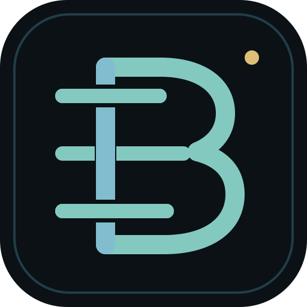
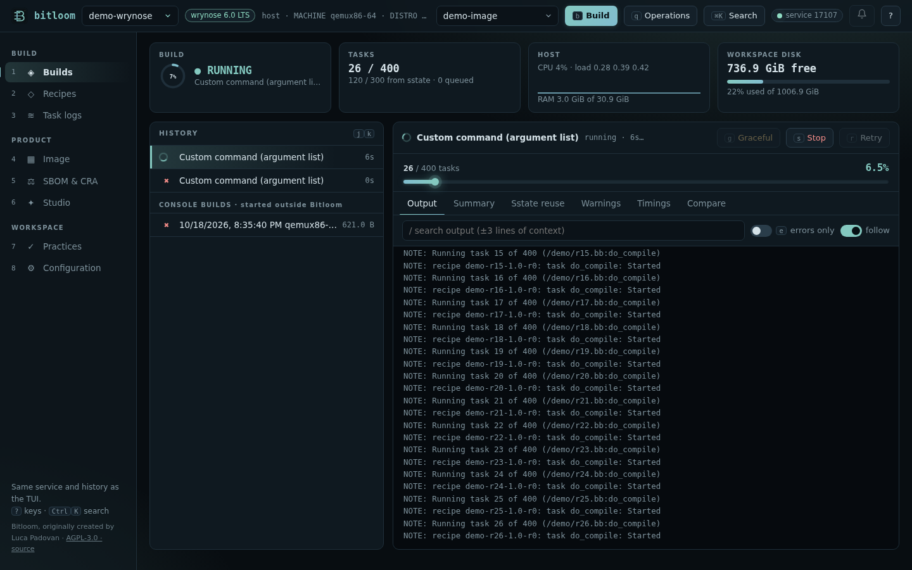
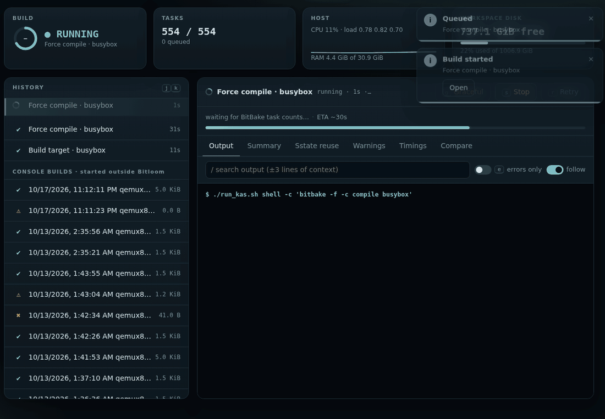
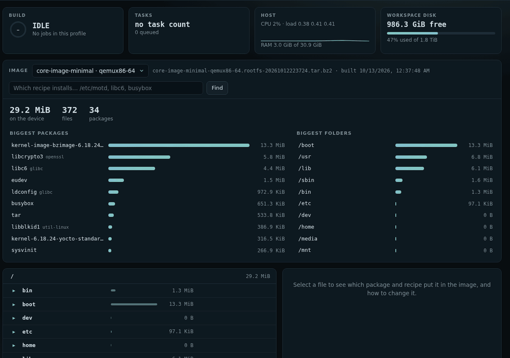
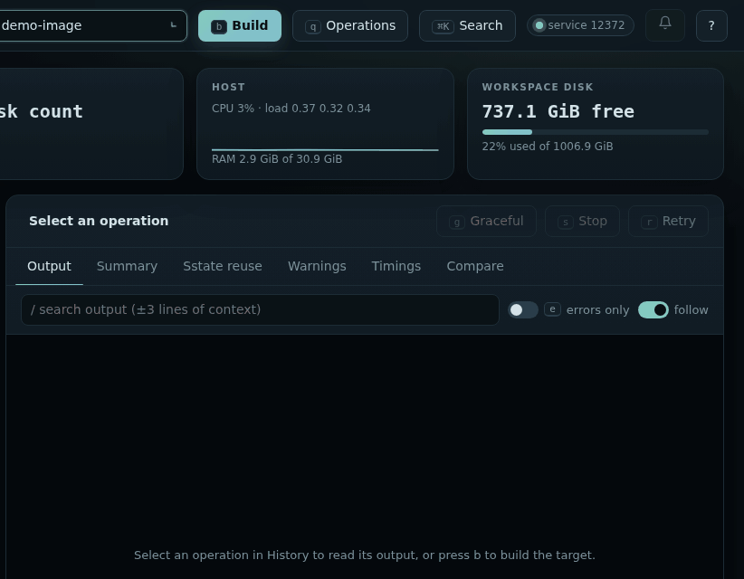
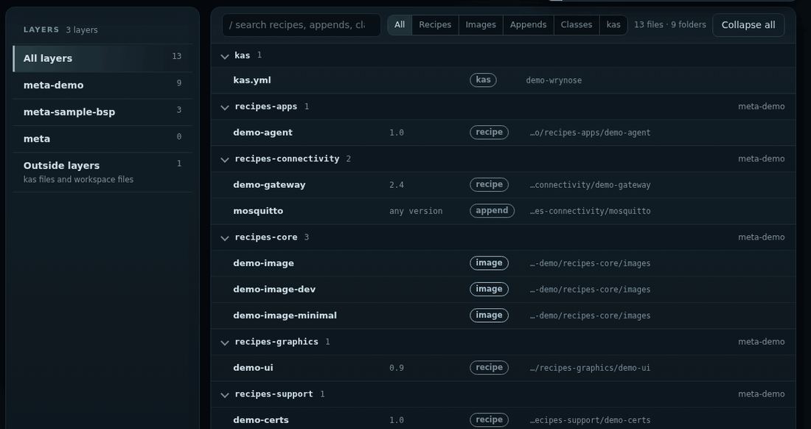
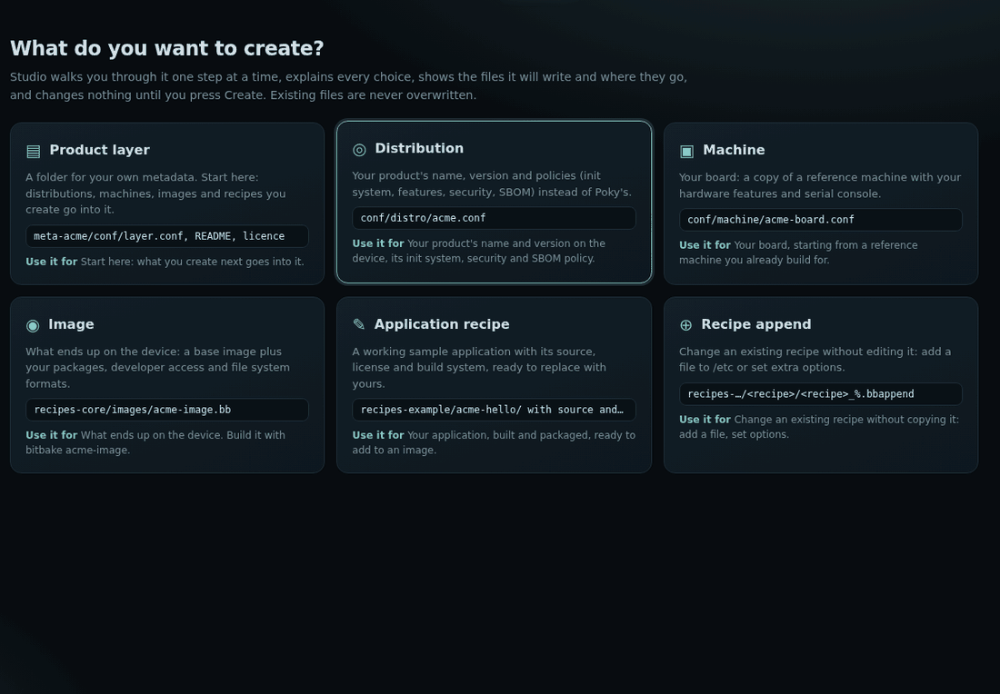
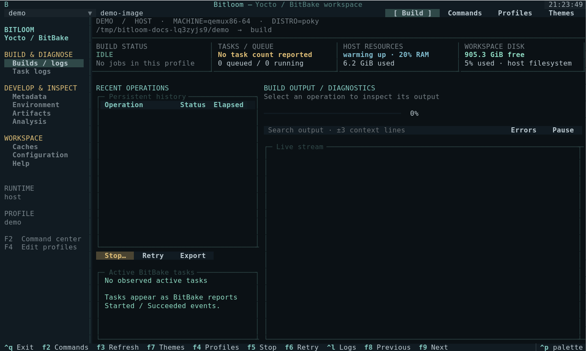
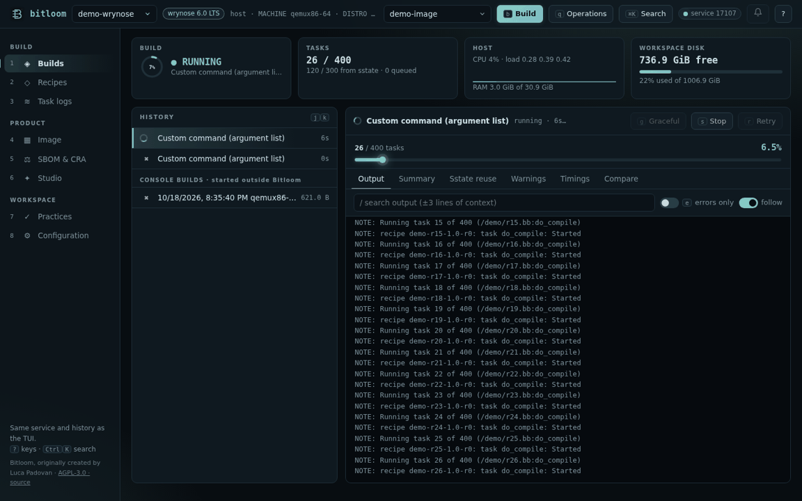
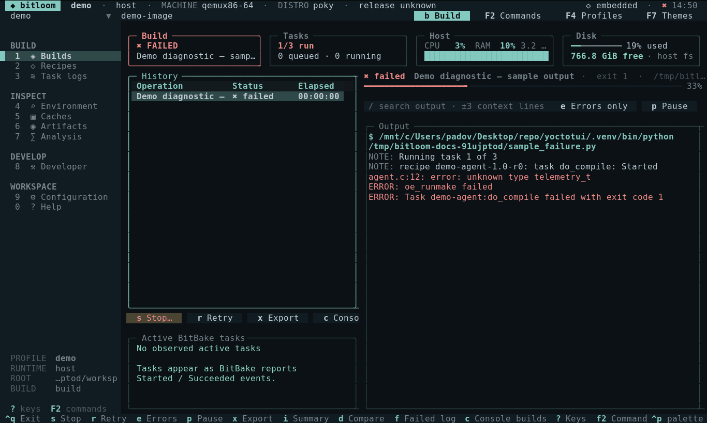

<div align="center">



# Bitloom

[](https://github.com/padovanl/bitloom/actions/workflows/tests.yml)
[](https://github.com/padovanl/bitloom/actions/workflows/release.yml)
[](https://github.com/padovanl/bitloom/releases/latest)
[](https://github.com/padovanl/bitloom/releases)
[](pyproject.toml)
[](LICENSE)

[](https://docs.yoctoproject.org/)
[](https://docs.yoctoproject.org/)
[](docs/projects.md)
[](docs/guide.md)
[](https://github.com/padovanl/bitloom/releases/latest)

**[Website](https://padovanl.github.io/bitloom/) · [Documentation](https://padovanl.github.io/bitloom/quickstart.html) · [Releases](https://github.com/padovanl/bitloom/releases)**

</div>

**A web dashboard and terminal cockpit for everyday Yocto and BitBake development.** Build images, follow and diagnose failures, browse recipes by layer, create your own distribution, check SBOMs and vulnerabilities for the Cyber Resilience Act and manage caches: in the browser or in a keyboard-first terminal UI, both on one build service that keeps running when you close them.

*Weaving layers, recipes and builds into one workspace.*



## 🌐 Web dashboard

```bash
bitloom --web              # prints the URL (with its access token) and opens your browser
```

* **Builds**: live history (new jobs slide in on top), streaming output with search and an errors-only view, progress and ETA, stop, graceful stop and retry, Toaster-style **Summary**, **Sstate reuse**, **Warnings**, **Timings** and **Compare** with the previous run, root-cause diagnosis of failures.
* **Target picker**: the build field lists the image recipes found in your layers, kas target and images already built first.
* **Image explorer**: what you built, file by file, with sizes, owners, the biggest packages and folders, and the package and recipe behind every file; **Services** lists what starts on the device (systemd units or SysV scripts in boot order, udev rules, D-Bus), also as `bitloom --services`; **Device tree** decompiles the deployed DTBs without `dtc` and lists enabled and disabled devices. *Which recipe installs…* answers for any file or package (also `bitloom --who-installs /etc/motd`), and *Change it with an append* opens Studio already filled in, starting from the file as it is on the device.
* **Recipes**: every layer with its counts, folders (`recipes-core`, `classes-recipe`…) that open on demand, filters for recipes, images, appends, classes and kas files, *Use as target*.
* **SBOM & CRA**: release support, SBOM quality gauges, vulnerabilities from sbom-cve-check, cve-check and Grype, exports to Markdown, HTML, CSV, JSON and SARIF, CRA readiness.
* **Studio**: create a layer, distribution, machine, image, recipe or append one step at a time: every option explained, where the files go and their content shown as you choose, a review of exactly what Create will do, then the next step (build it, use it, add an image to the new layer).
* **Practices**: how far the project follows the Yocto best practices (layers, appends, recipes, security, configuration), with the file and line of each finding and how to fix it. Switch rules on or off, change their severity, add your company's own rules in `bitloom-practices.json`; `bitloom --practices` fails CI on errors. → [Best practices](docs/practices.md)
* **Projects**: guided setup from a folder (kas files, bitbake-setup workspaces, Poky checkouts, `YML=… ./run_kas.sh build` launcher scripts, one profile per product), new projects pinned to Scarthgap or Wrynose with kas, or created by `bitbake-setup` from the official templates where the release has it (in the build container, nothing to install), clone from Git.
* `Ctrl+K` palette, `?` keys, toasts and browser notifications, light and dark themes, phone and tablet layouts. → [Web dashboard](docs/web.md)



*A real run, recorded as it happened (about three times faster): force compile of busybox through a `YML=… ./run_kas.sh` launcher profile on Wrynose.*

|  |  |
| --- | --- |
|  |  |

Over SSH keep the default loopback address and tunnel it: `ssh -L 8765:127.0.0.1:8765 build-server`.

## ⌨️ Terminal UI

`bitloom` opens the same service in the terminal, for SSH sessions and keyboard-only work: numbers open sections, letters act, `/` searches, `?` lists every key, editors use nano keys (`^O`, `^X`, `^W`). TUI and dashboard share queue and history, so a build started in one is followed in the other. → [Keyboard](docs/keyboard.md)



## ✨ Highlights

* **Builds that survive the window**: a local build service with a serial queue and history; detach, reconnect, follow from the browser or the terminal. Graceful stop and recovery.
* **Release aware**: one registry knows what each Yocto release can do (SPDX 2.2 or 3.0, cve-check or sbom-cve-check, VEX, fragments, bitbake-setup…), checked in the project's own layers and BitBake; what a release lacks is never offered, and Bitloom says what to use instead. → [Release capabilities](docs/commands.md#release-capabilities)
* **SBOM, CRA and releases**: SPDX 3 / 2.2 quality, VEX, vulnerabilities with reports, CRA readiness and timeline, SBOM settings with explanations. → [Compliance](docs/compliance.md)
* **Studio**: your own distribution, machines, images, recipes and layers, explained field by field. → [Studio](docs/studio.md)
* **Developer workbench** (`F10` in the TUI): variable origins, rebuild signatures, failed-task investigation, devtool, SDK/IDE setup, image comparisons, devices. → [Developer](docs/developer.md)
* **Daily helpers**: notifications when a build ends (desktop, ntfy, Slack/Teams), ETA, run comparison, tmp/work usage. → [Guide](docs/guide.md#daily-helpers)
* **Teams and CI/CD**: headless `--ci` matrix with JUnit and annotations, shared team profiles, infrastructure checks, device fleet, image matrix, builds started outside Bitloom. → [Teams](docs/teams.md)

## 📥 Install

From the [Releases page](https://github.com/padovanl/bitloom/releases) (replace `1.2.3`):

```bash
sudo apt install ./bitloom_1.2.3_all.deb      # Debian / Ubuntu, dependencies included

tar -xzf bitloom-1.2.3.tar.gz && cd bitloom-1.2.3   # any Linux / WSL2
python3 -m venv .venv && .venv/bin/python -m pip install .
```

Verify with `sha256sum --check --ignore-missing SHA256SUMS`; `bitloom --version` prints the installed version. Each release also ships `bitloom-1.2.3.spdx.json`, the SPDX SBOM of Bitloom and every Python package bundled in the `.deb` (also installed as `/usr/share/doc/bitloom/sbom.spdx.json`). Docker or Podman, kas and Yocto are separate tools for real builds. Details: [installation](docs/guide.md#install-from-a-github-release).

## 🚀 Start

```bash
./setup-demo.sh            # from a checkout: venv, sample workspace, opens the TUI
bitloom --web --demo       # the dashboard on the Scarthgap and Wrynose samples
bitloom --demo             # the same samples in the terminal (P switches profile)
bitloom --web              # in your project: the guided setup proposes a profile
```

<details><summary>Animations: tours of the dashboard and the TUI</summary>




</details>

## 📚 Documentation

| | |
| --- | --- |
| [User guide](docs/guide.md) | Profiles and runtimes, workflows, logs, caches, analysis, themes, troubleshooting |
| [Manual testbook](README.testbook.md) | Step-by-step acceptance of every feature and all 82 operations |
| [Command reference](docs/commands.md) · [Keyboard](docs/keyboard.md) | Generated from the code |
| [Validation](docs/validation.md) | Real Scarthgap and Wrynose builds through kas-container and what was verified |
| [Research map](docs/roadmap.md) | Sources, criticisms of earlier Yocto interfaces and how Bitloom answers them |

Browse it locally with `python tools/serve_docs.py --port 8000`; every page has search (`/`), a page list and light and dark themes.

## 🛡️ CRA and EN 40000

The CRA harmonised standards are being drafted as the [EN 40000 series](https://cyber-regulation.com/article/en-40000-series-explained); [prEN 40000-1-3](https://standards.iteh.ai/catalog/standards/cen/487254bf-baa1-48e9-be33-658b37f6fb90/pren-40000-1-3) covers vulnerability handling (receipt, assessment, remediation, communication, tracking). Bitloom does not implement or certify the standard: its compliance views are organised around the build evidence such a process relies on. It is engineering evidence, not legal advice.

## 🛠️ Development

```bash
python3 -m venv .venv && .venv/bin/python -m pip install -e '.[dev]'
.venv/bin/python -m pytest -q
```

Screenshots, the documentation site, release packages and the real kas validation builds are described in [Documentation and verification](docs/guide.md#documentation-and-verification) and [Build, launch and try the local Yocto workspace](docs/guide.md#build-launch-and-try-the-local-yocto-workspace).

## 🙏 Inspiration and thanks

Bitloom is inspired by the idea behind [yoctui](https://github.com/0xbadcaffe/yoctui): bringing everyday Yocto and BitBake work into a terminal interface. Thank you to [0xbadcaffe](https://github.com/0xbadcaffe), the author of yoctui, for the inspiration and for sharing the project with the community. Bitloom has its own implementation and interface. Hob, Toaster and knotty taught what to avoid; see the [research map](docs/roadmap.md#answering-the-criticisms-of-earlier-yocto-interfaces).

## 📄 License

Bitloom is free software, released under the [GNU Affero General Public License v3.0 or later](LICENSE) with the additional terms in [NOTICE](NOTICE).

* **Use it freely**, at home or at work, in any company, for any project, including commercial products built with Yocto. Running it, internally or for your team, costs nothing and asks nothing of you.
* **Change it and share it** under the same licence: whoever distributes a modified Bitloom, or offers it to others over a network (the web dashboard), must publish the full source of that version under the AGPL.
* **Keep the credits**: copies and modified versions keep the `NOTICE` file and the attribution to the original author, are marked as modified, and do not use the Bitloom name for themselves.

Bundled Python dependencies retain their own licenses. Releases up to v0.0.2 were published under the MIT License and remain available under it.
