<p align="center"></p>

# Bitloom

[](LICENSE)
[](https://github.com/padovanl/bitloom/releases/latest)
[](https://github.com/padovanl/bitloom/actions/workflows/tests.yml)
[](https://github.com/padovanl/bitloom/actions/workflows/release.yml)
[](https://padovanl.github.io/bitloom/)
[](https://github.com/padovanl/bitloom/releases)
[](https://www.python.org/)

**A terminal cockpit and web dashboard for everyday Yocto and BitBake development.** Build images, inspect recipes, develop with devtool, follow failures, create your own distribution, check SBOMs for the Cyber Resilience Act and manage caches, from a keyboard-first terminal UI or a browser, sharing one build service.

*Weaving layers, recipes and builds into one terminal workspace.*

Python 3.10+ · Textual · Linux / WSL2 · Host · Docker · Podman · kas · kas-container


The opening capture shows the idle sample workspace. Error screens in the tour demonstrate an intentionally failing sample command; they are not failures of Bitloom or the verified Yocto build.

## Learn and test Bitloom

Follow the [manual testbook](README.testbook.md) from installation through kas/container builds, layer and recipe creation, devtool, caches, interruption and every implemented command. Each case specifies inputs, prerequisites and expected evidence. Optional hardware/classes are recorded as N/A when unavailable. The [Pages testbook](https://padovanl.github.io/bitloom/testbook.html) is the same document rendered for the web. Chapter 13 covers the implemented Developer workflows in addition to all 74 command-center actions; chapter 14 covers keyboard-only use, the web dashboard, SBOM/CRA and release awareness, Studio and team features.

## Developer workbench

Press **F10** for sixteen connected developer views: variable origins and overrides, recipe/runtime navigation, rebuild signatures, failed-task investigation, IDE/SDK setup, image regressions, buildstats and container pressure, kas/multiconfig, downloads/offline verification, CVE/SPDX review, kernel fragments, upgrade baselines, devices and shutdown evidence.

Create complete MIT-licensed **CMake, Meson, Make, Python or Rust** layer/recipe fixtures with Preview → Create + register. Clone profiles into separate build directories, edit container files with backups, capture evidence and compare it after a change. Device profiles connect actual SSH/labgrid tests and recorded consoles to job/artifact references. Optional tasks are probed against the selected release before submission.

Follow the [Developer guide](docs/developer.md) for every input and operation, and [chapter 13 of the testbook](README.testbook.md#13-developer-acceptance) for all fourteen acceptance experiments. The [research and implementation map](docs/roadmap.md) retains upstream sources and practical limits. Public discussions are qualitative evidence, not a representative survey.

<details><summary>Animation: Actual Developer workbench tour using real kas-container evidence</summary>

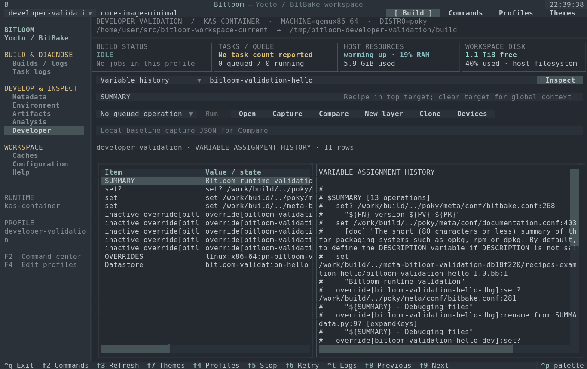
</details>

## Keyboard first

Every action has a key. Numbers `1`–`0` open sections, single letters act in the current section and are shown on every button and in the footer, `/` searches, `Esc` returns to the list, `?` shows the [keyboard reference](docs/keyboard.md). Editors use nano keys (`^O` write, `^X` exit, `^W` search, `^K`/`^U` cut and uncut); dialogs confirm with `^O` and close with `Esc`. `P` switches profile, `t` edits the target and Enter builds it, Ctrl+P searches sections, actions and all operations.

<details><summary>Screenshot: keyboard reference inside the TUI</summary>

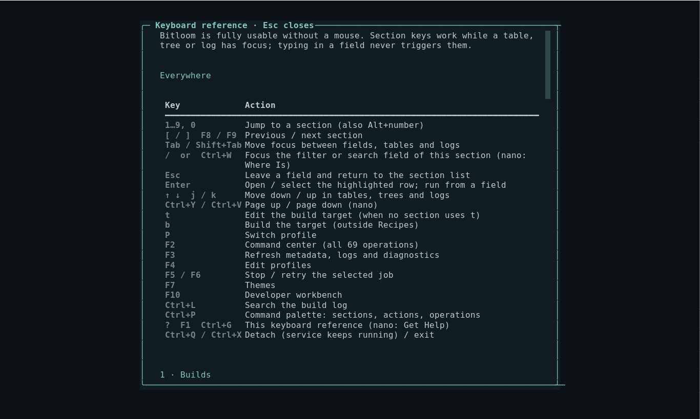
</details>

## Web dashboard

`bitloom --web` serves an animated dashboard for the same build service: live output and progress, Toaster-style build summaries, toasts for every job transition, a Ctrl+K command palette, SBOM & CRA, Studio and configuration views. Loopback only with a session token by default, keyboard driven, responsive and light/dark. See the [web guide](docs/web.md).

<details><summary>Screenshots: web dashboard</summary>


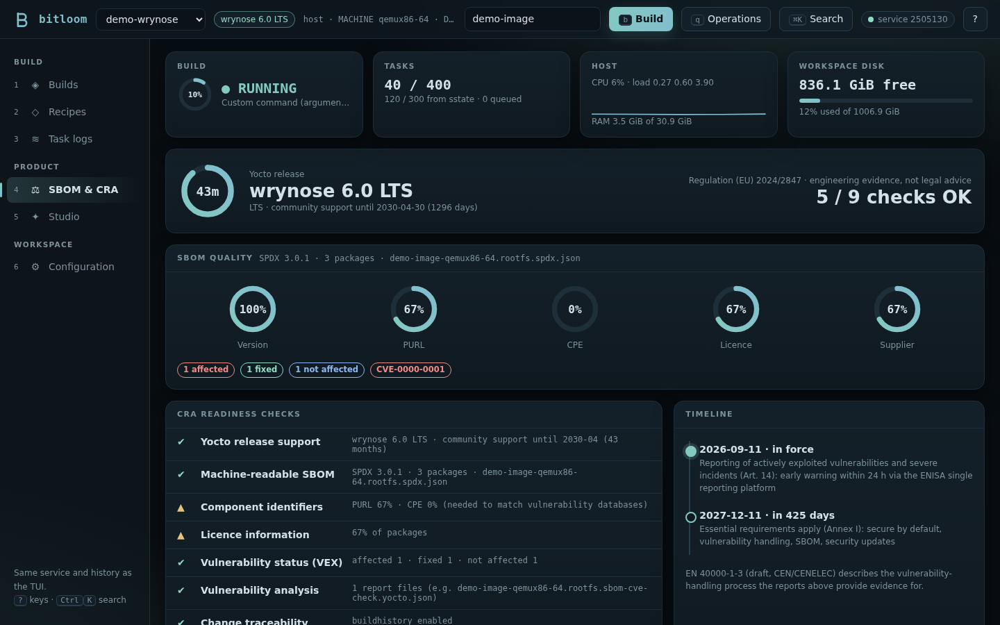
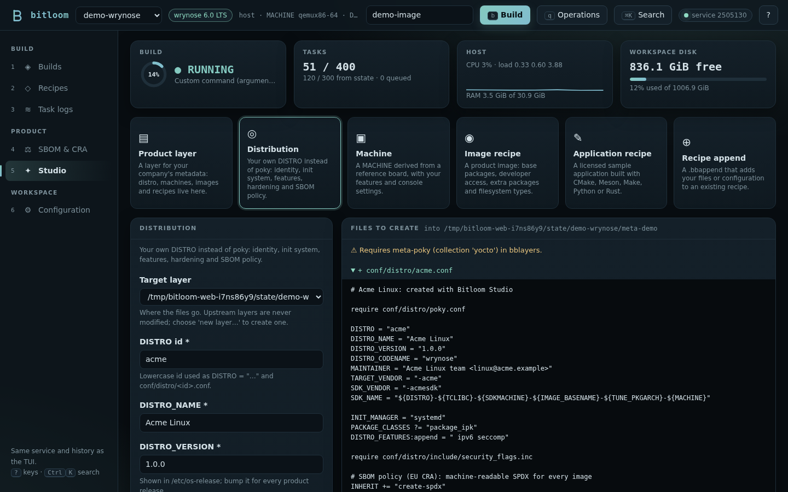
</details>

## SBOM, CRA and Yocto releases

Bitloom detects the Yocto release of each profile and adapts: operations, SBOM options and Studio defaults declare their release window, and when a feature is missing (for example `sbom-cve-check` before 6.0 Wrynose, or `cve-check` from 6.0) the TUI, the web dashboard and CI say so and offer the alternative the release provides.

* **SBOM quality** for SPDX 3 (Wrynose) and SPDX 2.2 (Scarthgap) images: PURL, CPE, licence and supplier coverage, VEX status and affected CVEs (`s` in Artifacts, `bitloom --sbom`).
* **CRA readiness**: release support window, SBOM, identifiers, VEX, CVE analysis, traceability, dispositions and reproducibility evidence, with the Regulation (EU) 2024/2847 timeline (`c` in Configuration, `bitloom --cra`).
* **SBOM settings** with an explanation, CRA relevance and release window for each option, applied as one managed block or kas overlay with backups (`s` in Configuration).

The CRA harmonised standards are being drafted as the [EN 40000 series](https://cyber-regulation.com/article/en-40000-series-explained); [prEN 40000-1-3](https://standards.iteh.ai/catalog/standards/cen/487254bf-baa1-48e9-be33-658b37f6fb90/pren-40000-1-3) covers vulnerability handling (receipt, assessment, remediation, communication, tracking). Bitloom does not implement or certify the standard: its compliance views are organised around the build evidence such a process relies on. Details in [SBOM, CRA and releases](docs/compliance.md); it is engineering evidence, not legal advice.

<details><summary>Screenshots: CRA readiness, SBOM settings and release-aware command center</summary>

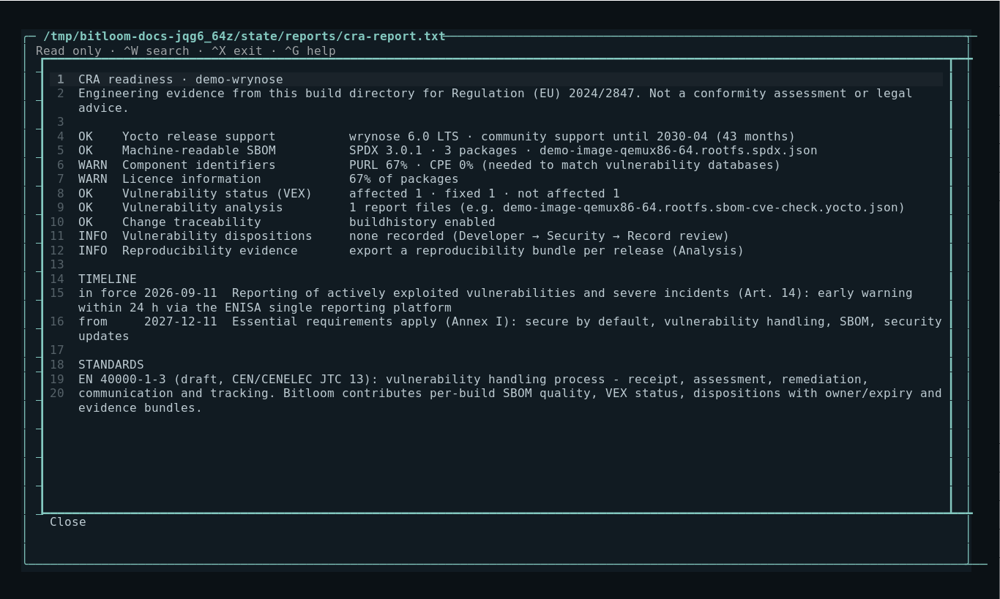
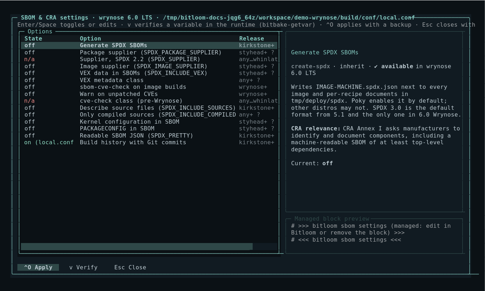
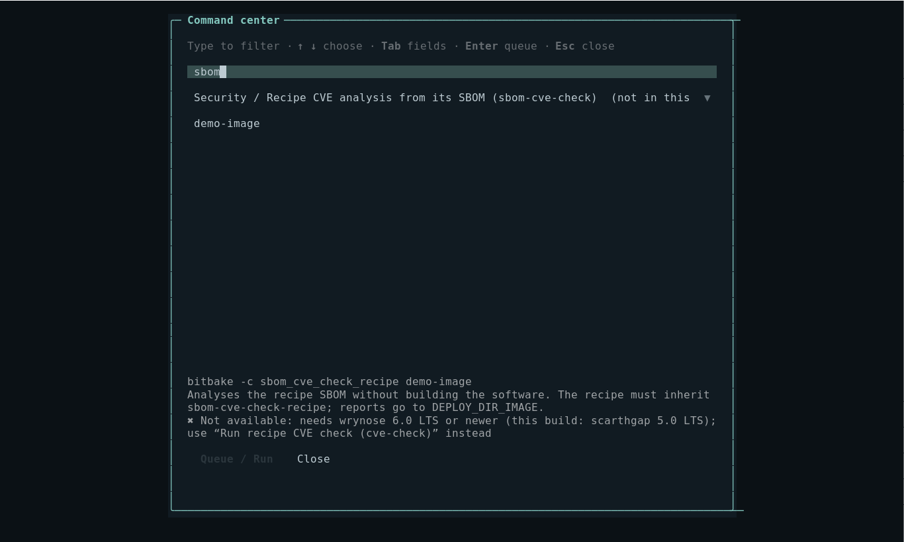
</details>

## Studio: your own distribution

`c` in Recipes opens Studio: create a product layer, your own `DISTRO` based on Poky or standalone OE-Core defaults (init manager, features, hardening, SBOM policy), machines derived from a reference board, images, licensed sample recipes and appends. Every field is explained, defaults follow the detected release, the preview shows every file, nothing is overwritten, and new layers are registered with `bitbake-layers` or a kas overlay. See [Studio](docs/studio.md).

<details><summary>Screenshot: Studio</summary>

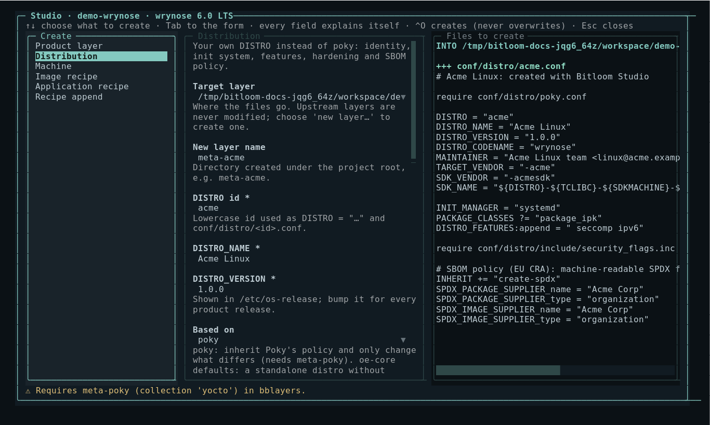
</details>

## Teams, CI/CD and setup

* `bitloom --ci ACTION[:TARGET] --profile …` runs a serial profile × operation matrix headless, with GitHub/GitLab log sections and annotations, JUnit XML and a JSON summary.
* Read-only team profiles through `include` (NFS or a shared repository).
* Setup and infrastructure checks: host limits, UTF-8 locale, WSL, filesystems of TMPDIR/DL_DIR/SSTATE_DIR (NFS, CIFS), reachability of mirrors, hash equivalence and PR servers.
* Image matrix across machines, device fleet status (`--fleet`), console builds started outside Bitloom, and a `wrapper` runtime for project scripts that launch kas.

See [Teams, CI/CD and setup](docs/teams.md).

## Lessons from earlier Yocto interfaces

Hob was retired for being fragile and tied to BitBake internals; Toaster must be running before a build and needs its own server; knotty output makes the failing cause hard to find. Bitloom uses only public command-line interfaces, reads evidence from any build after the fact (including console logs of builds it did not start), points at the root cause of failures and explains every option. The [research map](docs/roadmap.md#answering-the-criticisms-of-earlier-yocto-interfaces) lists the sources.

## Inspiration and thanks

Bitloom is inspired by the idea behind [yoctui](https://github.com/0xbadcaffe/yoctui): bringing everyday Yocto and BitBake work into a terminal interface. Thank you to [0xbadcaffe](https://github.com/0xbadcaffe), the author of yoctui, for the inspiration and for sharing the project with the community. Bitloom has its own implementation and interface.

## Install from a GitHub release

Open the [GitHub Releases page](https://github.com/padovanl/bitloom/releases) and download the assets for the version you want. Replace `1.2.3` below with that version.

### Debian / Ubuntu

Download `bitloom_1.2.3_all.deb`, then install it from the download directory:

```bash
sudo apt install ./bitloom_1.2.3_all.deb
bitloom --demo
```

Requires Python 3.10+ on Debian/Ubuntu. Python application dependencies are included under `/opt/bitloom/lib`; no pip installation is needed. Docker, Podman, kas and Yocto remain separate tools for real builds. Remove Bitloom with `sudo apt remove bitloom`.

### Other Linux distributions / WSL2

Download `bitloom-1.2.3.tar.gz` and install in a virtual environment:

```bash
tar -xzf bitloom-1.2.3.tar.gz
cd bitloom-1.2.3
python3 -m venv .venv
.venv/bin/python -m pip install .
.venv/bin/bitloom --demo
```

Alternatively, install the release wheel with `.venv/bin/python -m pip install /path/to/bitloom-1.2.3-py3-none-any.whl`. Source and wheel installation require Python 3.10+, venv support and internet access to install dependencies. WSL users should install inside their Linux distribution.

### Verify downloaded assets

Download `SHA256SUMS` alongside the packages, then run `sha256sum --check --ignore-missing SHA256SUMS` in the same directory. Check that the package you downloaded reports `OK`.

## Start in one minute

```bash
./setup-demo.sh
```

After cloning, run the script from the checkout. It creates or reuses `.venv`, installs Bitloom and its dependencies, prepares sample data, and opens the TUI. Requires Bash and Python 3.10+ with `venv` support on Linux or WSL2, plus internet access for the first install. Everything stays in the checkout; Docker, kas and a Yocto checkout are unnecessary for this sample demo.

```bash
./setup-demo.sh --no-launch       # Prepare only, useful over SSH or in automation
.venv/bin/bitloom --demo          # Open the prepared demo again
./setup-demo.sh --dev --no-launch # Also install test dependencies
./setup-demo.sh --python python3.12 --no-launch
```

`PYTHON` also selects the interpreter when creating a new environment. Existing `.venv` environments are reused. `./setup-demo.sh --help` lists the options. For a real containerized Yocto build, follow [the local build instructions](#build-launch-and-try-the-local-yocto-workspace).

The executable and Python package are both named `bitloom`. Configuration and state are stored under `.bitloom` by default.

The demo creates an isolated sample workspace under `.bitloom/demo`. Its metadata and screenshots are labelled demo data. It does **not** simulate successful Yocto builds or download Yocto.

For a real project, launch `bitloom`, press **F4**, and configure a profile. Alternatively:

```bash
mkdir -p .bitloom
cp examples/profiles.json .bitloom/profiles.json
# Replace the example paths before starting.
bitloom --config .bitloom/profiles.json
```

<details><summary>Animation: Animated tour of the actual TUI</summary>


</details>

## What you can do

| Area | Capabilities |
| --- | --- |
| Builds | Independent reconnectable build service, serial queue, persistent SQLite history, streaming logs, observed live recipe tasks, task progress, exit status, retries with original profile, cancellation, SDK/eSDK, recipe tasks, forced compile, dry runs, parsing |
| Runtimes | Initialized host environment; kas config composition; fresh Docker/Podman containers; existing containers; official kas-container wrapper |
| Layers | Expandable layer tree, search local layers, priorities through BitBake, add/remove/create, overlays, appends, cross-layer dependencies, edit metadata with backups |
| Recipes | Browse `.bb`, `.bbappend`, `.bbclass` and kas YAML, compile/patch/package individual recipes, list tasks, evaluate environment |
| Development | devtool modify/add/build/build-image/reset/finish/update/upgrade, upstream version checks, device deployment, devshell, kernel menuconfig and config checks |
| Errors and logs | Build and task log browsers, case-insensitive search with context, error-only view, pause/resume, failure notifications, exports, build summary and timestamped slow-task reports |
| Downloads | Fetch a recipe or all target dependencies, size/age inventory, orphan marker and partial-download audit, concrete prune plans |
| Shared state | Local inventory, age-based prune plans, recipe cleansstate, signature dumps/diffs, `-S printdiff` |
| Analysis | Runtime file/directory access and backed-up editing, binary artifact export with SHA-256 verification, failure diagnosis, image package/file provenance, preflight, snapshots and comparison, reproducibility bundles, conservative signature-reference cache plans; search metadata contents with file/line locations, compare package manifests by architecture, inspect sstate hit rates, group repeated warnings, export reports |
| Workbench | Filter evaluated environment variables, compare two snapshots, browse generated dependency edges and transitive/reverse dependency context, buildhistory Git diff |
| Outputs | Discover images, SDKs, manifests, licenses, SBOMs, buildstats and buildhistory files; text preview, read-only tar rootfs inventory (permissions, owners, links), and binary artifact paths |
| Configuration | Multiple named profiles, custom environment/runtime arguments, local.conf and bblayers.conf editor, backups, external-change detection, diagnostics |
| Releases | Local branch/revision/tag report, dirty-tree status and literal layer-series compatibility checks; separate profiles and build directories per release |
| Testing and security | testimage, ptest, CVE and SPDX command entry points when the required classes/configuration exist |
| Utilities | Argument-based custom commands, interactive terminal handoff, command filtering, keyboard shortcuts, command palette, CLI diagnostics |

The [command reference](docs/commands.md) documents every built-in action. The [user guide](docs/guide.md) describes complete workflows and runtime constraints.

## Reconnectable builds and evidence workflows

Real sessions use an independent local service: close the terminal and reconnect with the same `--state` directory. Ctrl+Q detaches; F5 explicitly stops a job. `--embedded` retains the previous stop-on-exit behavior. Inspect an idle service with `--service-status`, or stop it with `--service-stop`.

The **Analysis** selector connects signature explanations, failure diagnosis, runtime filesystem access, image provenance, snapshot comparison, devtool review, reproducibility exports, preflight and conservative cache reference plans. Shared/exclusive advisory cache locks coordinate cooperating Bitloom builders. Read the [workflow guide](docs/guide.md#evidence-workflows) for inputs, bounds and limitations.

<details><summary>Screenshot: Real container image provenance</summary>

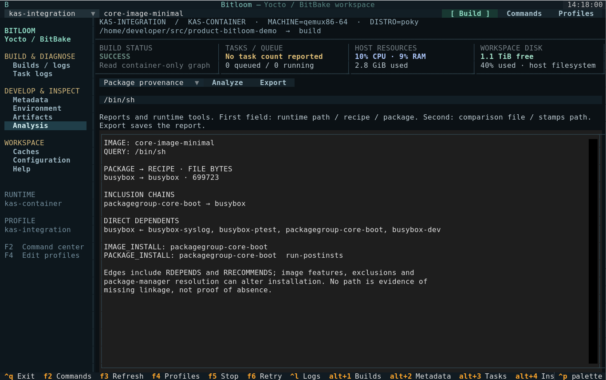
</details>

## Keyboard

| Key | Action |
| --- | --- |
| 1 … 9, 0 · [ ] | Open a section · previous / next section |
| letters | Section actions shown in the footer and on buttons (`s` stop, `r` retry, `e` errors, `c` console builds…) |
| / · Esc | Search in the section · back to the list |
| ? / F1 / Ctrl+G | Keyboard reference |
| P · t · b | Switch profile · edit target · build target |
| F2 | Search and queue a command (↑↓ choose, Enter queues) |
| F3 | Refresh local metadata, logs, diagnostics and artifacts |
| F4 | Edit profiles |
| F5 | Open build interruption options |
| F6 | Retry the selected job |
| F7 | Preview and save a terminal theme |
| F8 / F9 | Previous / next section, including Developer, Analysis and Help |
| F10 | Open Developer workbench |
| Ctrl+L | Focus build log search |
| Ctrl+P | Textual command palette |
| Ctrl+Q | Detach from service and exit; embedded/demo stops owned jobs |
| Enter | Select a build log or open a metadata/task/artifact row |
| Tab / Shift+Tab | Move focus |
| Escape / Ctrl+X | Close a dialog; editors ask before discarding changes |
| Ctrl+O · Ctrl+W · Ctrl+K/U | nano keys in editors: write · search · cut/uncut line |

The interface uses compact single-line controls, a terminal navigator, split history/output and syntax-highlighted metadata previews. **140 × 42** shows the complete workspace. Below 105 columns or 30 rows, tabs replace the navigator and side panes disappear. Short terminals also hide the task monitor and overview. Below 75 columns or 22 rows, logs take priority over history and metrics; resize to restore those panels. Command, profile and theme dialogs also fit within the terminal and scroll when necessary. Navigation with **F8/F9**, commands with **F2**, profiles with **F4** and themes with **F7** remain available. Layout tests cover **160 × 50, 120 × 36, 90 × 28, 80 × 24, 60 × 20 and 140 × 20**, including restoration after resizing. See the [compact capture](docs/assets/compact.png) and [small terminal capture](docs/assets/tiny.png). Host CPU/RAM and workspace filesystem usage are sampled every two seconds and explicitly labelled as host resources.

## Build interruption and recovery

**Stop…** offers three explicit choices:

- **Let finish** leaves the build running.
- **Graceful stop** sends exactly one SIGINT to the host BitBake client, or to the main process of a fresh container managed by Bitloom. BitBake can finish its currently executing tasks. The TUI does not escalate this request automatically.
- **Force + recovery** terminates the managed process/container and offers `bitbake -c clean` for recipes observed running in the log. Finished tasks are removed from that active set. Recovery is withheld if runtime shutdown is unconfirmed. Work files may contain developer edits: the recovery dialog makes the selection explicit.

New kas-container jobs have uniquely named, owned containers: force stop records termination of that exact container before offering recovery. Native kas wrappers and pre-existing containers do not expose a guaranteed client PID; their external server still needs verification. Graceful draining remains disabled for kas wrappers. A build interruption does not normally rewrite `.bb` files, and an observed active recipe is **not proof of corruption**. Task detection depends on standard BitBake log messages.

## Real Yocto validation

Two reproducible integration configurations are executed through the same Runner used by the TUI:

* [tests/integration/kas-minimal.yml](tests/integration/kas-minimal.yml): Poky **yocto-5.0.8** (Scarthgap 5.0 LTS), **qemux86-64**, **core-image-minimal**.
* [tests/integration/kas-wrynose.yml](tests/integration/kas-wrynose.yml): **yocto-6.0.2** (Wrynose 6.0 LTS) with bitbake, openembedded-core and meta-yocto as separate repositories, since the combined poky repository ends with 5.x.

`tools/prepare_validation.py --release both` creates the `kas-scarthgap` and `kas-wrynose` profiles; `tools/validate_kas.py --release wrynose` validates the second workspace.

```bash
# Install the official wrapper inside the project venv, not system-wide.
curl -fL https://raw.githubusercontent.com/siemens/kas/4.8.1/kas-container \
  -o .venv/bin/kas-container
chmod +x .venv/bin/kas-container
PATH="$PWD/.venv/bin:$PATH" python tools/validate_kas.py \
  --work /tmp/bitloom-kas-validation --engine docker
```

Docker/Podman must be running. The kas image supplies Yocto build dependencies. The first build downloads sources and can take considerable time/disk space. `.validation/` contains logs, SQLite history and `result.json`; it is ignored by Git. Use a Linux filesystem for work files. Docker installed via Snap has a private `/tmp`; see the [troubleshooting guide](docs/guide.md#troubleshooting).

**Verified on 2026-10-10:** all 4,064 tasks succeeded in 57m 10s through kas-container; the rootfs archive and eight runtime probes passed.

<details><summary>Screenshot: Actual successful kas-container build</summary>

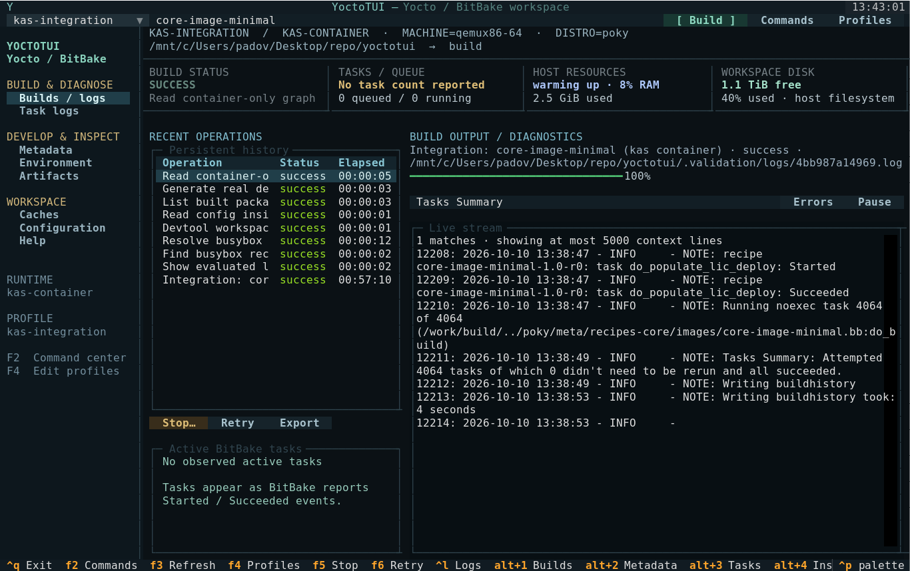
</details>

See the [validation report](docs/validation.md) for the actual result and limitations. Screenshots and GIFs show a sample workspace; they are not evidence of a completed Yocto image.

## Development and documentation

```bash
pip install -e . pytest pytest-asyncio
python -m pytest -q
python -m bitloom --list-actions
python -m bitloom --doctor

# Regenerate actual UI screenshots and GIF (optional tooling).
pip install pillow cairosvg
python tools/capture_docs.py
python tools/capture_web.py      # web dashboard, needs playwright with Chromium

# Build and preview the documentation site (default port 8000).
python tools/serve_docs.py --port 8080 --open
```

The static [documentation site](docs/index.html) is ready for GitHub Pages. The workflow uploads `docs/` on pushes to `main` and supports manual dispatch. In the GitHub repository, select **Settings → Pages → Source → GitHub Actions**. A GitHub remote and a push are required to publish; local files alone do not create a public site.

## Practical limits

This is an initial functional release. Each command remains subject to the selected Yocto release, runtime, device access and configuration. Inventory scans are bounded, age-based pruning does not perform signature reachability analysis, and no cache is pruned automatically. External builders sharing a cache cannot be detected reliably. Logs and profiles can contain proprietary paths or credentials; review exports before sharing them. Custom commands accept argv, not shell expressions.

No CI claim implies a full Yocto build: unit/UI tests and the opt-in container integration are separate validations.

## Terminal themes

Press **F7** or choose **Themes** in the toolbar to preview and save one of 14 palettes: Bitloom, Soft Slate, Linen, Nord, Dracula, Tokyo Night, Catppuccin Mocha, Gruvbox, Solarized Dark, Ocean, Forest, Ember, Paper and High Contrast. Linen and Paper are light themes; High Contrast uses a black background and bright foreground. Cancel restores the previous palette. The choice is stored separately from build profiles in the state's `appearance.json` and is restored next launch.

<details><summary>Animation: Actual terminal theme previews</summary>


</details>

The [Bitloom icon](docs/assets/bitloom-icon.svg) combines a woven B with horizontal layer threads and a vertical build thread. SVG is the source; PNG variants provide favicon, touch-icon and sharing support.

## Build, launch and try the local Yocto workspace

Run these commands from the repository root in a Linux/WSL terminal. Bitloom is a Python application: editable installation is sufficient for development; no native compilation is required.

### Install for development

```bash
python3 -m venv .venv
source .venv/bin/activate
python -m pip install -e '.[dev]'
bitloom --help
bitloom --demo
```

If themes appear monochrome and your shell sets `NO_COLOR`, run `unset NO_COLOR` before launching.

In this prepared workspace, `.venv` and kas-container already exist. You can start directly with `source .venv/bin/activate`.

### Build distributable packages

```bash
source .venv/bin/activate
python -m pip install 'setuptools>=61' build wheel
python -m build --no-isolation
```

Outputs are `dist/bitloom-0.1.0-py3-none-any.whl` and `dist/bitloom-0.1.0.tar.gz`. The distribution and executable are both named **bitloom**. The source archive includes the English manuals, Pages assets, examples and integration tools. To install the wheel into another environment:

```bash
python3 -m venv /tmp/bitloom-wheel
/tmp/bitloom-wheel/bin/python -m pip install dist/bitloom-0.1.0-py3-none-any.whl
/tmp/bitloom-wheel/bin/bitloom --help
```

### Open the already built local test workspace

The verified local workspace uses **Poky yocto-5.0.8 / Scarthgap**, **qemux86-64**, **core-image-minimal** and a pinned kas container image. Yocto tools execute inside Docker; the host runs only the TUI and container wrapper. `.validation` is local generated state and is intentionally absent from a fresh Git clone.

```bash
source .venv/bin/activate
python tools/prepare_validation.py
bitloom --config .validation/profiles.json --state .validation
```

A recorded result is historical evidence: temporary work mounts can be removed. Check `/work/build` through the runtime before relying on it; if absent, prepare a new workspace with `python tools/validate_developer.py --build` and launch `.developer-validation/profiles.json` as explained in the testbook.

The helper recreates the test profile from `.validation/result.json` when available. It preserves history and other profiles, uses the recorded workspace and does not build anything. The actual work directory is recorded in `.validation/result.json`; with Docker Snap, its contents are in the daemon's namespace and may appear empty on the host. In the container, the build directory is `/work/build`. Use Analysis runtime tools to browse it.

1. Keep `core-image-minimal` in the top target field and press **Build** for an incremental image build. Existing matching task outputs are reused.
2. Select its history row to follow the complete log. **F2** opens recipe tasks, fetch, SDK, layers and devtool actions; change the target to `busybox` to inspect or build one recipe.
3. In **Analysis**, choose **Build preflight** and enter `/work/build`. For **Package provenance**, set the top target back to `core-image-minimal` and enter `/bin/sh`; the verified inclusion chain is `packagegroup-core-boot → busybox`.
4. Try **Runtime directory** with `/work/build/tmp/deploy/images/qemux86-64`, or **Capture snapshot** with `/work/build`. **F7** previews and saves a theme.
5. **Ctrl+Q** detaches while the service continues. Launch the same command again to reconnect. **F5** opens explicit interruption choices; choose Let finish if you want the build to complete.

```bash
bitloom --state .validation --service-status
bitloom --state .validation --service-stop
```

The last command stops an idle service only. Stop it before running integration scripts that need exclusive access to `.validation`; closing the TUI alone does not stop the service.

### Reproduce on a fresh machine

Docker must be available and the build work directory must be on a Linux filesystem. Install the official wrapper if needed:

```bash
source .venv/bin/activate
curl -fL https://raw.githubusercontent.com/siemens/kas/4.8.1/kas-container -o .venv/bin/kas-container
chmod +x .venv/bin/kas-container
python tools/prepare_validation.py --work /tmp/bitloom-kas-validation --engine docker
bitloom --config .validation/profiles.json --state .validation
```

Press Build to initialize and build the image. The first build downloads repositories/sources and needs substantially more time and disk than the verified incremental run. The helper does not repair container mount permissions: if Docker Snap creates the dedicated mount as root, follow the [runtime troubleshooting guide](docs/guide.md#troubleshooting).

For scripted verification, with the service stopped:

```bash
python tools/validate_kas.py --work /tmp/bitloom-kas-validation --engine docker
python tools/prepare_validation.py
python tools/probe_kas.py
python tools/probe_workflows.py
```

`validate_kas.py` builds the image and verifies its rootfs; probes then exercise real runtime operations. `probe_workflows.py` submits a warm build to a separate persistent service and stops that service after completion. Unit/UI checks run with `python -m pytest -q`; they do not require a Yocto build.

### Preview the Pages site locally

```bash
python -m pip install '.[docs]'
python tools/serve_docs.py --port 8000          # rebuilds the HTML, then serves docs/
python tools/serve_docs.py --port 9000 --no-build --open
```

Open the printed address. Screenshots in the HTML pages are collapsed and load only when you expand them.

## License

Bitloom is released under the [MIT License](LICENSE). Bundled Python dependencies retain their own licenses.

### Gentle colors and keyboard focus

Press F7 and try **Soft Slate** (muted dark gray) or **Linen** (warm light background). **Nord** and **Catppuccin Mocha** are other softer choices. Focusing a log/report pane changes its border, keeping its background stable.

If Windows Terminal/WSL shows saturated blue blocks instead of the documented colors, check `echo "$TERM / $COLORTERM"`. On a terminal supporting true color, launch with `COLORTERM=truecolor .venv/bin/bitloom --demo` (or your usual profile arguments). This declares terminal capability; it does not change the saved palette.

### Navigation and elapsed time

F8 selects the previous workspace section; F9 selects the next, including Developer, Analysis and Help. F10 opens Developer directly. These keys work with conventional terminal escape sequences. Alt+number bindings remain available on terminals sending compatible key events, but are not the recommended navigation keys. Running history rows update their elapsed time once per second, independently of log output; finished durations remain fixed.

For step-by-step layer creation, new recipes, .bbappend files and rebuilding with kas, follow [Hands-on kas: layers and recipes](docs/guide.md#hands-on-kas-layers-and-recipes).

### Create files from the TUI

In **Metadata**, choose **New file**, or select **Create runtime file** in **Analysis**. Enter an absolute path in the selected profile's filesystem, select an empty file, private example recipe or .bbappend template, edit its contents, then choose **Create file**. Missing parent directories are created. Existing files, including symlinks, are never overwritten. Creation waits for this session's build queue to be idle.

For kas/container profiles, a path such as `/work/meta-bitloom/recipes-example/hello/hello_1.0.bb` is created inside that runtime; afterward Analysis opens its directory listing. Host files appear in the local Metadata browser when their location is indexed. Local metadata additions, edits and deletions are checked every five seconds. An open **Analysis → Runtime directory** listing refreshes every fifteen seconds while idle; it lists at most 2,000 entries. Modal editors pause automatic refresh. **F3** remains available for manual local rescans; **Analyze** refreshes a runtime directory immediately.

Creating a recipe file does not register its layer: use **Create layer** and **Add layer**, and declare the layer in kas for reproducible configuration.

<details><summary>Screenshot: Actual new-file dialog with a sample recipe</summary>

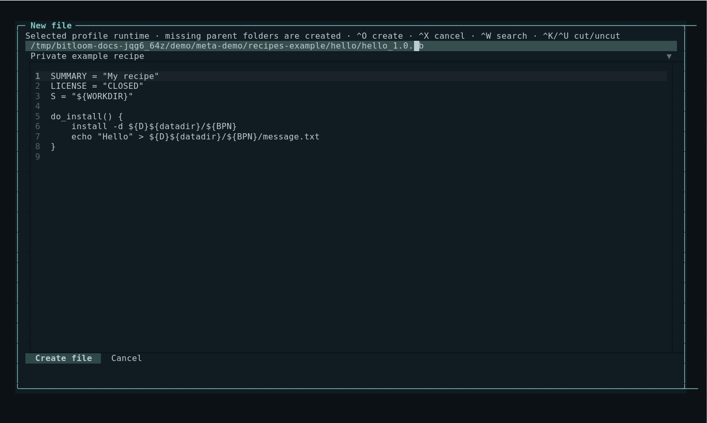
</details>

## Reproduce Developer experiments in a fresh kas container

After `./setup-demo.sh --dev --no-launch`, activate the venv and install the official kas-container wrapper as described in the [testbook](README.testbook.md#2-launch-with-kas-container). Docker/Podman must already work:

```bash
source .venv/bin/activate
python tools/validate_developer.py --build
COLORTERM=truecolor bitloom --config .developer-validation/profiles.json --state .developer-validation/manual
```

The helper prepares a dedicated work directory, probes actual BitBake metadata, creates/registers a test layer, builds a small data-only recipe, checks fetch/full-recipe offline execution, and introduces/restores a controlled task failure. It saves `.developer-validation/result.json` and real logs. Use `--engine podman` for Podman, `--work /absolute/new/workspace` for another workspace, or `--image` for a full core-image-minimal build with the generated package. A fresh workspace downloads sources and can take substantial time; the toolchain stays inside the pinned kas container. Repeated runs create uniquely named layers/overlays and retain earlier state. The test fixture uses CLOSED and data-only installation to keep validation smaller; the TUI wizard generates complete MIT-licensed source fixtures.

For your own source iteration, open F10 → New layer, preview a CMake recipe, create/register it, build its recipe and image, edit source through Runtime browser, then rebuild. The [Developer guide](docs/developer.md) explains captures, image/package comparisons, IDE mappings, security reviews and device evidence. With an existing persistent service, finish its queue and use `bitloom --state <state> --service-stop` once after upgrading so the next launch loads the new code.
