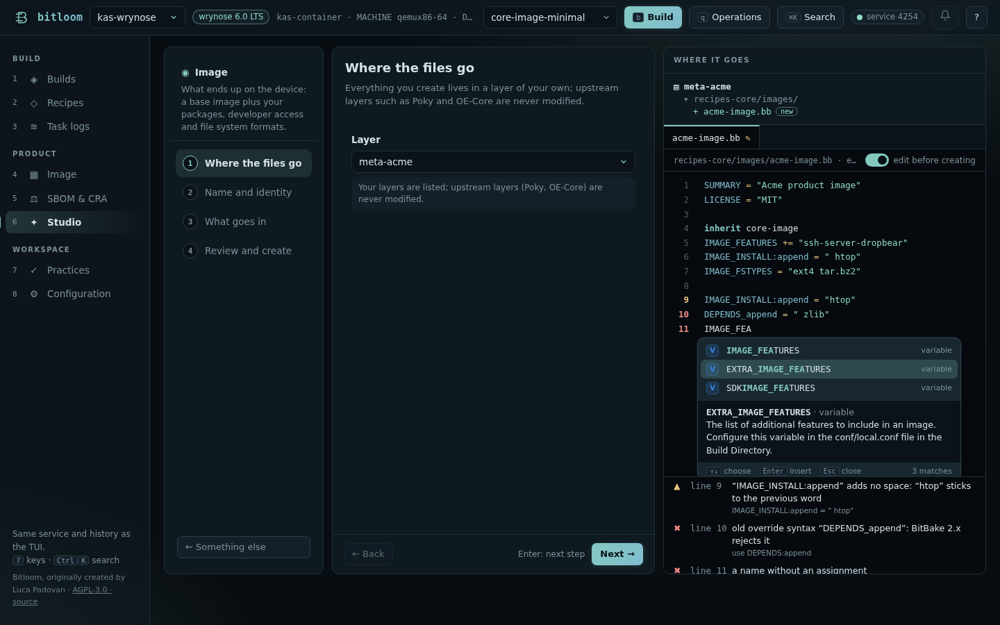

# BitBake assistant

Writing a recipe, an append or a configuration file by hand is where most Yocto mistakes start: an override written the old way, `:append` without its leading space, a class or a variable with a typo. Bitloom's assistant knows the vocabulary of **your** project and helps where you write, in the web dashboard, in the terminal and in CI.

Everything comes from the layers the project builds with, so it matches its release:

* variable and task documentation from OE-Core's `conf/documentation.conf`, plus every variable the project's classes and configuration files set;
* the classes, include files and recipes of the layers;
* machines (`conf/machine`) and distributions (`conf/distro`);
* licences (`files/common-licenses`), image features (`IMAGE_FEATURES[validitems]`, `FEATURE_PACKAGES_*`, `COMPLEMENTARY_GLOB`) and tasks.

On Scarthgap `debug-tweaks` is an image feature; on Wrynose it is not, and the assistant knows it because it reads the project's own layers.

## Completion

Suggestions follow what you are writing:

| You type | You get |
| --- | --- |
| a word at the start of a line | variables (with their documentation) and keywords (`inherit`, `require`, `addtask`…) |
| `inherit ` | the classes of the project |
| `require ` / `include ` | include files, with their path in the layer |
| `VAR:` | `append`, `prepend`, `remove`, machines, distributions, `class-target`, `pn-…`, `task-…` |
| `VAR[` | variable flags (`sha256sum`, `depends`, `noexec`, `vardeps`…) |
| `${` | variables |
| a value of `DEPENDS`, `RDEPENDS`, `IMAGE_INSTALL` | recipes |
| a value of `IMAGE_FEATURES`, `DISTRO_FEATURES`, `MACHINE_FEATURES` | the features of this release |
| a value of `MACHINE`, `DISTRO`, `LICENSE` | machines, distributions, licences |
| `addtask x after ` | tasks |

In the **web dashboard** (Studio, *edit before creating*) suggestions appear as you type and with **Ctrl+Space**: `↑`/`↓` choose, `Enter` or `Tab` insert, `Esc` closes. Each suggestion shows its kind (V variable, C class, R recipe, T task, M machine…), the letters you typed in bold, and the documentation of the selected one. Below the editor, the meaning of the word under the cursor.



In the **terminal** editors (open a file in Recipes, edit a runtime file, new file): **Ctrl+Space** lists the suggestions (`Enter` inserts, `Esc` returns to the text), **Alt+D** describes the word under the cursor, and a line under the editor shows the problems as you type.

## Problems as you write

| Problem | Why it matters |
| --- | --- |
| `DEPENDS_append`, `RDEPENDS_${PN}` | the old override syntax: BitBake 2.x (Yocto 3.4 and later) stops parsing |
| `IMAGE_INSTALL:append = "htop"` | `:append` adds no space: the word sticks to the previous one (`openssh-sshdhtop`) |
| `:append` together with `+=` | one of the two is enough |
| `FILESEXTRAPATHS:prepend` without `:=` or without the trailing `:` | your files are not found, or the search path breaks |
| an unclosed quote, a value without quotes, a `{` never closed | parse errors |
| a class that is not in the layers | “did you mean `systemd`?” |
| a `require` that points nowhere | parse error |
| `MACHINE`, `DISTRO` that the layers do not define; an image feature this release does not have | the build fails late, or silently ignores it |
| a variable one letter away from a known one (`IMAGE_INSTAL`, `DESCRIPTIOM`) | a typo BitBake accepts silently: the value is simply lost |
| `SRC_URI[md5sum]` | deprecated: use `sha256sum` |

Checked against the 1,037 recipes of OE-Core and meta-yocto on Wrynose, the assistant reports a handful of findings, all real: among them a typo in OE-Core itself (`DESCRIPTIOM` in `compiler-rt`) and an `:append` without its space in clang.

## Command line and CI

```console
$ bitloom --lint meta-acme                 # folders are searched for .bb, .bbappend, .bbclass, .inc and .conf
meta-acme/recipes-app/hello/hello_1.0.bb:2: ✖ old override syntax “DEPENDS_append”: BitBake 2.x rejects it
    → use DEPENDS:append
12 files · 1 errors · 0 warnings · 0 notes
$ echo $?
2
$ bitloom --explain IMAGE_FEATURES
IMAGE_FEATURES · variable
The primary list of features to include in an image. Configure this variable in an image recipe.
```

`--lint` exits 2 on errors (`--fail-on warning` also on warnings, `--fail-on never` reports only) and `--format json` gives the findings to other tools. It runs in seconds, without BitBake, so it fits a merge-request check before the build.

## What it does not do

The assistant reads files; it does not run BitBake. Values computed at parse time, variables set by classes outside the project and Python code are not evaluated: for those, Bitloom's *Resolve one BitBake variable* and the Developer workbench's variable origins ask BitBake itself. Full editing stays in your editor; for VS Code, the Yocto Project's BitBake extension complements Bitloom.
