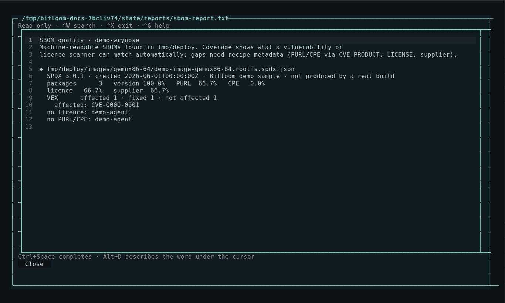
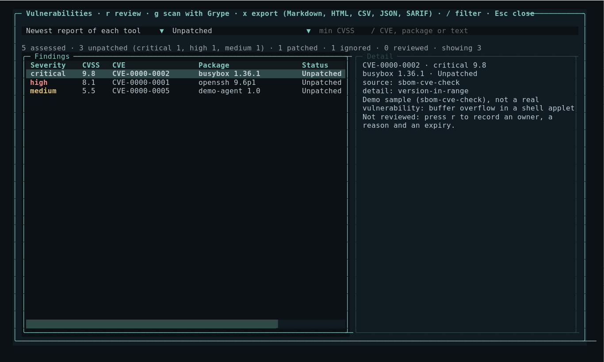
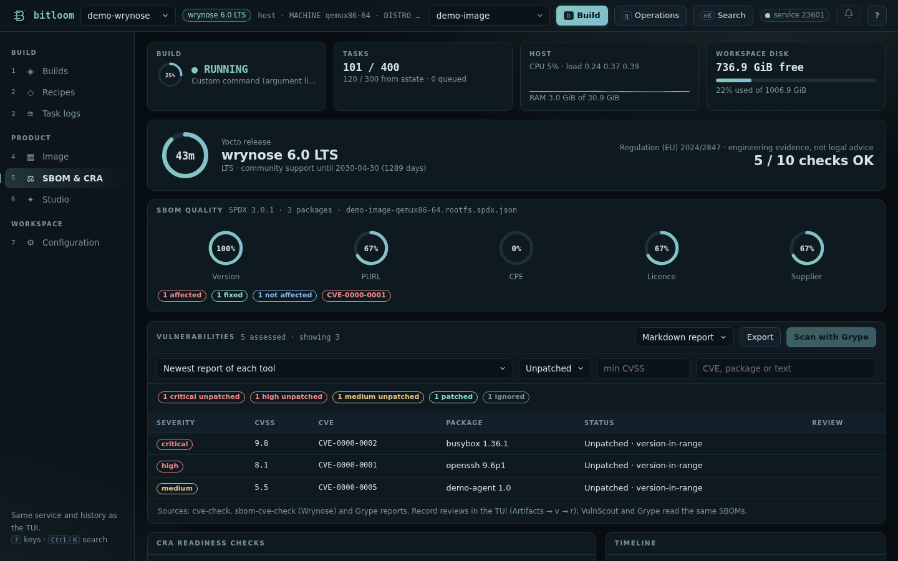

# SBOM, CRA and Yocto releases

Bitloom reads the evidence your build already produces and tells you, release by release, what is missing for a machine-readable SBOM and for vulnerability handling under the EU Cyber Resilience Act. It reports engineering evidence; it is not a conformity assessment or legal advice.

## Release awareness

Bitloom detects the Yocto series from `LAYERSERIES_CORENAMES` in the core layer (Poky, separate OE-Core or kas workspaces) and shows it in the top bar, the web header and the CRA report.

| Series | Version | Support | SBOM and CVE tooling |
| --- | --- | --- | --- |
| kirkstone | 4.0 LTS | until 2026-04 | SPDX 2.2 (`create-spdx`), `cve-check` |
| scarthgap | 5.0 LTS | until 2028-04 | SPDX 2.2 by default, `cve-check` |
| styhead … whinlatter | 5.1 – 5.3 | 7 months each | SPDX 3.0 default, `cve-check` |
| wrynose | 6.0 LTS | until 2030-04 | SPDX 3.0 only, VEX in recipe SBOMs, `sbom-cve-check` replaces `cve-check` |

Every operation, SBOM option, CRA check and Studio default asks one registry of **release capabilities** (`bitloom/capabilities.py`, listed in the [command reference](commands.md#release-capabilities)). Each capability is decided by evidence in the project first: the class in its layers (`vex.bbclass`, `sbom-cve-check.bbclass`, `create-spdx-3.0.bbclass`…), the tool in its own BitBake (`bitbake-config-build`, `bitbake-setup`), the kind of workspace; the release number is the fallback when the layers are not visible from Bitloom. A backport is therefore offered, and a class a release lacks is not. Configuration shows the answer for the active project (web: *What this release can do*; TUI: the *Release ·* health rows). When a feature does not exist in the project's release, Bitloom says so and offers what the release can do:

* the command center marks the operation *(not in this release)*, disables queueing and names the alternative (for example `cve-check` on Scarthgap instead of `sbom-cve-check`);
* the web dashboard refuses it with the same explanation;
* `bitloom --ci` skips it with a warning annotation and a JUnit `<skipped>` entry instead of failing the matrix;
* the SBOM settings screen shows *n/a* and refuses to enable it.

When the release cannot be detected locally (for example layers only inside a container image), Bitloom lets the runtime decide and probes optional tasks before queueing.


## SBOM quality

**Artifacts → `s`** (or `bitloom --sbom`) analyses the newest image and SDK SBOMs offline:

* **SPDX 3.0 JSON-LD** (`IMAGE.spdx.json`, Styhead and later).
* **SPDX 2.2** images, which ship `IMAGE.spdx.tar.zst`: Bitloom joins the image manifest with the per-package and recipe documents in `tmp/deploy/spdx`, so no zstd tooling is needed.

An SPDX 3 image SBOM from OpenEmbedded also describes the recipes that produced the image (including `-native` build tools), the downloaded source archives and the image itself. Coverage is measured on the installed packages (`software_primaryPurpose` *install*), the components that ship; the report lists how many other elements the document describes.

For each SBOM it reports the share of packages with a version, a PURL, a CPE, licence information and a supplier, the VEX status counts (affected, under investigation, fixed, not affected) with the affected CVE identifiers, the CVEs that SPDX 2.2 recipes record as fixed, and the packages without a licence or identifier. The `Organization: OpenEmbedded ()` placeholder does not count as a supplier: set your company in the SBOM settings.



## CRA readiness

**Configuration → `c`** (or `bitloom --cra`, exit code 2 when a check warns) lists:

| Check | Evidence |
| --- | --- |
| Yocto release support | Release series, LTS and community support end |
| Machine-readable SBOM | Newest image SBOM and its format |
| Component identifiers, licences | PURL/CPE and licence coverage (90% threshold) |
| Vulnerability status (VEX) | VEX assessments in the newest SBOM |
| Vulnerability analysis | `sbom-cve-check` / VEX reports or the `cve-check` summary |
| Change traceability | `buildhistory` in `INHERIT` |
| Vulnerability dispositions | Reviews recorded in Developer → Security, with owner and expiry |
| Reproducibility evidence | Reproducibility bundles exported from Analysis |

It also shows the CRA timeline: reporting obligations for actively exploited vulnerabilities and severe incidents (Article 14) apply from **11 September 2026**; the essential requirements of Annex I apply from **11 December 2027**.


### EN 40000

The CRA harmonised standards are being written by CEN/CENELEC JTC 13 as the [EN 40000 series](https://cyber-regulation.com/article/en-40000-series-explained). [prEN 40000-1-3](https://standards.iteh.ai/catalog/standards/cen/487254bf-baa1-48e9-be33-658b37f6fb90/pren-40000-1-3) covers vulnerability handling: receipt, assessment, remediation, communication and tracking of vulnerabilities, corresponding to Annex I Part II of the regulation. It is a draft at the time of writing.

Bitloom does not implement or certify the standard. Its compliance features are organised around the evidence such a process needs from the build: a per-build SBOM whose identifiers allow matching, VEX status and CVE analysis per release, dispositions with an owner and an expiry date, change traceability through buildhistory, and reproducibility bundles.

## Vulnerabilities

SBOM-based CVE tools cross the components of an SBOM with vulnerability databases. **Artifacts → `v`** (web: the *Vulnerabilities* panel in SBOM & CRA, CLI: `bitloom --vulns`) merges their results into one list, one row per CVE and package, the most urgent first:

| Source | File | Release |
| --- | --- | --- |
| sbom-cve-check (Bootlin) | `tmp/deploy/images/<machine>/<image>.rootfs.sbom-cve-check.yocto.json` | Wrynose, enabled with the `core/yocto/sbom-cve-check` fragment |
| cve-check | `tmp/log/cve/cve-summary.json`, `<image>.rootfs.json` | up to Whinlatter (`INHERIT += "cve-check"`) |
| Grype (Anchore) | `<state>/vulnerability-scans/*.grype.json` | any release with an SPDX JSON SBOM |

Each finding shows the severity (from CVSS v4, then v3, then v2), the score, the CVE with its link, the package and version, the status (*Unpatched*, *Patched*, *Ignored*) with the tool's detail (for example `version-in-range` or `not-applicable-config`), and the review recorded in Bitloom.

* Filter by source, status (unpatched, all, reviewed), minimum CVSS and text (`/`).
* **`r`** records a review for the selected CVE: owner, reason or evidence reference, and an expiry date (the same dispositions as Developer → Security). A review never marks the upstream vulnerability as fixed.
* **`g`** scans the newest SPDX JSON SBOM with [Grype](https://github.com/anchore/grype) (when installed) as a visible job; the list reopens with the results when it finishes. SPDX 2.2 images ship their SBOM as an archive: extract it first.
* **`x`** exports the findings shown (same filters) to `<state>/exports` in the format you choose; the web dashboard has the same *Export* menu.

### Export formats

| Format | Use |
| --- | --- |
| Markdown (`.md`) | A readable report for a ticket, a wiki or a pull request: summary by severity and status, the unpatched findings with NVD, CVE.org and OSV links, a section per package, the patched and ignored list in a collapsible block, and the Yocto remediation steps. |
| HTML (`.html`) | The same report as a self-contained page in light or dark theme; print it to PDF to share it. |
| CSV (`.csv`) | Spreadsheets; every row carries its NVD and OSV links. |
| JSON (`.json`) | Scripts and dashboards: sources, filters, counts and every finding with its links. |
| SARIF 2.1.0 (`.sarif`) | GitHub code scanning and other SARIF viewers: one alert per unpatched finding, ranked by CVSS (`security-severity`), with remediation help. |

From the command line or CI:

```bash
bitloom --vulns --format md -o vulnerabilities.md               # unpatched findings
bitloom --vulns --format html --all-statuses -o report.html     # with patched and ignored
bitloom --vulns --format sarif -o bitloom.sarif --min-cvss 7    # then upload with github/codeql-action/upload-sarif
```

Identifiers link to NVD, CVE.org and OSV for CVEs and to the GitHub advisory database for GHSA identifiers; the tool's own reference link is kept as well.

[VulnScout](https://github.com/savoirfairelinux/vulnscout) (Savoir-faire Linux) reads the same SPDX SBOMs, cve-check JSON, Yocto VEX and Grype results and adds a web assessment workflow and a CI mode (`--match-condition`, exit code 2); its [meta-vulnscout](https://github.com/savoirfairelinux/meta-vulnscout) layer runs it from BitBake.

CRA readiness lists *Unpatched vulnerabilities* (critical and high count as a warning), and CI can gate on findings:

```bash
bitloom --vulns --min-cvss 7 --fail-on-unpatched   # exit 2 when an unpatched finding scores 7.0 or more
```





**`do_sbom_cve_check` fails with “No such file or directory: …rootfs-<timestamp>.spdx.json”.** The image SBOM was reused from an earlier build (sstate or hash equivalence) and carries that build's `IMAGE_NAME` timestamp, while sbom-cve-check looks for the name of the current run. It happens after a change that rebuilds the root filesystem but not the SBOM. Rebuild the SBOM in the same run: `bitbake core-image-minimal -C create_image_sbom_spdx` (about three minutes on a warm build). Bitloom's failure diagnosis recognises it (*stale SBOM*) and gives the command.

Fixing a finding in Yocto: update the recipe or backport the fix with a patch carrying a `CVE: CVE-…` tag (sbom-cve-check and cve-check mark it Patched), correct the product/version matching with `CVE_PRODUCT`/`CVE_VERSION`, or record an assessment with `CVE_STATUS[CVE-…] = "reason: explanation"`.

## SBOM settings

**Configuration → `s`** manages SBOM, vulnerability and traceability options. Each option explains what it does, why it matters for the CRA and which releases provide it. Options whose first release is not confirmed are marked `?`; press `v` to verify the variable in your runtime with `bitbake-getvar`.

| Option | Writes |
| --- | --- |
| Generate SPDX SBOMs | `INHERIT += "create-spdx"` |
| Package / image supplier (SPDX 3) | `SPDX_PACKAGE_SUPPLIER_name/_type`, `SPDX_IMAGE_SUPPLIER_name/_type` |
| Supplier (SPDX 2.2) | `SPDX_SUPPLIER = "Organization: …"` |
| VEX data in SBOMs | `SPDX_INCLUDE_VEX = none | current | all` |
| VEX metadata class | `INHERIT += "vex"` |
| sbom-cve-check (Wrynose) | `bitbake-config-build enable-fragment core/yocto/sbom-cve-check` |
| Warn on unpatched CVEs | `SBOM_CVE_CHECK_SHOW_WARNINGS = "1"` |
| cve-check (before Wrynose) | `INHERIT += "cve-check"` |
| Source files, compiled sources, kernel config, PACKAGECONFIG, readable JSON | `SPDX_INCLUDE_SOURCES`, `SPDX_INCLUDE_COMPILED_SOURCES`, `SPDX_INCLUDE_KERNEL_CONFIG`, `SPDX_INCLUDE_PACKAGECONFIG`, `SPDX_PRETTY` |
| Build history | `INHERIT += "buildhistory"`, `BUILDHISTORY_COMMIT = "1"` |

`Enter`/`Space` toggles or edits, `^O` applies. Host and container profiles get one managed block in `conf/local.conf` (with a timestamped backup); kas profiles get a `bitloom-sbom.yml` overlay appended to the profile's `kas_file`, because kas regenerates `local.conf`. Fragments are enabled or disabled by queueing `bitbake-config-build`.


## New operations

| Operation | Command | Release |
| --- | --- | --- |
| Recipe CVE analysis from its SBOM | `bitbake -c sbom_cve_check_recipe RECIPE` | wrynose+ |
| Create recipe SBOM | `bitbake -c create_recipe_sbom RECIPE` | wrynose+ |
| Generate VEX metadata | `bitbake -c generate_vex RECIPE` | probed |
| Enable / disable sbom-cve-check | `bitbake-config-build enable-fragment / disable-fragment core/yocto/sbom-cve-check` | wrynose+ |
| Run recipe CVE check | `bitbake -c cve_check RECIPE` | until whinlatter |

## Try it

`bitloom --demo` creates `demo-scarthgap` and `demo-wrynose` next to the generic demo. Press `P` to switch: the Wrynose sample has an SPDX 3 SBOM with VEX and an sbom-cve-check report; the Scarthgap sample has an SPDX 2.2 SBOM and a cve-check summary. Every sample file is labelled; nothing claims a real build.

Sources: [Yocto security manual: checking for vulnerabilities](https://docs.yoctoproject.org/dev/security-manual/vulnerabilities.html), [VulnScout](https://github.com/savoirfairelinux/vulnscout), [Yocto Project 6.0 release notes](https://docs.yoctoproject.org/6.0/migration-guides/release-notes-6.0.html), [Yocto reference manual: classes](https://docs.yoctoproject.org/dev/ref-manual/classes.html) and [variables](https://docs.yoctoproject.org/dev/ref-manual/variables.html), [Bootlin: sbom-cve-check in Wrynose](https://bootlin.com/blog/sbom-cve-check-updates-integrated-in-yocto-6-0-wrynose-schneider-electric-support-new-releases-and-more/), [EN 40000-1-3 overview](https://cvdportal.com/standards/en-40000-1-3).
