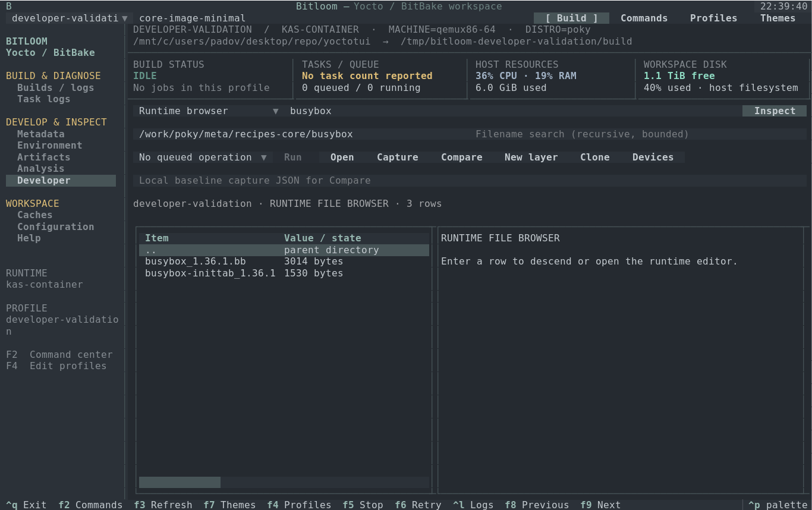
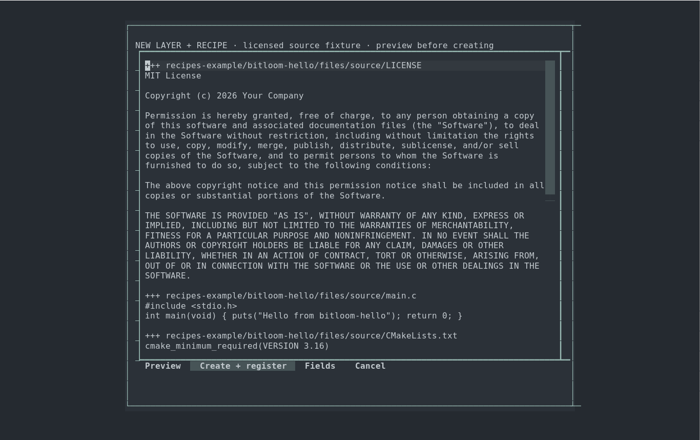

# Developer workbench

Press **F10** to open Developer, or reach it with F8/F9 or the sidebar. The workbench implements all fourteen workflows identified in the [research roadmap](roadmap.md), in sixteen views. It works through the selected host, kas, container or kas-container profile. Runtime paths are resolved inside that profile; they are not silently interpreted as host paths.

For installation, building Bitloom and preparing a real Yocto workspace, start with the [testbook](testbook.html). Its [Developer acceptance cases](testbook.html#13-developer-acceptance) cover every view and operation below. Sample demo mode does not provide BitBake.


## Everyday controls

1. Select a view and enter the recipe in the top recipe field. Use `mc:debug:busybox` for a configured BitBake multiconfig. Clear the field for a global variable query.
2. Read the placeholders in the two context fields. Their meaning changes with the view: variable name, runtime directory, report path, image or device.
3. Choose **Inspect**. Queries acquire the same build-directory ownership as queued builds and run only while the queue is idle. Parsing metadata may take several seconds.
4. Move through the table with arrows. **Enter / Open** opens the selected runtime file at its source line, navigates a directory, or displays signature evidence. Tab moves between controls. Logs/scripts are read-only; editable metadata receives backups and external-change checks.
5. Select an operation and choose **Run** to queue a build, SDK or offline check, or open its existing command dialog. Inspect itself is an evidence query, not a build request. Operation buttons scroll horizontally in a narrow terminal.

At 80×24 the table stacks above the report; at 60×20 it shrinks further. F10, F8/F9 and keyboard focus remain available. **Ctrl+Q** exits the interface; a running service build continues. **F5** opens explicit interruption choices.

### Capture, compare and refresh

**Capture** writes a private, timestamped JSON file under `<state>/exports`. The first capture fills the baseline field; later captures preserve it. Inspect after an edit or build, then choose **Compare**: it compares the current report to that baseline and saves a separate comparison export. Enter another capture path to change the baseline. Captures include the profile and original job reference where available; credential-like fields are redacted.

The workbench checks recorded file fingerprints every fifteen seconds while visible and idle. An edit makes the report **STALE**; inspect again before capturing or comparing. External edits and runtime editor saves invalidate capability data too. Fingerprint and directory scans are bounded, so Inspect remains the authoritative explicit refresh.

## Views and operations

| View | Recipe / first field / second field | Evidence and operations |
| --- | --- | --- |
| Variable history | Recipe or blank / `SUMMARY`, `PACKAGECONFIG`, `do_install`… / explanatory hint | Final value, assignment history with file/line, actual OVERRIDES and active/inactive override operations. Enter opens an origin. Uses installed getvar, with evaluated-environment fallback for multiconfig. |
| Recipe context | Recipe / optional path / hint | Selected provider/version, active appends, source/build/temp/sysroot paths, task logs and scripts. Open a directory to switch to Runtime browser. Build recipe or Devtool modify. |
| Runtime browser | Any / absolute runtime directory / optional filename search | Selectable directories, parent navigation, files, size and symlink labels. Filename search is recursive and bounded; Enter opens files through the runtime editor. |
| Rebuild evidence | Recipe / runtime build directory or blank / hint | Latest available paired signatures, diffsigs evidence, printdiff, potential reverse task dependencies, local cache candidates and mirror/hash-server settings. Dump signatures is queued. Missing pairs mean incomplete evidence; dependency reachability is not a guaranteed rebuild count. |
| Failure investigation | Recipe / runtime log, or blank for selected history job / hint | Original profile/job, task log, executed script and diagnostic context. Absolute compiler source locations are navigable; ambiguous relative paths are retained as text. Captures keep the old failure attached to its original job. |
| IDE / SDK bridge | Recipe / image recipe / optional SSH target | Evaluated source/build/sysroots/compiler/architecture, available IDE files and release-specific ide-sdk help. Generate IDE SDK, Export IDE mappings/database, Devtool modify and Build workspace. |
| Image regressions | Image recipe / optional image override / hint | Buildhistory installed packages, sizes, recipe owners, file modes/owners/links and IMAGE_INSTALL. Capture/Compare shows package byte deltas and file metadata changes. Trace selected package inclusion follows evaluated provenance. |
| Build performance | Any / buildstats directory or blank / hint | Slow tasks, measured timeline, observed task span, CPU/memory/I/O pressure, runtime cgroup-v2 limits/events and disk/inodes. Compare per-task duration trends. Parallel tasks overlap; durations are not added into a false build wall time. |
| Resolved kas / multiconfig | Recipe / optional recipe override / hint | Actual kas dump, MACHINE/DISTRO and multiconfig identities. Clone creates a separate build directory; Generate kas lock uses the installed release. Non-kas profiles show their profile/context without pretending to resolve kas. |
| Downloads / offline | Recipe or image / optional fetch log / hint | MIRRORS/PREMIRRORS, cache/network settings, URI DNS observations and checksum/DNS/TLS/access/missing-source/proxy classifications from logs. Prepare source mirrors, Verify fetch offline and Verify full build offline. |
| CVE / SBOM review | Image or recipe / absolute runtime JSON report / hint | Supported CVE/SPDX JSON formats, package/version/license, original issue status and available report/database dates. Capture/Compare tracks findings. Record selected issue review stores owner, reason and expiry separately from upstream status. |
| Kernel fragments | Kernel recipe, e.g. `virtual/kernel` / fragment path / final .config or blank | Requested versus actual CONFIG values, including disabled options, with match/mismatch rows. Kernel config check, Export kernel diff and Menuconfig use actual release tools. |
| Upgrade baseline | Recipe / optional recipe override / hint | Version, revisions, selected file/appends, patches, layer commits/dirty status and devtool workspace. Capture before/after Check latest version, Check upgrade status or Upgrade recipe. |
| Board laboratory | Devtool recipe / configured device name / exported local artifact | Device inventory, actual job results and persisted transcripts. Device status, deploy/undeploy, tests, console and labgrid acquire/release/power cycle. Requires configured equipment and installed tools. |
| Runtime capabilities | Recipe / optional recipe override / hint | Installed tools, Yocto/BitBake identity, actual listtasks, ide-sdk availability, multiconfig, terminal/KVM observations. Prepare new kas workspace initializes only a dedicated empty work directory. |
| Shutdown evidence | Any / runtime build directory or blank / hint | Current runtime processes/server files plus original job client/container/exit observations. A fresh kas shell has a different PID namespace and cannot prove an earlier server stopped. |

Image comparisons require the same image, machine, distro, libc and multiconfig. Upgrade comparisons allow a version change in the same machine context. Image package sizes use exact pkgdata PKGSIZE bytes where available, otherwise normalized buildhistory KiB with source labels; these are installed-package data, not compressed image sizes. Missing buildhistory, buildstats, security reports or device access is displayed as unavailable.



## Create a layer and recipe

Choose **New layer**. Enter a new absolute runtime directory, recipe name, layer collection, copyright owner and supported layer series. Select **CMake, Meson, Make, Python or Rust**. These are complete small source fixtures with an MIT license, matching LIC_FILES_CHKSUM, source files and layer.conf; use devtool add/recipetool for an existing external project.

**Preview** shows every file and registration change. **Fields** returns to editing. **Cancel** creates nothing. **Create + register** refuses existing destinations, including symlinks. For host/direct-container profiles, registration is queued through bitbake-layers. For kas profiles, Bitloom writes a new host YAML overlay including the original configuration and local runtime layer, and selects a new derived profile; the original YAML/profile is preserved. Registration is complete when the installed release can parse the selected composition: check Show configured layers and Show recipe appends, then build the recipe.

For the container experiment use `/work/meta-bitloom-dev`, recipe `bitloom-hello`, collection `bitloomdev`, series `scarthgap`, and a new `kas-bitloom-dev.yml`. The overlay adds the recipe to IMAGE_INSTALL. Build the recipe first, then core-image-minimal. Edit `files/source/main.c` through Runtime browser, change the greeting, rebuild and inspect the result. Choose different paths/names for a second experiment; the wizard does not overwrite an existing layer.



## Clone and compare configuration

**Clone**, also available in F4, copies a profile into a distinct absolute build directory. For kas it preserves KAS_WORK_DIR so local layers and source repositories remain available, and sets a separate absolute KAS_BUILD_DIR. kas-container mounts an external build directory as /build. Set optional machine/distro profile overrides, then select the clone. The YAML's resolved settings remain authoritative; inspect the actual kas dump before building. Changing machine/distro in a clone does not rewrite your original YAML. The queue remains serial; separate profiles do not enable concurrent BitBake invocations.

Docker Snap may have a private daemon /tmp: a host directory can be empty while its container mount contains the complete build. **Prepare new kas workspace** repairs only the top directory of an empty, separately configured work mount. It refuses a nonempty directory owned by another user. Runtime paths remain `/work/...`; read/write them using Bitloom rather than guessing a host mapping.

### IDE path mapping

For a host-accessible container checkout, add an explicit mapping in F4:

```json
"source_mappings": {
  "/work": "/home/you/yocto-work"
}
```

**Export IDE mappings / database** writes a private export with evaluated paths and, when available, a mapped compile_commands.json. Mapping respects directory boundaries and compiler path arguments. Configure the real host-visible path; mapping a Docker-private path does not copy files or create a working SDK. For daemon-private workspaces, use an IDE/container context with actual source/sysroot access. Generate IDE SDK probes release support before queueing devtool ide-sdk; supported build systems, SDK configuration and a matching target image are prerequisites for native IDE builds/debugging.

## Offline and security checks

**Prepare source mirrors** runs fetchall with BB_GENERATE_MIRROR_TARBALLS in a temporary post-read configuration. **Verify fetch offline** runs BitBake fetchall with BB_NO_NETWORK; **Verify full build offline** applies BB_NO_NETWORK to the complete target build. Results, arguments and logs enter normal history. These checks cover BitBake fetchers; kas bootstrap may still need network for repositories/images. Fetch readiness and full-build readiness are separate outcomes. Restore deliberately broken URIs/checksums before verification.

Run release-supported CVE/SPDX actions in F2, find the actual JSON report through Runtime browser, then inspect it in CVE / SBOM review. Existing issue statuses remain intact. Review exceptions are private local records with mandatory owner/reason/expiry; expired reviews are visibly labelled. Missing or unsupported reports do not produce an empty, apparently clean security result. An unpatched finding alone is not an exploitability assessment.

## Boards and console

Choose **Devices** to edit `<state>/devices.json`. Example for a board you own:

```json
{
  "devices": [{
    "name": "qemu-lab",
    "ssh": "root@192.0.2.10",
    "test_argv": ["ssh", "-o", "BatchMode=yes", "{device}", "bitloom-hello"],
    "console_argv": ["picocom", "-b", "115200", "/dev/ttyUSB0"]
  }]
}
```

Replace example addresses and serial paths with actual equipment. An optional `labgrid_place` enables labgrid show/acquire/release/power cycle/console using the installed labgrid-client and its environment. Test/console arrays are your explicit local commands; placeholders include `{device}`, `{artifact}`, `{recipe}` and `{place}`. Use a dedicated board and record ownership before changing it.

Device status runs a real SSH or labgrid query. Tests and deploy require an exported local artifact whose SHA-256 is saved with device/job evidence. **Devtool deploy transfers the recipe's workspace outputs; the referenced image hash is context, not proof that image was flashed.** Your test_argv can invoke a real board-specific deployment/test tool if required. Serial sessions use the real terminal and util-linux script to retain a transcript and actual exit status; exits are controlled by the console program. Hardware is never simulated as successful.

## Capabilities and stopping

Optional command-center task actions probe the selected recipe's actual listtasks, with a short-lived cache invalidated by profile/metadata changes. Missing testimage/ptest/kernel/security tasks are rejected before queueing with the observed prerequisite. Missing ide-sdk is also rejected. Configuration and report parsing remains release-dependent.

For newly owned kas-container jobs, Runner gives each Docker/Podman container a unique Bitloom name/label. Force stop targets that exact container and records its stop result; confirmed termination of its namespace permits recovery for recipes observed active. Graceful draining remains available only where the actual BitBake client can receive the documented signal. An arbitrary kas wrapper or existing external container still requires server verification; wrapper exit alone is insufficient. Shutdown evidence separates observations from confirmation.


The [validation report](validation.md) distinguishes real kas-container builds/probes, fixture parser tests and hardware/IDE/kernel experiments still requiring an operator. Reproduce evidence with `python tools/validate_developer.py --build`; add `--image` for a new full minimal-image build. The helper prepares a dedicated workspace, writes a generated test overlay/profile and preserves original integration configuration. It deliberately introduces and restores one failing task after successful offline checks.
