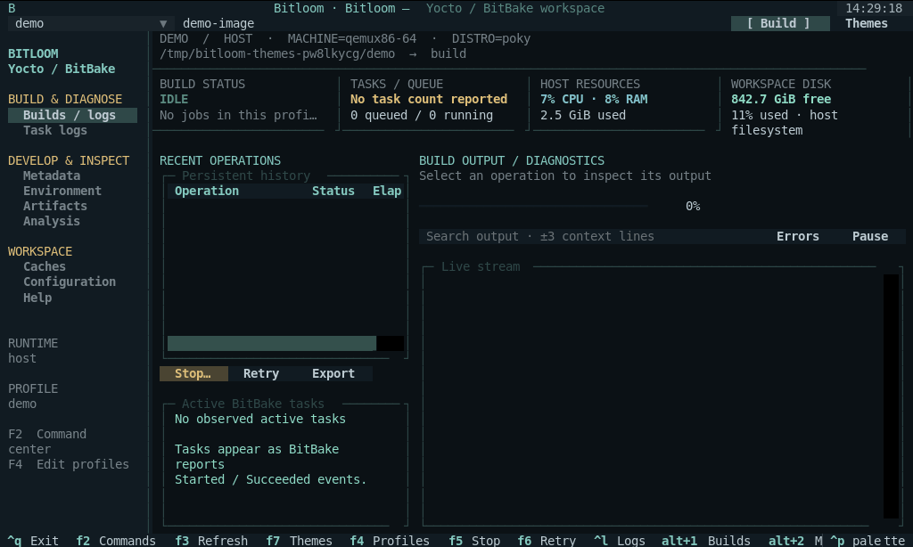

# User guide

## Install from a GitHub release

Open the [GitHub Releases page](https://github.com/padovanl/bitloom/releases) and download the assets for the version you want. Replace `1.2.3` below with that version.

### Debian / Ubuntu

Download `bitloom_1.2.3_all.deb`, then install it from the download directory:

```bash
sudo apt install ./bitloom_1.2.3_all.deb
bitloom --demo
```

Requires Python 3.10+ on Debian/Ubuntu. Python application dependencies are included under `/opt/bitloom/lib`; no pip installation is needed. The package also provides the `yoctotui` compatibility command. Docker, Podman, kas and Yocto remain separate tools for real builds. Remove Bitloom with `sudo apt remove bitloom`.

### Other Linux distributions / WSL2

Download `yoctotui-1.2.3.tar.gz` and install in a virtual environment:

```bash
tar -xzf yoctotui-1.2.3.tar.gz
cd yoctotui-1.2.3
python3 -m venv .venv
.venv/bin/python -m pip install .
.venv/bin/bitloom --demo
```

Alternatively, install the release wheel with `.venv/bin/python -m pip install /path/to/yoctotui-1.2.3-py3-none-any.whl`. Source and wheel installation require Python 3.10+, venv support and internet access to install dependencies. WSL users should install inside their Linux distribution.

### Verify downloaded assets

Download `SHA256SUMS` alongside the packages, then run `sha256sum --check --ignore-missing SHA256SUMS` in the same directory. Check that the package you downloaded reports `OK`.

## Fresh checkout demo

Run `./setup-demo.sh` from the cloned checkout to create or reuse `.venv`, install dependencies and launch the sample TUI. Requires Bash, Python 3.10+ with venv support on Linux or WSL2, and internet access for installation. No Docker, kas or Yocto installation is needed for the sample data.

Use `./setup-demo.sh --no-launch` to prepare without launching, then `.venv/bin/bitloom --demo` to start later. `--dev` installs test dependencies; `--python python3.12` or `PYTHON` selects the interpreter for a new environment. The script also works when invoked from another directory. All demo data stays under `.yoctotui/demo` in the checkout.

The terminal adapts while resizing: below 105 columns or 30 rows it hides the navigator and side panes; below 30 rows it also hides the overview. Below 75 columns or 22 rows it hides history and metrics to preserve output. Resize to restore panels. Alt+1–5 switches sections and F2/F4/F7 opens commands/profiles/themes even when toolbar controls are hidden. Verified sizes range from 60 × 20 to 160 × 50, including a wide 140 × 20 terminal.

## Profiles and paths

Profiles are local JSON stored at `.yoctotui/profiles.json` by default. State is stored at `.yoctotui/`; both paths can be set on the command line. The file is atomically replaced with mode 0600. Profile names must be unique; queued jobs retain a copy of the original profile.

| Field | Meaning |
| --- | --- |
| `name` | Unique profile identifier |
| `root` | Absolute or relative project root (resolved on the host) |
| `build_dir` | Build directory, relative to root or absolute on host |
| `mode` | `host`, `kas`, `container`, or `kas-container` |
| `init_script` | Host/container init script; autodetects oe-init-build-env or poky/oe-init-build-env |
| `kas_file` | kas configuration path(s), including colon-separated composition |
| `engine` | Docker or Podman for generic container mode |
| `image` | Builder image for a fresh container |
| `container_name` | Existing container name; empty starts a fresh temporary container |
| `container_root` | Project mount path inside a generic container; default `/work` |
| `machine`, `distro` | Environment overrides passed through BitBake's allow-list |
| `downloads`, `sstate` | Host paths used by cache inventory; these do not modify BitBake configuration |
| `environment` | String environment variables; kas variables control kas paths/runtime |
| `container_args` | Array of additional Docker/Podman arguments |
| `targets` | Suggested targets; the first fills the toolbar |

`DL_DIR`/`SSTATE_DIR` in local.conf are read as literal hints. `${TOPDIR}` is expanded; other expressions require a profile path override. Runtime paths, especially kas container paths, may differ from host paths. Use **Resolve env** to inspect the authoritative result.

### Host

Set root to your checkout. The TUI sources the init script in bash and executes a quoted argument list. You can also start from an already initialized shell and leave init_script empty. No shell operators in target fields are executed.

### kas

Set mode to `kas` and point kas_file to your YAML. BitBake/devtool commands execute with `kas shell FILE -c COMMAND`; kas actions call the appropriate subcommand directly. Install kas in your preferred environment.

### kas-container

Install the official kas-container wrapper and a functioning Docker or Podman runtime. Set `KAS_CONTAINER_ENGINE`, `KAS_WORK_DIR` and optionally `KAS_BUILD_DIR` in environment. Use a dedicated work directory distinct from the Git source repository. The wrapper supplies containerized kas and Yocto dependencies.

kas-container does not forward every arbitrary host environment variable into its container. Put Yocto overrides in kas YAML or use officially supported kas environment variables. The machine/distro profile fields map to `KAS_MACHINE`/`KAS_DISTRO` in kas modes; you can also set these directly. Set container engine through `KAS_CONTAINER_ENGINE`, not the generic engine field.

### Generic Docker / Podman

Set mode to `container`, engine and image. New containers bind root at container_root, use the current UID/GID and have a unique name. The image must contain bash and your build dependencies. BitBake should be the final exec process for graceful signalling.

Existing container_name uses `exec` instead; that container must already mount the project at container_root. build_dir must be inside root. External caches require explicit mounts plus matching paths in your build configuration. Runtime args must be JSON strings, such as `["--network", "host"]`; review privileged options yourself.

## Build and development workflows

Enter one target or recipe in the toolbar and press Build or F2. Filter the command list by group/name. Required inputs appear dynamically. Review the exact invocation and queue it. Builds and utilities share a serial queue to avoid two servers modifying one build directory.

The Build pane persists operation, profile, status, timestamps, exit code and log path. Enter on a row loads its log. Retry uses original command and profile even if you have switched profiles. Live progress comes from standard `Running task N of M` messages. History timestamps are stored in UTC.

Use recipe browsing to locate metadata, open files, build or start devtool modify. The metadata browser indexes local files, including inactive layers; `Show layers`, `Show recipes`, `Show appends` and `Show overlaid recipes` ask BitBake for evaluated state.

Interactive actions suspend Textual and give the real terminal to devshell, menuconfig, QEMU or kas shell. They require a real terminal and cannot start while a queued/running job occupies the runner. Their output is not persisted as a queued build log.

## Terminal layout

F5 opens interruption options and F6 retries the selected job. Use the navigator or Alt+1 through Alt+5 for Builds, metadata, task logs, workbench and caches. Controls occupy one terminal row. Below 105 columns, tabs replace the navigator and the main pane receives the full width. History stacks above logs so Stop and Retry remain accessible in compact terminals. The expandable layer tree selects local layers or recipes and synchronizes the table filter and preview. It includes inactive local metadata; evaluated BitBake commands remain authoritative. Recipe and kas files have a syntax-highlighted preview capped at 200 lines; Enter opens the complete editable file. The cockpit shows observed active BitBake tasks and persistent history alongside logs. Host CPU/RAM and workspace disk usage are sampled every two seconds; these are not container-specific measurements. Header MACHINE/DISTRO values come from explicit profile overrides or literal local.conf assignments; Resolve env remains authoritative for evaluated configuration.

## Errors and log search

Failures generate a notification and refresh the task-log browser. Select a failed build in history and use Failed task log in Task logs to read paths explicitly reported by BitBake through the original runtime. This works with container-only paths too; at most ten logs are queued per click. Search selected logs case-insensitively with three surrounding lines, or toggle errors-only. Pause freezes live display while output continues to be written to disk; Resume reloads the captured tail. The live view keeps 5,000 lines; searches inspect the complete file and cap the rendered result. Export copies the original complete log to `.yoctotui/exports`.

Task logs are discovered under the standard `tmp/work/ARCH/RECIPE/VERSION/temp` hierarchy and ordered by modification time. Custom TMPDIR layouts currently require setting build_dir to match the expected layout or opening logs externally. Symlink aliases are skipped to avoid duplicate entries.

The Workbench build report extracts warnings, errors, task summaries, failed tasks and shared-state summaries. Timings ranks completed tasks by durations observed in timestamped kas output. Overlapping tasks are not added into a false build duration. Plain BitBake logs without timestamps cannot supply those timings; use buildstats artifacts. It does not invent diagnoses. Use the task's own log to determine the cause.

## Workbench

**Environment:** Resolve env for the chosen target, wait for success, then Load. Filter both variable names and values. Capturing two environments for the same target/profile enables Env diff. Literal exported values are compared; function bodies and assignment provenance remain in the original log.

**Dependencies:** Generate graph for a target and wait for success. Choose Dependencies and Load to read task-depends.dot from the configured host-visible build directory. If the build directory is container-only, Load queues a read through the original runtime and parses its persisted output. Filter nodes to explore task relationships. The first 20,000 edges are indexed. Enter an exact node name in the filter and choose Why this task? to traverse required and reverse dependencies. Traversal detects cycles and limits each direction to 200 nodes.

**Build history:** Enable buildhistory and BUILDHISTORY_COMMIT in local.conf, build an image, then open Build history diff. The report shows recent Git commits and changes between the newest two commits.

**Signatures:** Use Dump signatures, Explain sstate differences, Read signature file or Compare signature files. Signature commands use BitBake tools from the selected release rather than decoding undocumented binary formats.

## Root filesystem inspection

Select a tar rootfs archive in Artifacts and use Rootfs inventory. The report lists file type, mode, numeric UID/GID, size and link targets. Archives are never extracted and links are never followed. The inventory is bounded to 20,000 entries. Other image formats require their own tooling.

## Analysis reports

Open **Analysis** in the navigator or tab bar, choose a report, and press Analyze. Export saves the displayed report under the state directory's exports folder.

- **Search metadata:** enter a literal phrase. Search is case-insensitive and covers indexed recipes, appends, classes, kas YAML and layer.conf, including inactive layers. Results contain paths and line numbers. Files above 2 MB or unreadable files are skipped; output stops at 1,000 matches. Container-only metadata must be made host-visible to be indexed.
- **Compare manifests:** enter before and after image manifest paths. Standard `package architecture version` rows and two-column `package version` rows are supported. Added/removed packages and changed versions are listed separately; architecture is part of identity. Conflicting versions and malformed rows are rejected. Each manifest is limited to 100,000 lines. Paths refer to host-visible files, including copied container artifacts.
- **Sstate efficiency:** leave the first path blank to use the selected build log, or enter another log path. The report reads actual Sstate summary counts and computes hit rate for wanted tasks and coverage including current tasks. A zero denominator or missing count is shown as unavailable. This does not establish which cache objects are safe to remove.
- **Warning groups:** select or enter a build log. Identical messages are counted after removing the timestamp/logger prefix; the 200 most frequent groups are shown. Different recipe paths and message text remain distinct.

Metadata, manifest, efficiency and warning reports read persisted data from the selected paths. Runtime tools below also provide explicit editing and artifact export.

## Cache and download maintenance

Scan either Downloads or Shared state to view names, size, age and relative paths. Inventory is capped at 20,000 files. The scan total is the indexed total, not necessarily the entire cache. Set an age of at least one day and open Prune plan. It lists concrete files and estimated bytes; nothing is removed before Execute plan.

Pruning excludes symlinks, `.lock`/`.done` markers, Git checkout internals and files whose sibling lock exists. Each file's path, size, modification time and sibling lock are checked again at deletion. Only files inside the selected root can be deleted. The TUI refuses a plan while its own jobs are active/queued. Other machines/builders cannot be detected.

Age is not proof that an artifact is unused. Keep shared caches and offline source requirements in mind. Recipe clean keeps downloads/sstate; cleansstate removes local recipe shared state; cleanall also deletes recipe downloads. Remote sstate mirrors are unaffected by local inventory pruning.

Download audit reports possible partial files, lock files and orphan completion markers. For actual source integrity checking, use the recipe fetch task and its SRC_URI checksums.

## Releases and compatibility

Versions reports local repository branches, commit IDs, Git descriptions, dirty status and literal LAYERSERIES_COMPAT declarations against locally detected LAYERSERIES_CORENAMES. Dynamic expressions can require manual review. Metadata parse is authoritative.

Use one profile/build directory per release. The TUI does not switch active Git branches underneath a running build, silently migrate local.conf syntax or mix caches without your configuration.

## Configuration editing

local.conf, bblayers.conf and metadata are editable. Save creates a timestamped backup, refuses to overwrite a file changed externally, and atomically replaces the contents. Files above 2 MB and binary files are not opened in the editor. Close without saving discards in-editor changes. Review changes with your usual Git tooling.

Example snippets cover buildhistory/buildstats, mirrors, shared caches, offline builds, mirror tarballs, thread limits and optional image/security classes.

## Troubleshooting

- **bitbake not found:** configure an init script or launch from a sourced environment.
- **Docker permission denied:** the user running Bitloom must have permission to the Docker socket; the app never changes daemon permissions.
- **Docker Snap and /tmp:** Snap's daemon can see a different `/tmp` from the host. A bind mount may be created as root in the daemon namespace. Prefer a dedicated Linux directory visible to both namespaces, or initialize only the dedicated mount ownership inside a container. Never apply broad permissions to Docker or the project root.
- **Windows/NTFS build paths:** store Yocto work directories on a Linux filesystem. The TUI source can live under /mnt/c; BitBake source/build caches should not rely on NTFS semantics.
- **kas custom machine override:** use KAS_MACHINE/KAS_DISTRO or kas YAML; arbitrary environment variables may not be forwarded by the wrapper.
- **Stop left an external build running:** wrapper/pre-existing-container modes cannot guarantee server termination. Verify processes in that runtime before recovery.
- **Missing task/class:** check your release and INHERIT configuration. CVE, SPDX, testimage and ptest entry points require appropriate metadata.
- **Too little space/RAM:** check Health, reduce thread counts, and inspect cache plans before removal.
- **Small terminal:** use keyboard shortcuts and Tab, or increase to 140×42 for the complete layout.

## Documentation and verification

`python tools/capture_docs.py` captures the real Textual interface with Pilot and exports SVG/PNG/GIF. It uses labelled demo data. `python tools/validate_kas.py` executes a real image build through Runner and records a JSON result. Read validation.md for evidence from the current development session.

## Persistent build service and reconnecting

Real launches now use an independent local build service by default. Closing the TUI, pressing Ctrl+Q, or losing the terminal detaches the client: queued and running jobs remain owned by the service. Reopen Bitloom with the same `--state` directory to reconnect. Jobs retain their original profile, commands and complete logs. Multiple clients can observe the same service.

```bash
bitloom --config .yoctotui/profiles.json --state .yoctotui
bitloom --state .yoctotui --service-status
bitloom --state .yoctotui --service-stop  # idle service only
bitloom --embedded                     # exit stops owned jobs
```

Demo mode remains embedded. F5 still explicitly interrupts a selected job through the service. The service refuses an idle-stop request when jobs remain queued/running; use F5 first if interruption is intended. A Unix socket in a private Linux `/tmp/bitloom-services-UID` directory works even when the project lives on a WSL Windows mount. Connections are restricted to the same UID. History remains under the selected state directory. This is local persistence, not reboot recovery or a distributed scheduler: a crashed service marks incomplete history interrupted on its next start and does not automatically replay work.

## Runtime filesystem and artifacts

The Analysis selector now provides **Runtime directory**, **Runtime file**, **Edit runtime file** and **Export runtime artifact**. Enter an absolute path as seen by the selected runtime, such as `/work/build/conf/local.conf` in kas-container. These operations run Python inside that runtime through the same command routing as builds. Python 3 must exist there.

Directory previews stop at 2,000 entries; text previews/edits at 2 MiB. Runtime editing opens an actual editor, rejects files changed since the preview, refuses symlink edits, preserves the original file in a content-addressed backup and replaces the file atomically. Saving is blocked while this client's build queue is active. External programs remain responsible for their own edits.

Binary export streams a file up to 1 GiB into a temporary local file and verifies both SHA-256 and byte count before committing it. The second path is the local destination; leaving it blank uses the state's exports directory. Existing destinations are never overwritten. This handles artifacts visible only inside the container, including a Docker Snap daemon's private filesystem. It does not require mounting or extracting an image.

## Evidence workflows

| Analysis choice | Input and result |
| --- | --- |
| Why rebuilding? | Enter one recipe; queue release-native `bitbake -S printdiff` and evaluated environment. Analyze again after completion to link the stored explanation, the two newest available sigdata files per task/work variant, release-native signature comparisons and referenced variable values. The chosen signature timestamps must match your intended before/after states. Use F2 to capture a fresh printdiff; a matching cache can legitimately report no difference. |
| Failure diagnosis | Select a build log or enter a runtime task log path. Classify fetch/patch/compile/QA/rootfs evidence and show the first diagnostic with context and reported task-log paths. Suggestions are troubleshooting steps, not automatic fixes. |
| Package provenance | Set the top target field to an image recipe and enter a package or absolute installed file path. Evaluate the image, read runtime pkgdata, map files to packages/recipes and show a shortest path from PACKAGE_INSTALL/IMAGE_INSTALL through runtime dependencies. |
| Build preflight | Enter a runtime build directory or leave blank. Check writable parent, disk headroom, free inodes and configuration presence in the actual filesystem. BLOCK and WARN are distinct; this advisory report does not intercept queued commands. |
| Devtool review | Enter the runtime source Git directory. Review status, uncommitted diff, commits and patch text before using build/deploy/finish/reset from F2. It does not calculate the release-specific final patch transfer set. |
| Capture snapshot | Record runtime configurations, repository commits/dirty state, image manifests, artifact sizes and package file sizes into JSON. If a log is selected, include its measured warning, timing and sstate reports; select the correct build log yourself. |
| Compare snapshots | Enter before and after JSON paths. Compare configuration diffs, layer commits, package manifests, package/artifact sizes and recorded metrics. Unavailable metrics remain absent; a snapshot records capture time state, not an automatically reconstructed historic build. |
| Reproducibility bundle | Export a reference JSON bundle with original profile, runtime snapshot, available kas configurations and resolved cached container image digests. Dirty sources require a separate patch export; this is not a self-contained source archive or one-command replay. |
| Cache reference plan | Enter host-visible or runtime cache and stamps directories. Index 64-character signature hashes and classify files as referenced or unproven. No deletion follows from a missing reference. |

Package inclusion follows both RDEPENDS and RRECOMMENDS. Virtual providers, renaming, package-manager choices, exclusions and optional recommendations can complicate the chain; absent evidence is explicitly not proof of absence. The evaluated image operation requires an idle queue. Mirror reachability and layer compatibility are not proven by filesystem preflight; use BitBake metadata parsing, layer inspection and fetch actions.

Reproducibility exports redact credential-named configuration lines and URL userinfo. Profile environment uses a small build-control allowlist; unknown keys and custom container arguments are omitted. Supply those separately. Inspect any bundle before sharing because project-specific secrets embedded under innocuous configuration names cannot be recognized reliably. An unresolved container tag is explicitly reported and is not treated as an exact digest.

## Coordinating shared caches

Bitloom builders take a shared `.bitloom-coordination.lock` on host-visible download and sstate directories. Maintenance takes an exclusive lock, so cooperating services cannot prune while another Bitloom builder uses the cache. A separate build-directory lease prevents duplicate builders across local state directories. Existing `.lock` and `.done` protection also applies when executing a plan directly.

These are advisory locks. External BitBake processes, container-only cache paths and builders that do not take the same lock are not coordinated. Signature reference plans are conservative: one build's stamps are not an exhaustive record of every cache user. For release-specific removal, coordinate all builders and use that release's `scripts/sstate-cache-management.sh` after inspecting its own help/options. Bitloom does not infer reachability from age or silently invoke a destructive cache script.

## Terminal themes

Press **F7** or the toolbar's **Themes** button. Choose a palette to preview it immediately, then **Save theme** to persist it or **Cancel/Escape** to restore the palette you opened with. Changes affect terminal backgrounds, surfaces, tables, selection colors, modal dialogs and semantic status colors. Source previews use a matching light/dark syntax palette on their next refresh.

| Theme | Character |
| --- | --- |
| Bitloom | Original dark terminal palette with mint and blue |
| Nord | Cool slate and arctic cyan |
| Dracula | Charcoal, violet and cyan |
| Tokyo Night | Deep blue with lavender |
| Catppuccin Mocha | Soft dark violet and blue |
| Gruvbox | Warm charcoal with olive and gold |
| Solarized Dark | Deep teal with blue accents |
| Ocean | Navy with bright aqua |
| Forest | Dark green with sage accents |
| Ember | Warm brown with amber and coral |
| Paper | Light paper background with dark text |
| High Contrast | Black background with bright white, cyan and yellow |

The choice is a UI preference stored in `appearance.json` under the selected state directory, independent of build profiles. Missing, malformed or unknown saved themes fall back to Bitloom. Themes do not change build settings or stop queued work.



## Build, launch and try the local Yocto workspace

Run these commands from the repository root in a Linux/WSL terminal. Bitloom is a Python application: editable installation is sufficient for development; no native compilation is required.

### Install for development

```bash
python3 -m venv .venv
source .venv/bin/activate
python -m pip install -e '.[dev]'
bitloom --help
bitloom --demo
```

If themes appear monochrome and your shell sets `NO_COLOR`, run `unset NO_COLOR` before launching.

In this prepared workspace, `.venv` and kas-container already exist. You can start directly with `source .venv/bin/activate`.

### Build distributable packages

```bash
source .venv/bin/activate
python -m pip install 'setuptools>=61' build wheel
python -m build --no-isolation
```

Outputs are `dist/yoctotui-0.1.0-py3-none-any.whl` and `dist/yoctotui-0.1.0.tar.gz`. The distribution name remains yoctotui; its executable is **bitloom**. The source archive includes the English manuals, Pages assets, examples and integration tools. To install the wheel into another environment:

```bash
python3 -m venv /tmp/bitloom-wheel
/tmp/bitloom-wheel/bin/python -m pip install dist/yoctotui-0.1.0-py3-none-any.whl
/tmp/bitloom-wheel/bin/bitloom --help
```

### Open the already built local test workspace

The verified local workspace uses **Poky yocto-5.0.8 / Scarthgap**, **qemux86-64**, **core-image-minimal** and a pinned kas container image. Yocto tools execute inside Docker; the host runs only the TUI and container wrapper. `.validation` is local generated state and is intentionally absent from a fresh Git clone.

```bash
source .venv/bin/activate
python tools/prepare_validation.py
bitloom --config .validation/profiles.json --state .validation
```

The helper recreates the test profile from `.validation/result.json` when available. It preserves history and other profiles, uses the recorded workspace and does not build anything. On this machine the recorded directory is `/tmp/yoctotui-kas-validation`; with Docker Snap, its contents are in the daemon's namespace and may appear empty on the host. In the container, the build directory is `/work/build`. Use Analysis runtime tools to browse it.

1. Keep `core-image-minimal` in the top target field and press **Build** for an incremental image build. Existing matching task outputs are reused.
2. Select its history row to follow the complete log. **F2** opens recipe tasks, fetch, SDK, layers and devtool actions; change the target to `busybox` to inspect or build one recipe.
3. In **Analysis**, choose **Build preflight** and enter `/work/build`. For **Package provenance**, set the top target back to `core-image-minimal` and enter `/bin/sh`; the verified inclusion chain is `packagegroup-core-boot → busybox`.
4. Try **Runtime directory** with `/work/build/tmp/deploy/images/qemux86-64`, or **Capture snapshot** with `/work/build`. **F7** previews and saves a theme.
5. **Ctrl+Q** detaches while the service continues. Launch the same command again to reconnect. **F5** opens explicit interruption choices; choose Let finish if you want the build to complete.

```bash
bitloom --state .validation --service-status
bitloom --state .validation --service-stop
```

The last command stops an idle service only. Stop it before running integration scripts that need exclusive access to `.validation`; closing the TUI alone does not stop the service.

### Reproduce on a fresh machine

Docker must be available and the build work directory must be on a Linux filesystem. Install the official wrapper if needed:

```bash
source .venv/bin/activate
curl -fL https://raw.githubusercontent.com/siemens/kas/4.8.1/kas-container -o .venv/bin/kas-container
chmod +x .venv/bin/kas-container
python tools/prepare_validation.py --work /tmp/yoctotui-kas-validation --engine docker
bitloom --config .validation/profiles.json --state .validation
```

Press Build to initialize and build the image. The first build downloads repositories/sources and needs substantially more time and disk than the verified incremental run. The helper does not repair container mount permissions: if Docker Snap creates the dedicated mount as root, follow the [runtime troubleshooting guide](#troubleshooting).

For scripted verification, with the service stopped:

```bash
python tools/validate_kas.py --work /tmp/yoctotui-kas-validation --engine docker
python tools/prepare_validation.py
python tools/probe_kas.py
python tools/probe_workflows.py
```

`validate_kas.py` builds the image and verifies its rootfs; probes then exercise real runtime operations. `probe_workflows.py` submits a warm build to a separate persistent service and stops that service after completion. Unit/UI checks run with `python -m pytest -q`; they do not require a Yocto build.

### Preview the Pages site locally

```bash
python -m pip install '.[docs]'
python tools/build_docs.py
python -m http.server 8000 --directory docs
```

Open `http://localhost:8000`. The Pages workflow is included, but this workspace has no GitHub remote and no public deployment yet.
