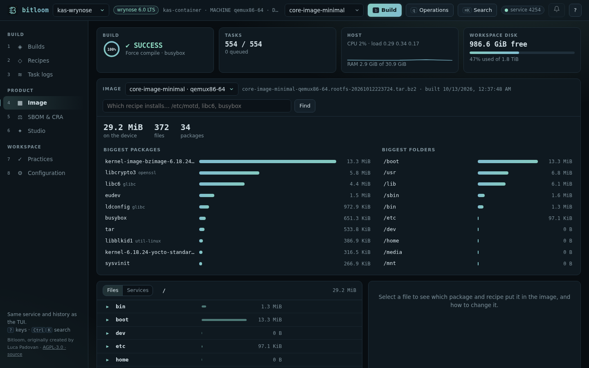
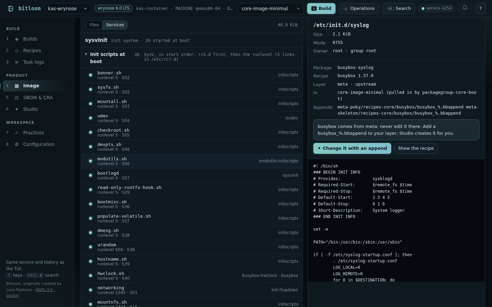

# Image explorer

What did the build actually put on the device, where does each file come from, and how do you change it? The Image explorer answers from what BitBake left on disk after the build: no BitBake run, no device needed.

Open it with section **4** of the [web dashboard](web.md), **Ctrl+K → Explore the built image**, or ask *Which recipe installs…* from anywhere (web, TUI, command line).



## What you see

* **The image** of the active profile: every image built for every machine, newest first. Bitloom reads the root filesystem archive in `tmp/deploy/images/<machine>` (`tar.bz2`, `tar.gz`, `tar.xz`, or `tar.zst` when `zstd` is installed), or the `rootfs` folder in `tmp/work` while it still exists (without `rm_work`). Add a tar type to `IMAGE_FSTYPES` if your image only produces disk images.
* **Totals**: the size on the device, the number of files and of packages.
* **Biggest packages** and **biggest folders**: where the space goes. Click a package to see which recipe builds it; click a folder to open it.
* **The file tree**, folder by folder, each entry with its size, a bar relative to the folder, and the **package · recipe** that installs it. Symbolic links show their target.
* **The selected file**: size, permissions, owner and group, the package and recipe, the layer (yours or upstream), the images that contain it and *what pulls it in* (the packages that depend on it, such as `packagegroup-core-boot`), the existing `.bbappend` files of that recipe, and the content when it is a small text file.

## What starts on the device

**Services** (next to *Files*) shows what the image runs and what reacts to it, read from the root filesystem, each entry with the package and recipe that installs it:

* the **init system** (systemd, SysV init or BusyBox init) and, with systemd, the default target;
* **systemd units**: the ones that *start at boot* (enabled by a link in `/etc/systemd/system/*.wants`, with the target that wants them), the ones *installed but not enabled* (started on demand by a socket, D-Bus or another unit, or not at all) and the *masked* ones (linked to `/dev/null`), with their description and `ExecStart`;
* **SysV init scripts** in start order: `rcS.d` first, then the runlevel, with their `S` number; the scripts run only at shutdown and reboot, and the helpers linked nowhere, are listed apart;
* **udev rules** in the order udev applies them, with the number of rules and their first comment; a file in `/etc/udev/rules.d` replaces the one with the same name in `/lib`, and a link to `/dev/null` disables it;
* **D-Bus**: services started on request (their bus name and systemd unit) and bus policies.

Select an entry to open its file with the usual details: owner, package, recipe, layer and *Change it with an append*. To change what starts, append to the recipe (`SYSTEMD_AUTO_ENABLE`, `SYSTEMD_SERVICE`, `INITSCRIPT_PARAMS`) or take its package out of the image.



The same list is in the TUI (**Analysis → Services in the image**) and on the command line:

```console
$ bitloom --services core-image-minimal
SERVICES IN core-image-minimal (qemux86-64)

init system  sysvinit

SYSV INIT SCRIPTS
  ● banner.sh                    runlevels S · order 02         initscripts (initscripts)
  ● sysfs.sh                     runlevels S · order 02         initscripts (initscripts)
  ● mountall.sh                  runlevels S · order 03         initscripts (initscripts)
  ● udev                         runlevels S · order 04         eudev (eudev)
…
```

## Change it

Under the file, Bitloom says what to do:

* the recipe comes from an upstream layer (Poky, OE-Core, meta-yocto…): never edit it there. **Change it with an append** opens [Studio](studio.md) on a *Recipe append* already filled in: the recipe, its folder (`recipes-core`…) and, for a file in `/etc`, the file itself, **starting from its current content on the device**. Edit it with *edit before creating*, review, create, rebuild;
* your layer already appends that recipe: change your append;
* the recipe is in your layer: edit the recipe.

Some files are in no package: `/etc/passwd`, `/etc/group`, `/etc/shadow`, `/etc/ld.so.cache`… They are made while the image is assembled, by useradd, ldconfig, package post-install scripts or the image recipe's `ROOTFS_POSTPROCESS_COMMAND`. Bitloom says so and points to where to change them (for example `EXTRA_USERS_PARAMS` in the image recipe for users).


## Which recipe installs…?

Type a file on the device (`/etc/motd`), a package as installed (`libc6`) or a recipe (`glibc`) in the Image view's search, the Ctrl+K palette, the TUI's **Analysis → Which recipe installs…**, or on the command line:

```console
$ bitloom --who-installs /etc/inittab
WHICH RECIPE INSTALLS: /etc/inittab

sysvinit-inittab (sysvinit-inittab) ships this file
  recipe   sysvinit-inittab 2.88dsf   …/meta/recipes-core/sysvinit/sysvinit-inittab_2.88dsf.bb
  layer    meta  (upstream)
  file     /etc/inittab
  image    core-image-minimal (qemux86-64)  pulled in by sysvinit
  change   add recipes-core/sysvinit-inittab/sysvinit-inittab_%.bbappend to your layer (Studio → Recipe append)
```

It is the same information as `oe-pkgdata-util find-path` and `lookup-recipe`, plus the layer, the images, the dependants and the advice, read from `tmp/pkgdata/<machine>/runtime` and the image manifests. Package renames are followed (`libc6` is the `glibc` package). A file name without a path (`inittab`) also works. It answers for what has been packaged: build the recipe or the image once first.

## Practical limits

* Ownership comes from package data (`FILES_INFO`); files created at image assembly time have no package, as explained above.
* Disk images (`ext4`, `wic`) are not opened: Bitloom needs a tar archive or the rootfs folder.
* Very large images take a few seconds the first time (the archive is read once, then cached until it changes).
* Owners come from the archive. The `rootfs` folder in `tmp/work` belongs to your build user (pseudo keeps the real owners in its own database), so owners are not shown for it.
* The TUI offers *Which recipe installs…* and *Services in the image* in Analysis and the rootfs inventory in Artifacts (`i`); the folder-by-folder explorer is in the web dashboard.
