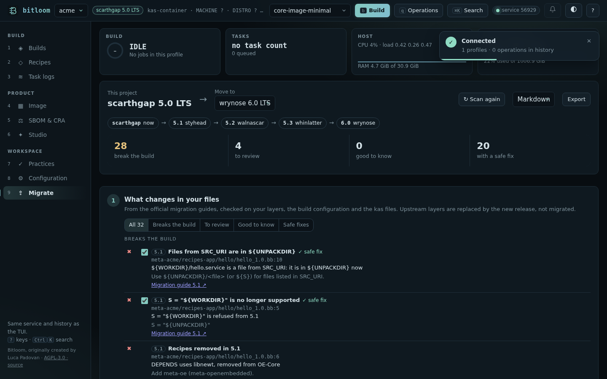
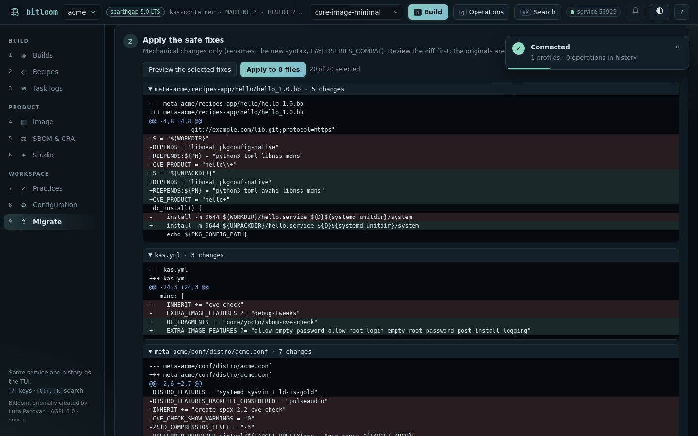
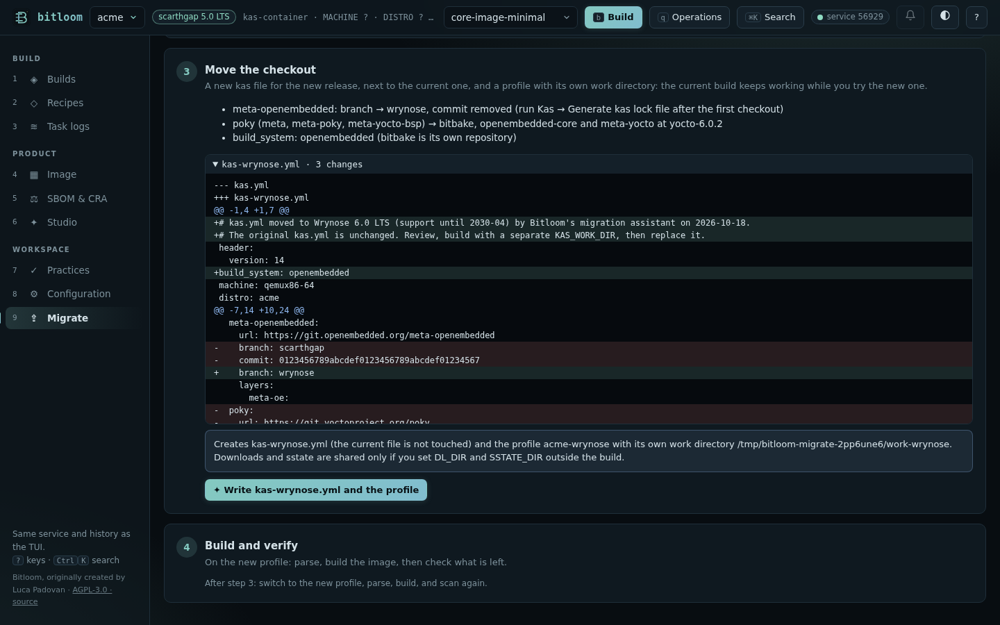

# Migrate to a newer release

Moving a product from one Yocto LTS to the next means reading every migration guide in between and finding, in your own layers, what each one changes. From Scarthgap (5.0) to Wrynose (6.0) that is four guides: 5.1 Styhead, 5.2 Walnascar, 5.3 Whinlatter and 6.0 Wrynose. Bitloom has them as rules, checks your files against all of them, fixes what is mechanical, and moves the checkout without touching the build you have.

Open it with section **9** of the [web dashboard](web.md) (or Ctrl+K → *Migrate*), the TUI's **Analysis → Migration check**, or `bitloom --migrate`.



## How it works

* **The path.** Bitloom reads the project's release and offers every newer one it covers; the path shows each release on the way, each linked to its official guide. A migration that skips releases chains their rules: nothing is skipped.
* **Your files only.** Your layers, the build configuration (`local.conf`, `auto.conf`, `site.conf`, `bblayers.conf`) and the kas files of the profile, `local_conf_header` included; for a launcher-script profile, the kas file its variable names (`YML=…`). Upstream layers (OE-Core, meta-yocto, meta-openembedded…) are replaced by the new release, not migrated.
* **Three kinds of finding**: what **breaks the build** (an error from that release on), what **changes behaviour** and deserves a look, and what is **good to know**. Each says where (file and line), what changed, what to do, and links the exact section of the guide.

## What it checks

| From the guide | In your files |
| --- | --- |
| 5.1 | `S = "${WORKDIR}"`; `${WORKDIR}/<file>` for files from `SRC_URI` (now in `${UNPACKDIR}`); `../` in `LIC_FILES_CHKSUM`; Go recipes without `destsuffix=${GO_SRCURI_DESTSUFFIX}`; removed variables (`TCLIBCAPPEND`, `VOLATILE_LOG_DIR`, `VOLATILE_TMP_DIR`), recipes (libnewt, python3-toml, mpeg2dec…), the `siteconfig` class; `license-incompatible` renamed `license-exception` |
| 5.2 | `debug-tweaks`; Git `SRC_URI` without `branch=` or with several branches; `virtual/${TARGET_PREFIX}gcc` and the other toolchain providers; `BB_CURRENT_MC == "default"`; `UBOOT_ENTRYPOINT` without `0x`; `ZSTD_COMPRESSION_LEVEL = "-3"`; systemd's `usrmerge`; `UBOOT_ENV` in FIT images; `ld-is-gold`; removed variables, recipes (libnss-mdns renamed avahi-libnss-mdns…) and classes |
| 5.3 | kas files on the `poky` repository; `S = "${WORKDIR}/…"`, `S = "${WORKDIR}/git"`; `FOO="bar"` without spaces; Wic plugins with dashes; `fitImage` as `KERNEL_IMAGETYPE`; `CFLAGS +=` in recipes that also build natively; removed variables, recipes, `PACKAGECONFIG` options and classes (`kernel-fitimage`, `icecc`) |
| 6.0 | `LAYERSERIES_COMPAT` of your layers; `*_BACKFILL`, `*_BACKFILL_CONSIDERED`, `DISTRO_FEATURES_DEFAULT`; meta-poky's removed templates; `create-spdx-2.2`; the `cve-check` class and its variables; `CVE_PRODUCT` escapes; `WIC_SECTOR_SIZE`; WKS files outside `files/wic`; `systemd` and `sysvinit` together; the comma form of `UBOOT_CONFIG[x]`; `PKG_CONFIG_*` without `inherit pkgconfig`; VEX file names; `DEBUG_BUILD`; the default init manager without a `DISTRO`; removed recipes, options and classes |

## Fix what is mechanical

About half of the findings have a **safe fix**: a rename, the new syntax, the new variable, `LAYERSERIES_COMPAT`, `cve-check` → `OE_FRAGMENTS += "core/yocto/sbom-cve-check"`, `debug-tweaks` → the four features it stood for. Select them, **Preview** shows the diff of every file, **Apply** writes them. Several fixes on one line are combined. The original files are kept in the state folder, and **Undo** restores any earlier set. A file changed since the scan is never overwritten.



What needs a decision stays with you, explained: a Git URL without a branch, a removed recipe you depend on (which layer now has it), WKS files to move, `UBOOT_CONFIG` to split.

## Move the checkout

For a kas or launcher-script project, Bitloom writes the project's kas file **for the new release, as a new file** (`kas-wrynose.yml` next to `kas.yml`), never over the current one:

* the `poky` repository becomes `bitbake`, `openembedded-core` and `meta-yocto` at the tags Bitloom's own Wrynose builds use, with your layers mapped to the right repository and `build_system: openembedded`;
* other repositories on a release branch (`branch: scarthgap`) move to the new branch; their old commit pins are removed, and *Generate kas lock file* records new ones after the first checkout;
* a new profile (`<name>-wrynose`) builds it with **its own work directory**, so the current build stays as it is until the new one works. A launcher-script profile keeps its script and gets its variable pointed at the new file.



For a Poky checkout or a bitbake-setup workspace, the step explains how to set up the new release next to the current one (bitbake-setup workspaces belong to one release).

## Build and verify

Step 4 switches to the new profile, parses the metadata (`bitbake -p`), builds the image and opens [Best practices](practices.md). Scan again: what is left needs a human, and the build log of the new release tells the rest; Bitloom's failure diagnosis reads it for you.

## Command line

```console
$ bitloom --migrate --to wrynose              # exit 2 while something breaks the build
Migration scarthgap → wrynose

Path: scarthgap → styhead → walnascar → whinlatter → wrynose · your layers: meta-acme · 6 files · 48 rules from the official guides
2 break the build · 0 to review · 0 good to know · 1 with a safe fix
…
$ bitloom --migrate --to wrynose --apply      # apply the safe fixes, originals kept in the state folder
$ bitloom --migrate --format md > migration.md
```

## Practical limits

* The rules read files: values computed by Python or set in classes outside your layers are not evaluated; the first build on the new release finds the rest.
* Removed recipes are found in dependencies, images and your appends; a recipe pulled in by another layer is reported when that layer is updated.
* Bitloom covers Scarthgap to Wrynose and the releases between them. Each future release adds its guide's rules as one more step.
