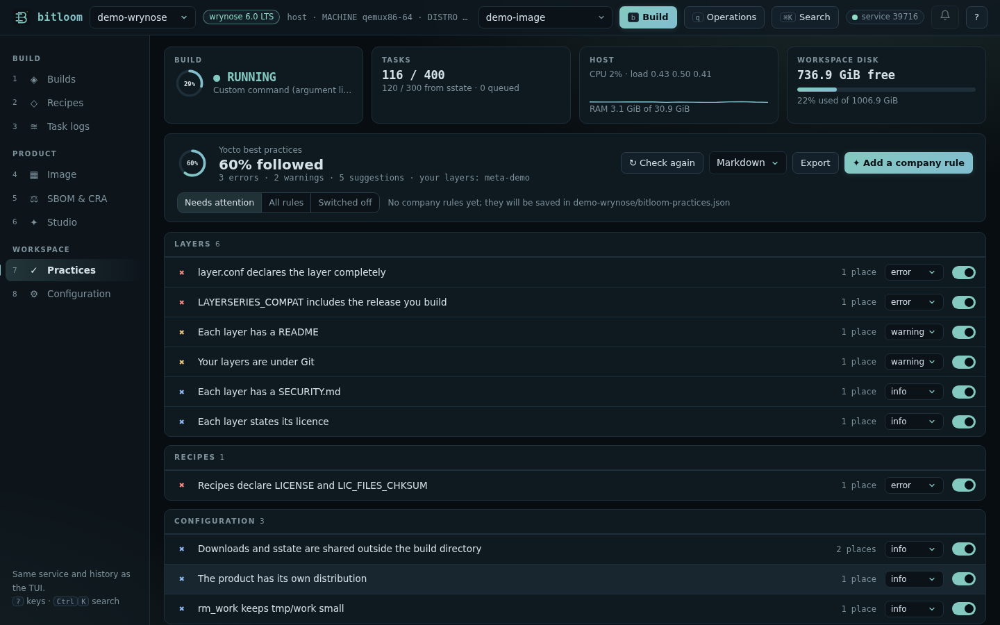
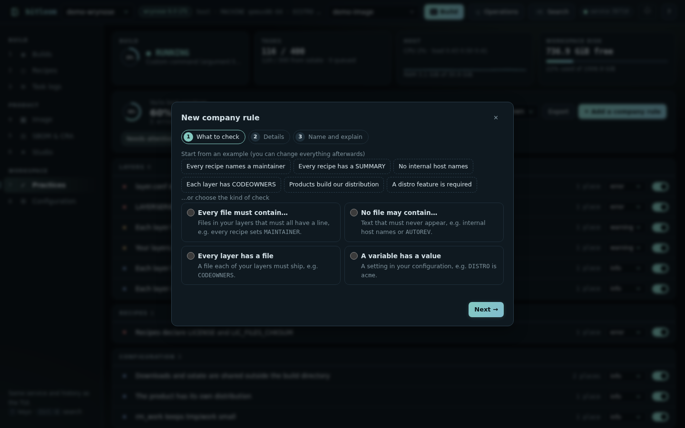
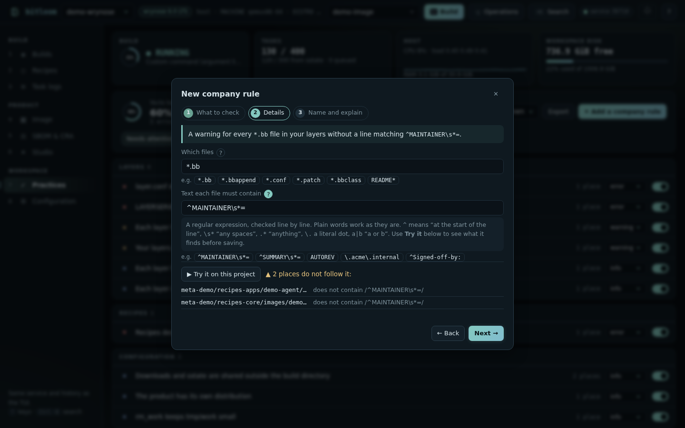

# Best practices

Does your project follow the way the Yocto Project recommends to work? **Practices** reviews your layers and build configuration against the advice of the Yocto documentation, shows what you already follow, what needs attention (with the file and line) and how to fix it. Your team decides which rules apply, how serious each one is, and can add its own.

Open it with section **7** of the [web dashboard](web.md) or **Ctrl+K → Best practices**. In CI, run `bitloom --practices` (see [below](#in-ci)).



## What is checked

Only **your** layers are judged: the ones of your product, not Poky, OE-Core, meta-openembedded or other upstream layers. Upstream layers are only checked for local changes (they should have none). Each rule links to the page of the Yocto documentation it comes from.

| Area | Rules |
| --- | --- |
| Layers | named `meta-<name>`; `layer.conf` declares collection, pattern, priority and `LAYERSERIES_COMPAT`; the compatible series includes the release you build; `LAYERDEPENDS` names layers the project has; a README, a `SECURITY.md` and a licence in each layer; `layer.conf` sets only layer variables; BSP, distribution and software in separate layers; layers under Git |
| Upstream | Poky, OE-Core and the other upstream checkouts are not modified |
| Appends | upstream recipes are extended with a `.bbappend`, not copied; every append has its recipe; `FILESEXTRAPATHS:prepend := "${THISDIR}/files:"`; the colon override syntax (`:append`, not `_append`); product images are your own recipes, not appends to `core-image-*` |
| Recipes | `name_version.bb` in lowercase; `LICENSE` and `LIC_FILES_CHKSUM`; `sha256sum` for downloads; Git sources pinned with `SRCREV` (no `AUTOREV`); patches with `Upstream-Status` |
| Security | no development access in the product (`debug-tweaks`, `allow-empty-password`, `allow-root-login`, `empty-root-password`) |
| Configuration | `DL_DIR` and `SSTATE_DIR` shared outside the build directory; a distribution of your own instead of `poky`; product settings in layers rather than `local.conf`; `buildhistory`; `rm_work` |

Each rule is an **error**, a **warning** or a **suggestion**. The score is the share of the rules that apply to your project (switched on, with something to check) that it follows.

## Tune it for your project

Every rule has a switch and a severity:

* switch a rule **off** when it does not apply (a project that deliberately ships `poky`, a BSP-only repository). It moves to *Switched off* and no longer counts;
* change its **severity**: make `rm-work` an error on the shared build server, or `layer-security-policy` a suggestion for an internal layer.

The choices are saved in **`bitloom-practices.json`** at the project root. Commit it: everyone who opens the project, and CI, applies the same rules.

## Company rules

**Add a company rule** opens a short wizard. Nothing to learn first: every field has a **?** that explains it, examples you can click, and a sentence at the top that says the rule in plain words as you build it (*An error unless `DISTRO` is exactly `acme` in your configuration*).

1. **What to check.** Start from an example (every recipe names a maintainer, every recipe has a `SUMMARY`, no internal host names, each layer has `CODEOWNERS`, products build our distribution, a distro feature is required) or pick one of the four kinds of check.
2. **Details.** The files and the text to look for, the file each layer must have, or the variable and its value. **Try it on this project** runs the check at once, without saving: *your project follows it*, or the places that do not, with file and line.
3. **Name and explain.** A title (the id is made from it), how serious it is (an *error* fails CI), and one sentence each for *why it matters* and *how to fix it*: they are shown to whoever breaks the rule.





The four kinds of check:

| Check | Passes when | Example |
| --- | --- | --- |
| `files-must-match` | every file matching `files` in your layers contains `pattern` (a regular expression, line by line) | every recipe sets `MAINTAINER` |
| `files-must-not-match` | no file matching `files` contains `pattern` | no `x11` in configuration files, no internal host names |
| `layer-file-exists` | each of your layers has the file or folder at `path` | a `CODEOWNERS`, a `docs/` folder |
| `variable` | the configuration value of `name` is `set`, `unset`, `equals`, `contains` or `not-contains` the `value` | `DISTRO` equals `acme`, `DISTRO_FEATURES` contains `seccomp` |

The same rules can be written directly in the file:

```json
{
  "disabled": ["layer-security-policy"],
  "severity": {"rm-work": "error"},
  "rules": [
    {
      "id": "acme-maintainer",
      "title": "Recipes name a maintainer",
      "severity": "warning",
      "why": "Our release process needs an owner per component.",
      "fix": "Add MAINTAINER = \"Team <team@acme.example>\" to the recipe.",
      "check": {"type": "files-must-match", "files": "*.bb", "pattern": "^MAINTAINER\\s*="}
    },
    {
      "id": "acme-distro",
      "title": "Products build the ACME distribution",
      "severity": "error",
      "check": {"type": "variable", "name": "DISTRO", "op": "equals", "value": "acme"}
    }
  ]
}
```

Rules are checked before they are saved: ids are lowercase with hyphens and cannot reuse a built-in id, patterns must be valid regular expressions, paths must stay inside the layer. A company rule never runs commands.

Variables are read from `local.conf`, `auto.conf`, your distribution files and your image recipes, following `=`, `?=`, `+=`, `.=`, `:append`, `:prepend` and `:remove`. `DISTRO` and `MACHINE` are what the build selects (the profile, the kas file, `local.conf`), not the distribution file that names itself. They are the literal values written there, not what BitBake computes: a value set by a class or an include of a layer outside your project is not seen.

## Export and CI

**Export** downloads the review as Markdown (for a merge request or a wiki), JSON (for tools) or text.

### In CI

```console
$ bitloom --practices
Yocto best practices · 81% followed

0 errors · 1 warning · 4 suggestions · your layers: meta-acme

APPENDS

✔ Upstream recipes are extended, not copied
✔ Overrides use the colon syntax
…
CONFIGURATION

✖ Product configuration lives in layers, not local.conf  [warning]
    local.conf:4: IMAGE_FSTYPES: product configuration belongs in your distro, machine or image
    why: local.conf is per developer and not versioned with the product.
    fix: Move image contents to your image recipe and policies to your distro. (https://docs.yoctoproject.org/what-i-wish-id-known.html)
…
$ echo $?
0
```

With `--fail-on warning` the same review exits 2.

| Option | Effect |
| --- | --- |
| `--practices` | review the active profile (or `--profile NAME`) with the project's `bitloom-practices.json` |
| `--format text\|md\|json` | the report format |
| `-o FILE` | write the report to a file |
| `--fail-on error` | exit status 2 when an active rule at *error* fails (the default) |
| `--fail-on warning` | also fail on warnings |
| `--fail-on never` | always exit 0: report only |

## Practical limits

* The review reads files; it does not run BitBake. Values computed at parse time are outside its view (see *Variables* above).
* Your layers are the layers inside the project folder that are not known upstream layers; a layer kept elsewhere is treated as upstream.
* Practices are in the web dashboard and on the command line, not in the TUI.
