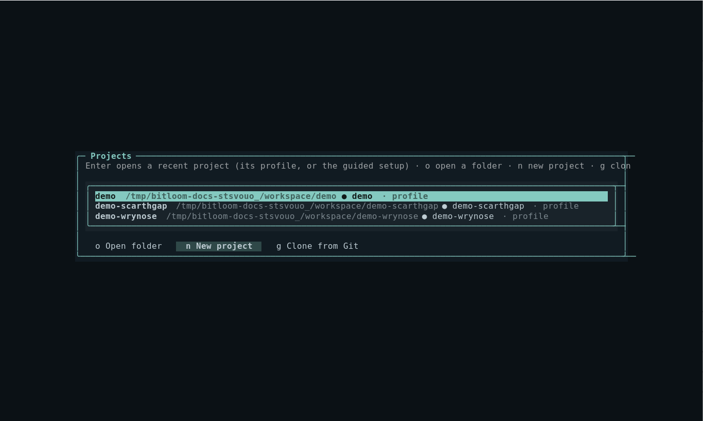
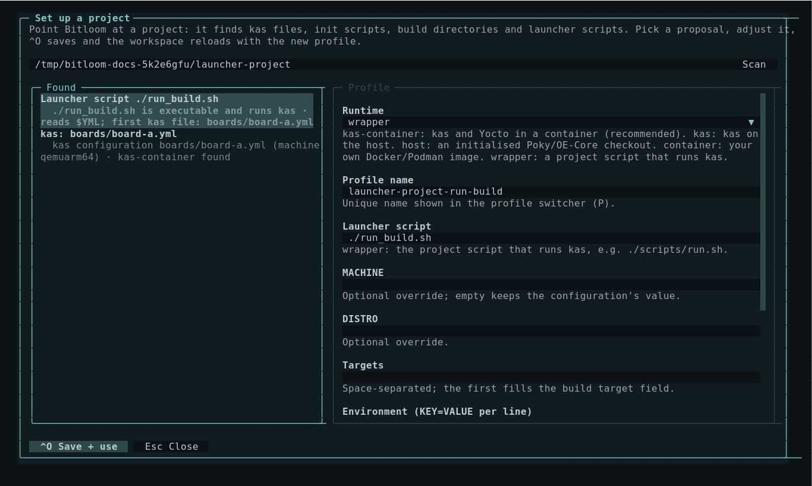
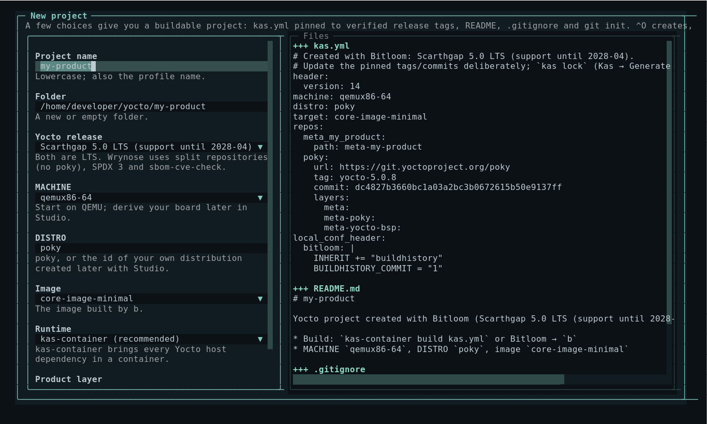
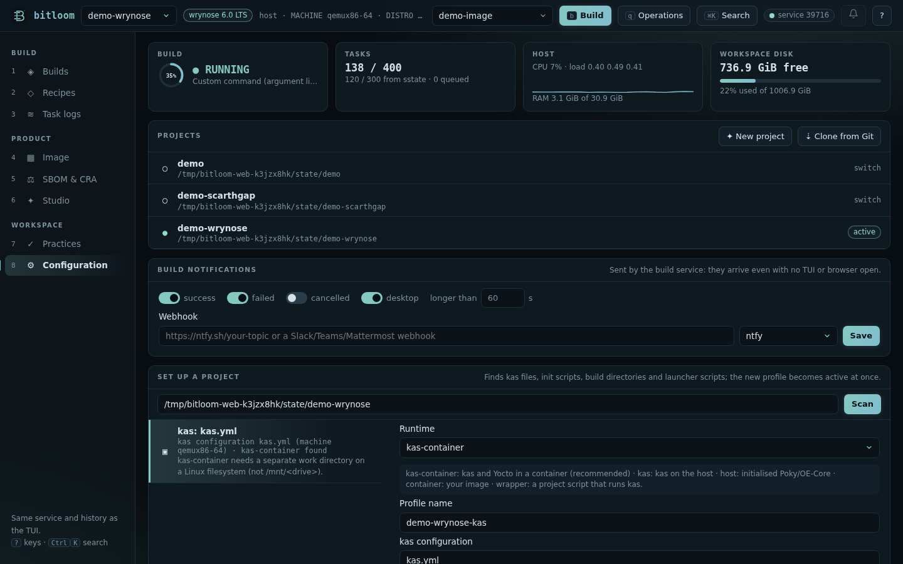

# Projects and guided setup

Bitloom works with many projects at once: every project is a profile, and switching project is switching profile (`P`). The **Projects** hub opens existing folders, creates new Yocto projects and clones projects from GitHub or any Git server. The **guided setup** reads how a folder builds and proposes a ready-to-use profile.

Open the hub with **Configuration → `w`**, **Ctrl+P → Projects**, or the *Projects* panel in the web dashboard's Configuration section (`6`).

## Open an existing project: guided setup

1. In the hub press **`o`**, type the project folder and press **Enter** (or use **Set up a project** in the web Configuration section).
2. Bitloom scans the folder (two levels deep, read-only) and proposes profiles, each with the evidence it found:
   * **Launcher scripts**: executable scripts that call `kas`/`kas-container`, for example a project's `run_build.sh`. Each product configuration becomes its own `wrapper` proposal, titled the way you run it (`YML=kas/board-a.yml ./run_build.sh build`): the variable the script reads (such as `YML`) is set to that file, and machine and targets come from it, following `includes`. Files that other kas files include, or that name no machine, are fragments and are not offered as products. The build folder is read from the script's `KAS_WORK_DIR` (defaults such as `${KAS_WORK_DIR:-$HOME/build}`, `$PWD`, the script's own folder, helper variables like `TOP=$(cd $(dirname $0) && pwd)` and per-product forms like `build-${YML%.yml}` or `$(basename $YML .yml)` are expanded); when the script computes it at run time, set `KAS_WORK_DIR` in the profile.
   * **kas configurations**: YAML files with a kas `header`; MACHINE and target are read from the file. kas-container is proposed when available (or when kas is missing), with a separate work directory under `~/bitloom-work`.
   * **Poky / OE-Core checkouts**: `oe-init-build-env` (also under `poky/`, `sources/`, `layers/`) with existing build directories and their MACHINE/DISTRO.
3. Choose a proposal with **↑/↓**; the form on the right fills in. Every field is explained and checked as you type: project root, kas files, launcher executable, `KAS_WORK_DIR` (refused when missing, warned when on `/mnt/<drive>` under WSL), init script, profile validity. For launcher scripts it also warns when the script does not pass its arguments on (BitBake commands need `shell -c`) and when no build exists yet in the folder Bitloom will read.
4. **^O** saves. The profile becomes active, and the selectors, metadata, task logs and health checks reload immediately: press **`b`** to build.

If a folder already has a profile, opening it switches to that profile instead of asking again.

On the very first start, when no profiles file exists, the guided setup opens automatically in the current directory.

### Project launcher scripts

When the folder has a script that runs kas, the proposal uses the `wrapper` runtime: kas operations call `./script <subcommand>` and BitBake commands call `./script shell -c '<command>'`, with the environment variables from the profile (for example `YML=boards/board.yml`). For BitBake commands and runtime probes the script must forward `shell -c` and keep standard input open. See [Teams, CI/CD and setup](teams.md#project-launcher-scripts) for the details and a minimal example script.

## Create a new project

Press **`n`** in the hub (web: **New project**). A few choices give a buildable project:

| Field | Meaning |
| --- | --- |
| Project name | Lowercase; also the profile name |
| Folder | A new or empty folder (defaults to `~/yocto/<name>`) |
| Yocto release | Scarthgap 5.0 LTS (Poky repository) or Wrynose 6.0 LTS (bitbake, openembedded-core and meta-yocto) |
| MACHINE, DISTRO, image | Start on QEMU with `poky`; derive your board and distribution later with [Studio](studio.md) |
| Runtime | kas-container (recommended) or kas on the host |
| Product layer | Creates `meta-<name>` registered in the kas file |

Bitloom writes `kas.yml` pinned to the release tags verified by its own real builds (yocto-5.0.8 and yocto-6.0.2, with the commits the tags point to), a README, a `.gitignore`, the optional layer, and runs `git init`. The profile becomes active; the first build downloads layers and sources. Update the pinned tags deliberately, and use *Generate kas lock file* to record exact revisions.

## Clone from GitHub or Git

Press **`g`** in the hub (web: **Clone from Git**), enter an `https://`, `ssh://`, `git@` or `file://` URL, the destination (suggested from the URL until you edit it) and an optional branch or tag. Your Git credentials and SSH agent are used as in a terminal.

The clone runs as a normal job, so you follow its progress in Builds. When it succeeds, the guided setup opens on the new folder.

## Recent projects

The hub lists recently opened, created, cloned and set-up folders (stored in `<state>/projects.json`) together with every profile root. **Enter** switches to the folder's profile, or runs the guided setup if the folder is not set up yet.

## Web dashboard

The Configuration section has the same three parts: **Projects** (recent list, New project with live file preview, Clone from Git), **Set up a project** (scan, proposals, form, live checks, *Save and use*), and the health checks. Saving or creating selects the new profile in the header at once; a finished clone raises a toast with *Set it up*.

## API

| Method and path | Purpose |
| --- | --- |
| `GET /api/projects` | Recent projects, releases, machines and images |
| `POST /api/projects/preview`, `/create` | Plan or create a new project `{name, dir, release, machine, distro, target, runtime, layer, owner}` |
| `POST /api/projects/clone` | Clone `{url, dest, branch}` as a job; returns the job id |
| `GET /api/setup/scan?dir=…` | Proposals for a folder |
| `POST /api/setup/check`, `/save` | Check or save `{profile}`; saving makes it active |
