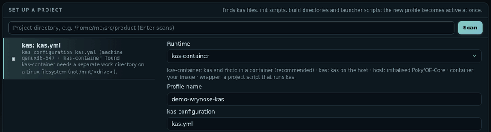

# Quickstart

From nothing to a build you can follow in the browser, in five steps. Every step also works in the terminal UI; the two share one build service.

## 1. Install

Download the version you want from [GitHub Releases](https://github.com/padovanl/bitloom/releases) (replace `1.2.3`):

```bash
sudo apt install ./bitloom_1.2.3_all.deb            # Debian / Ubuntu: dependencies included
```

On other distributions and WSL2, install the source archive in a virtual environment:

```bash
tar -xzf bitloom-1.2.3.tar.gz && cd bitloom-1.2.3
python3 -m venv ~/.bitloom-venv && ~/.bitloom-venv/bin/pip install .
```

Check the result with `bitloom --version`. Real builds also need what your project uses: kas or kas-container with Docker or Podman, or an initialised Poky checkout. See [installation](guide.md#install-from-a-github-release) for checksums and the release SBOM.

## 2. Look around on the samples

```bash
bitloom --web --demo
```

Bitloom prints the dashboard URL, which carries its access token, and opens your browser. The demo has a Scarthgap and a Wrynose sample workspace: switch between them with the profile menu. Press `?` for the keys, `Ctrl+K` for the palette, `1` to `9` for the sections. Nothing here runs a real build.

## 3. Connect your project

Start Bitloom from your project folder:

```bash
cd ~/src/my-product
bitloom --web
```

With no profile yet, the dashboard opens **Configuration → Set up a project** on that folder and proposes how it builds, with the evidence it found:

| Your project has | Bitloom proposes |
| --- | --- |
| kas files (`kas/*.yml`) | a `kas-container` profile per configuration, with a work directory on a Linux filesystem |
| a launcher script that runs kas, used as `YML=kas/board.yml ./run_kas.sh build` | a `wrapper` profile per product; BitBake commands run as `./run_kas.sh shell -c '…'`, and the build folder comes from the script's `KAS_WORK_DIR` |
| a Poky or OE-Core checkout | a `host` profile that sources `oe-init-build-env` |



Pick a proposal, check the fields (each is explained and checked as you type) and press **Save**. When one launcher builds several products, **Save all products** creates one profile each. Details: [Projects and guided setup](projects.md).

## 4. Build and follow

1. In **Builds** (`1`), click the target field or press `t`: it lists the image recipes found in your layers, the kas target and the images already built first. Any recipe works too.
2. Press `b` (or **Build**). The job appears at the top of the history, with live output, progress and an ETA.
3. When it ends, **Summary** (`u`) groups errors, warnings and failed tasks; **Compare** (`d`) shows what changed since the previous run. A failed build's summary starts with a diagnosis of the real cause: the failed task, its log, the lines that matter and the next step.
4. **Operations** (`q`) queues any of the 79 operations: one recipe's compile, a clean, a dry run, an SDK, an SBOM or CVE check. Operations your Yocto release does not have are not offered, and say what to use instead.
5. **Image** (`4`) opens what you built: every file with its size and the package and recipe that installs it, and *Change it with an append* for anything you want different. See [Image explorer](image.md).


Close the browser whenever you like: the build service keeps the queue and the history, and `bitloom --web` reconnects. Optional notifications tell you when a build ends ([Daily helpers](guide.md#daily-helpers)).

## 5. The same, in the terminal

```bash
bitloom
```

Opens the terminal UI on the same service, profiles and history: useful over SSH. Numbers open sections, letters act, `/` searches, `?` lists every key, `P` switches profile. See the [keyboard reference](keyboard.md).

## Where next

* [Web dashboard](web.md): every section, notifications, the API.
* [SBOM, CRA and releases](compliance.md): SBOM quality, vulnerabilities and their exports, CRA readiness.
* [Studio](studio.md): your own layer, distribution, machine, image or recipe, explained field by field.
* [User guide](guide.md): profiles and runtimes, caches, analysis, troubleshooting.
* [Teams and CI/CD](teams.md): headless `--ci` runs, team profiles, launcher scripts in depth.
