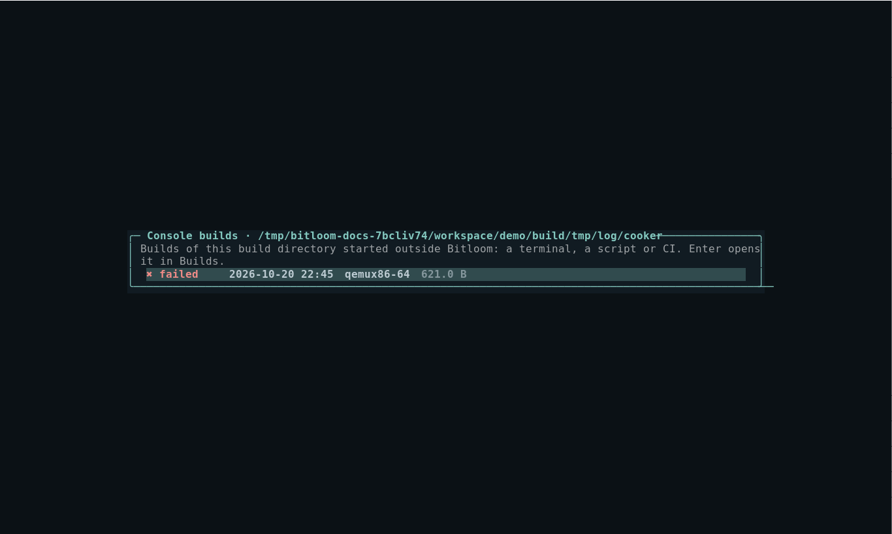

# Teams, CI/CD and setup

Features for organisations with many products, images, devices and build machines. Bitloom still runs one build at a time per build service: a serial queue avoids concurrent BitBake servers fighting over a build directory.

## A build server: run Bitloom as a service

On a shared build machine you want the build service, and usually the dashboard, running after a reboot and without a terminal open. Bitloom installs them as **systemd user services** (no root needed):

```console
$ bitloom --service-install --web --host 127.0.0.1 --port 8765
wrote ~/.config/systemd/user/bitloom.service
wrote ~/.config/systemd/user/bitloom-web.service
enabled and started bitloom.service, bitloom-web.service
dashboard: http://127.0.0.1:8765/#token=…
to keep it running when you log out: loginctl enable-linger <you>
```

* `bitloom.service` runs the build service for the state folder (`--state`, default `.bitloom` in the current folder, resolved to an absolute path); `bitloom-web.service` runs the dashboard on top of it. Without `--web` only the build service is installed: the TUI and `bitloom --web` attach to it as usual.
* The dashboard keeps its token in `<state>/web.token` (mode 0600, `--persistent-token`), so the URL, and your bookmark, survives restarts. Keep the default loopback address and reach it with an SSH tunnel (`ssh -L 8765:127.0.0.1:8765 build-server`).
* A build service already started by Bitloom is stopped first (only when idle), so there is never more than one per state folder. The unit's `PATH` is your login `PATH` without WSL's Windows folders.
* `bitloom --service-status` shows the units and the jobs; `bitloom --service-uninstall` stops and removes them. `--service-name` installs several (one per state folder).
* `loginctl enable-linger` keeps user services running when you are not logged in: run it yourself once.
* Under WSL, systemd must be enabled in `/etc/wsl.conf` (`[boot] systemd=true`).

## Headless CI runs

`bitloom --ci` runs operations without the TUI, with the same profiles, runtimes, serial queue and history:

```bash
bitloom --config ci/profiles.json --state .ci \
  --ci kas-build --ci build:core-image-minimal \
  --profile product-a --profile product-b \
  --junit results.xml --summary summary.json
```

* `--ci ACTION[:TARGET]` is repeatable; `bitloom --list-actions` lists the identifiers. Interactive operations and operations needing other inputs are refused.
* `--profile` is repeatable: the matrix runs every operation on every profile, serially.
* `--annotations auto|github|gitlab|plain` (default `auto`, from `GITHUB_ACTIONS`/`GITLAB_CI`) folds each job's log into a collapsible section and turns failed tasks and the most frequent warnings into annotations.
* `--junit` writes one test case per job (failed tasks, last errors and task log paths in the failure); `--summary` writes JSON with status, exit code, duration, task and setscene counts, sstate hit rate, warning groups, failed tasks and the images produced.
* Operations the profile's Yocto release does not provide are skipped with a warning (`<skipped>` in JUnit), so one matrix can span Scarthgap and Wrynose.
* `--fail-fast` stops at the first failure. SIGTERM and Ctrl+C stop the running job cleanly. Exit code 0 means every job that ran succeeded.

Example GitHub Actions step:

```yaml
- run: bitloom --config ci/profiles.json --state .ci --ci kas-build --junit results.xml --summary summary.json
- uses: actions/upload-artifact@v4
  if: always()
  with: { name: bitloom-reports, path: "results.xml\nsummary.json\n.ci/logs/" }
```

## Team profiles

Share profiles through NFS or a repository with `include`:

```json
{
  "active": "product-a",
  "include": ["/nfs/yocto/team-profiles.json", "../shared/profiles.json"],
  "profiles": [ { "name": "my-experiment", "root": "/home/me/src/product", "mode": "kas-container" } ]
}
```

Included files contain a `profiles` array. Relative paths resolve from the profiles file; environment variables such as `$HOME` expand. Team profiles are read-only: the profile editor shows only your own, the switcher (`P`) marks them *team*, and clone creates an editable copy. An unreachable include is reported in Configuration instead of preventing Bitloom from starting.

## Setup and infrastructure checks

Configuration and `bitloom --doctor` (exit code 2 when a check warns) include host checks that new team members otherwise discover one failed build at a time: CPU cores, memory, Python, UTF-8 locale, inotify watches, open-files limit, Docker/Podman, kas and git, and on WSL a reminder to keep builds on the Linux filesystem.

They also report the filesystem of the build directory, `TMPDIR`, `DL_DIR` and `SSTATE_DIR`. `TMPDIR` or the build directory on NFS, CIFS, 9p or drvfs is a warning (locking, hard links, speed); shared downloads and sstate on network storage are fine, with a reminder that a read-only `SSTATE_MIRRORS` plus a local `SSTATE_DIR` scales better when many builders write.

**Configuration → `n`** (or `bitloom --doctor --network`) probes the shared infrastructure configured in `local.conf`: `SSTATE_MIRRORS`, `PREMIRRORS`, `MIRRORS` (TCP reachability or mounted `file://` paths), `BB_HASHSERVE`, `BB_HASHSERVE_UPSTREAM` and `PRSERV_HOST`. It never downloads or authenticates.

## Many images and machines

**Artifacts → `m`** shows the image matrix: for every `MACHINE` in `tmp/deploy/images`, each image file with its size and date and the package count from its manifest, plus SDK installers.

## Many devices

Configure devices in Developer → Devices (SSH, labgrid places, console and test commands). **Fleet status** (Developer → Board view → *Fleet status*, or `bitloom --fleet`) probes every device at once with SSH `BatchMode` or `labgrid-client show`, with timeouts, and writes `fleet-status.json`. `--fleet` exits 1 unless every device is online, so a lab health job can gate on it.

## Builds started elsewhere

BitBake writes the complete console of every build to `tmp/log/cooker/<MACHINE>/<timestamp>.log`. **Builds → `c`** lists them, classified from their task summary, including builds started from a terminal, a script or CI. Opening one gives the same search, errors-only filter and reports as a Bitloom job, without having had Bitloom running at the time. The web dashboard lists them under the history.



## Project launcher scripts

Many products wrap kas in a script that selects the configuration through an environment variable, for example `YML=board.yml ./scripts/kas-wrapper.sh build`. The `wrapper` runtime uses such a script:

```json
{
  "name": "board",
  "root": "/home/me/src/product",
  "mode": "wrapper",
  "launcher": ["./scripts/kas-wrapper.sh"],
  "launcher_shell": ["shell", "-c", "{command}"],
  "environment": { "YML": "boards/board.yml", "KAS_WORK_DIR": "/home/me/work/board" }
}
```

* kas operations become launcher + subcommand: *Build kas configuration* runs `./scripts/kas-wrapper.sh build`.
* Every other command runs through `launcher_shell`: `bitbake -e busybox` becomes `./scripts/kas-wrapper.sh shell -c 'bitbake -e busybox'`.
* Profile environment variables (such as `YML`) reach the script; `KAS_WORK_DIR`/`KAS_BUILD_DIR` locate the build directory as for kas profiles.

For the TUI to run BitBake commands, queries and runtime probes, the script must forward a shell command into the build environment (kas's `shell -c`, or whatever `launcher_shell` names) and keep standard input open (`docker run -i`) for Analysis and Developer probes. Health checks verify that the launcher exists and is executable.

## Team chat notifications

Point the build service at a Slack, Teams or Mattermost incoming webhook (or an ntfy topic the team subscribes to) in Configuration → `o`: every long build on a shared build machine posts its outcome, profile, duration and failing task log, with no TUI attached. See [Daily helpers](guide.md#know-when-a-build-ends).

## Profiles from other versions

Profiles and history written by a newer or older Bitloom load with unknown keys ignored (Configuration lists them). The build service reports its version: when it is older than the client, the TUI and the web dashboard ask you to restart it when idle (`bitloom --service-stop`).
