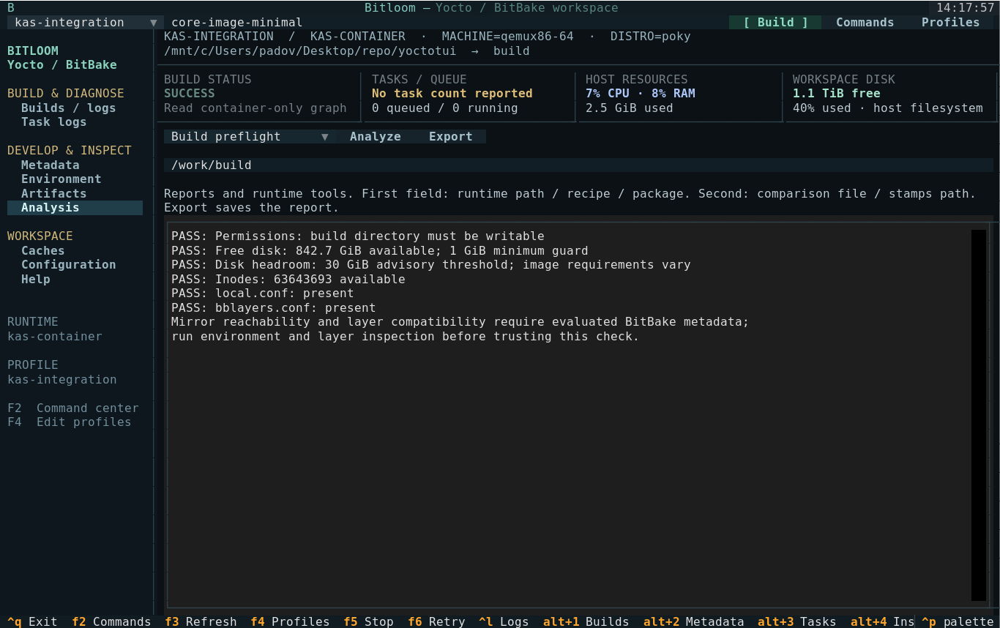
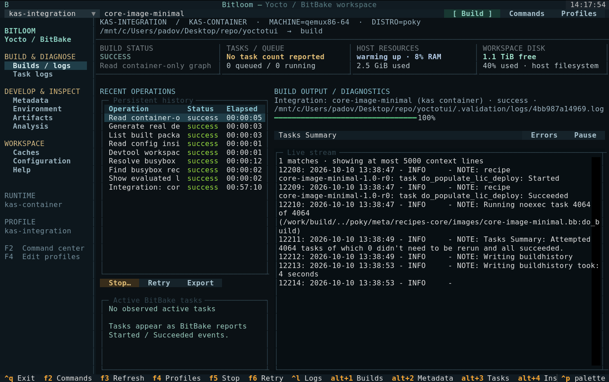
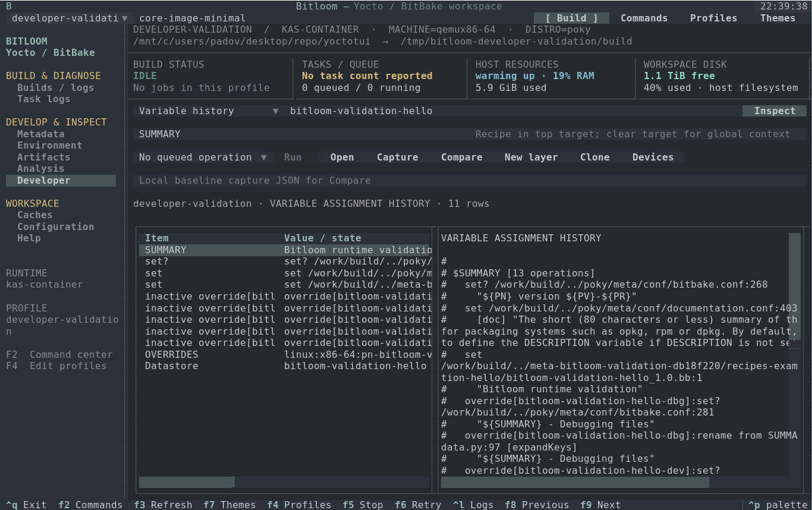
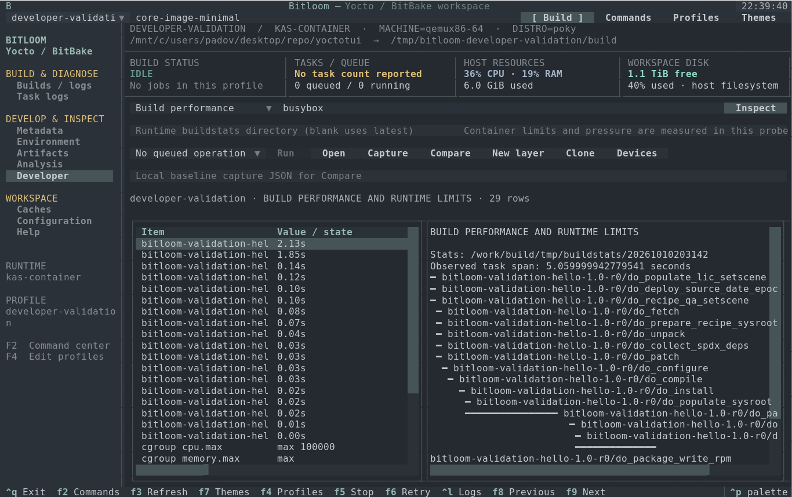
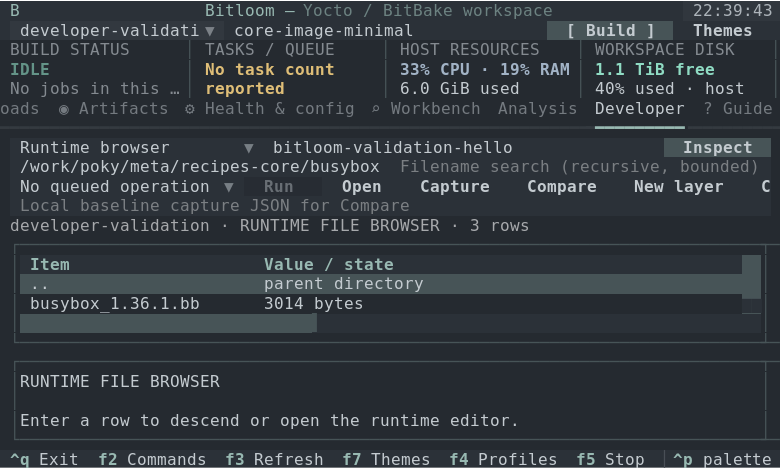

# Validation report

## Status

**Completed on 2026-10-10.** The real kas-container image build exited 0: all **4,064 tasks succeeded**, with no reused tasks. Elapsed wall time was **57 minutes 10 seconds** (10:41:45–11:38:55 UTC). BitBake reported **20 warnings and no errors**. The deployed rootfs archive was independently opened and hashed from the Docker daemon filesystem.

## Automated checks

The expanded suite passed **59 unit and UI tests** on Python 3.10.12 and Textual 1.0.0. It covers argument construction, shell quoting, host/kas/container routing, profile persistence, serial jobs, failure exit codes, cancellation, single-signal graceful stop, cache deletion boundaries, full-file log search, report parsing, failure-log persistence, external kas checkout indexing and TUI navigation, graph traversal through cycles, read-only rootfs inventory, source previews, keyboard navigation, pause/resume and responsive terminal layout. Installation with pip install -e . completed successfully. The installed CLI was also launched in a real 140×42 PTY with the kas profile/history and exited cleanly with Ctrl+Q.

The sandbox's Python thread-pool shutdown hung even for a minimal asyncio.to_thread example. The same tests passed when executed outside that sandbox. This restriction is separate from application behavior.

## Genuine Yocto image build

| Setting | Value |
| --- | --- |
| Target | core-image-minimal |
| Machine | qemux86-64 |
| Distro | poky |
| Release | yocto-5.0.8 (Scarthgap) |
| Poky revision | dc4827b3660bc1a03a2bc3b0672615b50e9137ff |
| kas wrapper / image | 4.8.1 |
| Image digest observed | sha256:fef6f850106a6823e65e133ed8157a847431dea4aa2de3a636c11f65e9977476 |
| Runtime | Docker, through kas-container |
| Engine integration | Bitloom Runner, SQLite history, persistent streamed log |
| Work | Dedicated work mount recorded in .validation/result.json, in the Docker daemon namespace |
| Output format | root filesystem tar.bz2 |
| Threads | BB_NUMBER_THREADS=8, PARALLEL_MAKE=-j8 |
| Initial sstate | Wanted 1,854; Local 0; Mirrors 0; Missed 1,854 |
| Result | 4,064 attempted tasks, all succeeded; exit 0 |
| Rootfs archive | core-image-minimal-qemux86-64.rootfs-20261010104206.tar.bz2 |
| Archive size | 18,012,484 bytes |
| Rootfs evidence | 724 entries; shell present; 27,107,202 regular-file bytes |
| SHA-256 | f96d0d5d60d2465caa4ca5ce6b8d60e92c454e1a2a1df1e27d1c236db0f7cfe1 |

No Yocto build toolchain was installed on the host. The official kas image provides those dependencies. The project venv contains TUI/test/documentation tools and the kas-container wrapper. Build data and the downloaded image consume disk space; they are isolated, not nonexistent.

Docker Snap exposed a private /tmp mount initially owned by root. Only that dedicated work mount was assigned the builder UID/GID. Docker socket permissions were not modified. A failed initial attempt and the later real build logs are retained locally under .validation.

The configuration pins the fetched Poky commit for reproducibility. Standard upstream source fetches and mirrors are used; network warnings are not treated as successful fetch evidence.

## Runtime probes after the build

All eight probes ran through Bitloom Runner and the same pinned kas-container image, with exit 0: evaluated layers, busybox recipe lookup, busybox environment, devtool status, container-only local.conf, built package listing, dependency graph generation and container-only graph reading. The environment contained **1,943 parsed variables**, with MACHINE=qemux86-64 and PN=busybox. The graph contained **12,654 parsed edges**.

The rootfs inventory utility was also exercised on the actual copied archive without extraction. The timing report found **4,048 completed timestamp pairs** and zero unmatched starts; the slowest compile was llvm-native at **1,770 seconds**. Task wall times overlap and do not sum to the build duration.

Reproduce post-build probes with `PATH="$PWD/.venv/bin:$PATH" python tools/probe_kas.py`. Local machine evidence is retained in `.validation/result.json`, `.validation/probes.json`, the SQLite history and original logs; generated rootfs files are ignored by Git.


## Documentation site

The static documentation was exercised in Chromium 153 using Playwright: capability filtering, runtime profile examples, screenshot dialog, all generated HTML manuals and a 390-pixel mobile viewport passed. No JavaScript page errors or failed resources were observed. The site and publishing workflow are committed. Local browser checks do not claim a public Pages deployment.

## Screenshots and GIF

The real-kas-* images show the verified build and its actual environment/dependencies. Other media is explicitly sample data. Media in assets/ was captured from the actual Textual app with Pilot. The sample workspace and controlled failure are clearly labelled demo data. SVG is exported by Textual and cropped to the terminal grid, removing Rich's decorative desktop-window frame; PNG is rendered with a local monospace font from that grid; GIF sequences those actual captures. No generated image or invented successful build screen is used.

## Coverage boundaries

A passing minimal image build does not validate every board, old release, devtool operation, existing-container lifecycle, shared-cache topology, external device or optional testing/security class. Podman command construction is tested; a Docker execution does not prove an end-to-end Podman build. Graceful stop uses documented BitBake client behavior and single-signal unit verification; interrupting the full validation build was not used as a shortcut.

Reference behavior: [BitBake knotty UI shutdown handling](https://github.com/openembedded/bitbake/blob/master/lib/bb/ui/knotty.py), [kas container guide](https://kas.readthedocs.io/en/4.8.1/userguide/kas-container.html).

## Additional Analysis validation

The Analysis panel was tested for metadata content search, report export and sstate mode switching. Parser checks cover package architecture changes, conflicting manifest versions, missing current-task counts, zero denominators and repeated warning messages. The existing real kas build supplied 35 manifest package/architecture entries, a 0% initial sstate hit rate and 20 warning occurrences. Comparing its unchanged manifest against itself yielded no differences; changed manifests were validated with explicit test fixtures. No additional cold Yocto build was required for these read-only features.

## Persistent service and runtime evidence validation

The new workflows were exercised against the same pinned kas-container and existing real build on 2026-10-10 with `tools/probe_workflows.py`. Runtime preflight found writable configuration, 842.8 GiB available and more than 63 million free inodes. The snapshot recorded two Git repositories, two manifests, 4,798 package size records and eight non-symlink artifacts. These are bounded snapshot counts, not counts of packages installed in the minimal image.

Image provenance evaluated core-image-minimal and identified `/bin/sh` as owned by package/recipe `busybox`, with the inclusion path `packagegroup-core-boot → busybox`. Reported BusyBox package file bytes were 699,723; those are pkgdata file sizes, not compressed image size.

Two real jobs completed through the independent service after the submitting RPC connections closed: `bitbake -S printdiff busybox` and a warm `bitbake core-image-minimal`. Both exited 0. The warm build attempted 4,064 tasks, all already current and all succeeded; its summary reported Current 1,854 with Wanted 0. This validates an incremental container build, not a second cold build. The service was stopped only after its queue finished.

The runtime binary exporter transferred the actual 18,012,484-byte rootfs archive and verified SHA-256 `f96d0d5d60d2465caa4ca5ce6b8d60e92c454e1a2a1df1e27d1c236db0f7cfe1`, matching the original artifact. WSL verification exposed unsupported Unix sockets on the project Windows mount; sockets now live in a private Linux /tmp directory while history remains in the project.

Additional automated checks cover UI detach/reconnect, an independent service surviving closed client connections, build-directory leases, shared/exclusive cache locking, redacted exports, conservative signature plans, runtime edit conflicts/backups and byte-exact binary export without overwrite. A persistent daemon does not provide reboot recovery. Shared-cache locking only coordinates participants using the same advisory lock; external builders remain outside that guarantee.






A final runtime check resolved the configured kas image to its matching cached digest, found 22 BusyBox sigdata files and indexed 4,044 stamps signature references against 5,897 cache files. No before/after signature pairs existed for those BusyBox task variants, so no variable-difference claim was made from that workspace. Pair comparison was verified separately with an explicit two-signature fixture using the release-tool invocation. Default runtime build-path discovery also retained the pinned Poky commit without assuming the host path existed.

## Theme and identity validation

The expanded suite passed 50 tests after adding twelve palettes. The theme UI test switches through every palette, verifies distinct actual screen backgrounds, cancels back to the original theme, saves Paper and restores it in a new session. Status/log colors use semantic palette colors, including the light palette. `tools/capture_themes.py` records actual terminal views for all twelve palettes and assembles the documentation GIF; NO_COLOR is cleared for those captures. The woven B icon is an original SVG with 32-, 180- and 512-pixel PNG exports used by README, site headers and favicons.

## Package and launch instructions validation

The documented `python -m build --no-isolation` produced the 0.1.0 wheel and source archive after satisfying the declared setuptools >=61 requirement. The wheel was installed into a fresh temporary virtual environment and imported from its site-packages while running outside the checkout; CLI help, the twelve palettes, actual TUI startup and a switch to Paper were verified. The source archive includes README, Pages/manual sources and assets, integration YAML and the profile preparation tool.

`tools/prepare_validation.py` recreated the local kas profile from the recorded workspace without starting a build or deleting history. The documented TUI launch opened the actual local profile/history in a terminal and exited with Ctrl+Q; its idle service was then stopped. Build, launch, local test, fresh-machine setup, reconnect and documentation preview commands are covered in README and the user guide. These packaging checks do not claim another cold Yocto build.

## Fresh demo setup and terminal resizing

`setup-demo.sh --no-launch` was run against a fresh temporary source copy without `.venv`, in a directory whose name contains spaces. It created the virtual environment, installed dependencies and generated demo metadata successfully. The installed app then launched at 80 × 24 and opened its command dialog using F2. No Yocto download or image build is part of this sample setup.

The responsive UI test resizes one running app through 160 × 50, 120 × 36, 90 × 28, 80 × 24, 60 × 20, 140 × 20 and back to 160 × 50. It checks visible build controls, usable log dimensions, section navigation and restoration of hidden panels. Small terminals hide history and metrics to preserve log space. The 60 × 20 test also opens commands, profiles and themes and checks that each dialog stays within the terminal boundaries. Scrollbar tracks and corners now use each theme's surface palette, and log panes only show vertical scrollbars when needed. Theme tests check log and analysis backgrounds and scrollbar colors across all twelve palettes.

The README and landing page open with an idle demo capture. Failure captures elsewhere show the explicitly labelled diagnostic sample; they do not represent a Bitloom failure or the real kas-container build result.

## Release packaging

The manual release workflow was validated with actionlint 1.7.12. Local packaging generated versioned source archives, wheels, Debian packages and SHA256SUMS for 0.2.0 and 0.2.1; all checksum checks passed. Seven release tests verify stable version validation and synchronized distribution/runtime versions. The .deb was actually installed in a disposable kas container, where `/usr/bin/bitloom --help` succeeded and the runtime version was checked. No package was installed on the host. The final source, wheel and Debian package were also checked for the MIT license. This verifies local packaging; the GitHub release workflow has not been dispatched or published during this work.

## Bitloom namespace migration

The distribution, Python imports, entry point, default state directory, release assets and helper scripts now use Bitloom consistently. The full suite passed 59 tests after renaming. Version 0.2.2 source, wheel and Debian assets were generated with the new names; the Debian package was installed in a disposable container, where the Bitloom CLI and runtime import/version succeeded. References to the external yoctui project remain in the inspiration credit. Historic terminal captures retain the original checkout paths shown when they were recorded.

## Live elapsed time and terminal navigation

A regression test runs a real four-second subprocess and verifies that its history duration advances before completion and stays fixed afterward. F8/F9 navigation is exercised with keys decoded from actual terminal escape sequences, rather than synthetic Alt events. These replace Alt+number as the documented navigation keys.

## TUI file creation and external refresh

The new-file dialog was exercised through the real Textual app: a recipe template was edited and saved into newly created parent directories, and the file appeared in Metadata. Timer-driven tests verify externally added, edited and deleted recipes are reflected in the local index. File creation was also executed and read back inside a disposable kas container. Regression tests verify existing files and dangling symlinks cannot be overwritten. The complete suite passed 62 tests before the additional runtime-directory timer test; the subsequent 13-test UI suite passed with that timer included. A separate UI test also verifies generic text-file creation opens the containing directory.

Host Metadata is a local filesystem index. Container-only files are created and edited through the runtime operations; after creation the containing runtime directory opens in Analysis. Local scans run every five seconds; open runtime directory listings refresh every fifteen seconds while idle, with a 2,000-entry limit. Automatic refresh pauses while a modal is open.

## Developer workbench validation

The fourteen researched workflows are implemented in sixteen F10 views, with English instructions and P01–P14 manual cases. The suite now contains **99 unit/UI tests**; final checks cover actual backend invocation, multiconfig/virtual targets, large runtime payloads, source-preserving profile clones, no-overwrite licensed scaffolds for five build systems, variable origins, buildhistory KiB/pkgdata exact bytes, incompatible image baselines, overlapping buildstats, CVE dispositions, kernel fragments, artifact hashes, compiler path mapping, stale captures, optional task prerequisites and 60×20/80×24 Developer layout. A scheduled telemetry update during screen teardown was observed and guarded; the regression suite was repeated after the fix.

Real Developer validation ran through Docker and the pinned kas 4.8.1 image on Scarthgap 5.0.8. A **new dedicated work mount** was used because the earlier temporary image-build mount had been removed. The earlier 4,064-task image evidence remains historical evidence; it is not a claim that that old directory is still available. No host Yocto toolchain was installed.

| Actual check | Result |
| --- | --- |
| Runtime capabilities | BusyBox listtasks, installed tools/release, ide-sdk help and runtime prerequisites evaluated |
| Metadata probes | Variable assignment origins, selected recipe/appends/paths, runtime browser, IDE context, upgrade/layer context, mirrors/downloads and rebuild/shutdown observations executed |
| New local layer | Created inside /work and registered through a new host kas overlay/profile |
| Small data-only recipe | 661 attempted tasks; 645 already current and all succeeded; exit 0 |
| Source mirror preparation | Actual BitBake fetchall with BB_GENERATE_MIRROR_TARBALLS; exit 0 |
| Fetch offline | BB_NO_NETWORK fetchall; 130 tasks already current, exit 0 |
| Full recipe build offline | BB_NO_NETWORK build; 661 tasks already current, exit 0 |
| Controlled task failure | Deliberate bbfatal in do_install; actual failed job, task log and executed script resolved |
| Restored recipe | Failing append restored with backup; 661 tasks, 657 already current, all succeeded |
| Performance | Successful recipe session contained 18 recorded task stats with an observed span of 5.06 seconds; current runtime cgroup/pressure/disk evidence recorded separately |
| Cloned kas profile | Original local layer retained in /work; evaluated WORKDIR resolved under the independent /build mount |
| Owned container stop | Dedicated READY/sleep container stopped by its unique Bitloom name; stop code 0, client code 137, persisted cancelled status and confirmed recovery eligibility |

An initial validation-fixture packaging error was caught by installed-vs-shipped QA and fixed before the successful run. Its original failed log remains local. The helper's compact test recipe uses CLOSED and data-only installation to reduce build scope; complete MIT source templates are separately verified with actual no-overwrite runtime creation and parser fixtures. This run does not claim all five toolchains were compiled.

Reproduction:

```bash
python tools/validate_developer.py --build
python tools/validate_shutdown.py
python tools/capture_developer.py
python -m pytest -q
python tools/check_testbook.py
python tools/build_docs.py
```

Add `--image` to the first command for a new full minimal-image build. The executed `--build` run deliberately did not repeat the earlier full image build. Its image probe correctly recorded unavailable buildhistory image data in the new workspace. Image regression parsing/deltas were tested with explicit fixtures following the actual installed Scarthgap buildhistory format; no missing new image was presented as built.

Local evidence: `.developer-validation/result.json`, `clone-result.json`, `stop-result.json`, individual runtime report JSON, state directories and complete logs. Probe PASS means the executable query ran; optional artifacts retain their availability flag. The stop experiment verified an owned container with a sleeping process, not draining an actual running BitBake task. Kernel compilation, interactive IDE cross-build/debugging, CVE database scanning, physical board/serial/labgrid execution and end-to-end Podman builds still require their real environments and are marked separately in the testbook.







The new GIF and screenshots use the actual Textual UI displaying saved real runtime reports. The layer-wizard capture is explicitly a preview, with no files created by the capture. `tools/check_docs.py` checks all six HTML manuals, feature filtering, screenshot dialogs and a mobile viewport; documentation media does not simulate a successful SDK, board operation or missing image.
