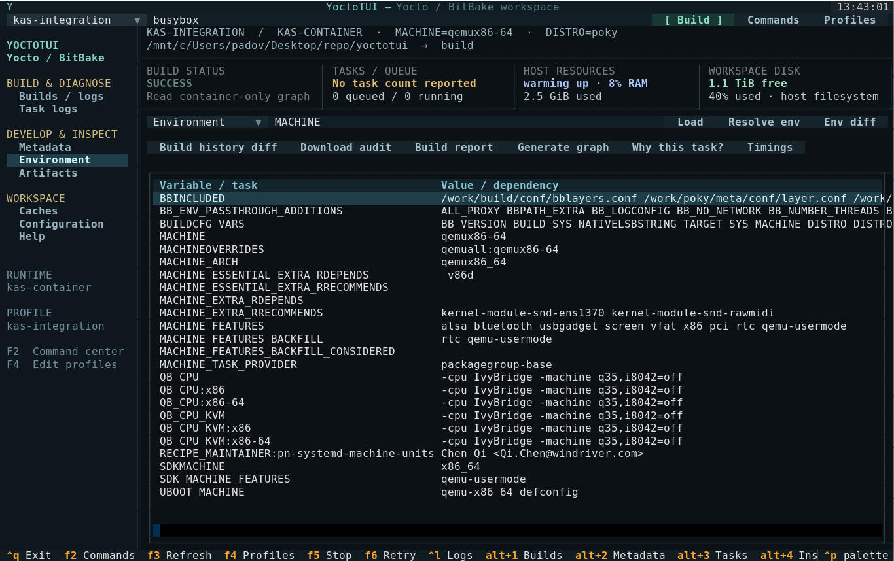
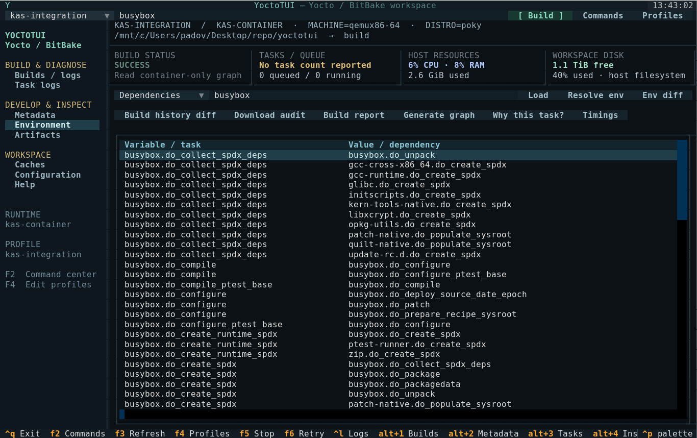

# Validation report

## Status

**Completed on 2026-10-10.** The real kas-container image build exited 0: all **4,064 tasks succeeded**, with no reused tasks. Elapsed wall time was **57 minutes 10 seconds** (10:41:45–11:38:55 UTC). BitBake reported **20 warnings and no errors**. The deployed rootfs archive was independently opened and hashed from the Docker daemon filesystem.

## Automated checks

The expanded suite passed **33 unit and UI tests** on Python 3.10.12 and Textual 1.0.0. It covers argument construction, shell quoting, host/kas/container routing, profile persistence, serial jobs, failure exit codes, cancellation, single-signal graceful stop, cache deletion boundaries, full-file log search, report parsing, failure-log persistence, external kas checkout indexing and TUI navigation, graph traversal through cycles, read-only rootfs inventory, source previews, keyboard navigation, pause/resume and responsive terminal layout. Installation with pip install -e . completed successfully. The installed CLI was also launched in a real 140×42 PTY with the kas profile/history and exited cleanly with Ctrl+Q.

The sandbox's Python thread-pool shutdown hung even for a minimal asyncio.to_thread example. The same tests passed when executed outside that sandbox. This restriction is separate from application behavior.

## Genuine Yocto image build

| Setting | Value |
| --- | --- |
| Target | core-image-minimal |
| Machine | qemux86-64 |
| Distro | poky |
| Release | yocto-5.0.8 (Scarthgap) |
| Poky revision | dc4827b3660bc1a03a2bc3b0672615b50e9137ff |
| kas wrapper / image | 4.8.1 |
| Image digest observed | sha256:fef6f850106a6823e65e133ed8157a847431dea4aa2de3a636c11f65e9977476 |
| Runtime | Docker, through kas-container |
| Engine integration | YoctoTUI Runner, SQLite history, persistent streamed log |
| Work | Dedicated /tmp/yoctotui-kas-validation mount in the Docker daemon namespace |
| Output format | root filesystem tar.bz2 |
| Threads | BB_NUMBER_THREADS=8, PARALLEL_MAKE=-j8 |
| Initial sstate | Wanted 1,854; Local 0; Mirrors 0; Missed 1,854 |
| Result | 4,064 attempted tasks, all succeeded; exit 0 |
| Rootfs archive | core-image-minimal-qemux86-64.rootfs-20261010104206.tar.bz2 |
| Archive size | 18,012,484 bytes |
| Rootfs evidence | 724 entries; shell present; 27,107,202 regular-file bytes |
| SHA-256 | f96d0d5d60d2465caa4ca5ce6b8d60e92c454e1a2a1df1e27d1c236db0f7cfe1 |

No Yocto build toolchain was installed on the host. The official kas image provides those dependencies. The project venv contains TUI/test/documentation tools and the kas-container wrapper. Build data and the downloaded image consume disk space; they are isolated, not nonexistent.

Docker Snap exposed a private /tmp mount initially owned by root. Only that dedicated work mount was assigned the builder UID/GID. Docker socket permissions were not modified. A failed initial attempt and the later real build logs are retained locally under .validation.

The configuration pins the fetched Poky commit for reproducibility. Standard upstream source fetches and mirrors are used; network warnings are not treated as successful fetch evidence.

## Runtime probes after the build

All eight probes ran through YoctoTUI Runner and the same pinned kas-container image, with exit 0: evaluated layers, busybox recipe lookup, busybox environment, devtool status, container-only local.conf, built package listing, dependency graph generation and container-only graph reading. The environment contained **1,943 parsed variables**, with MACHINE=qemux86-64 and PN=busybox. The graph contained **12,654 parsed edges**.

The rootfs inventory utility was also exercised on the actual copied archive without extraction. The timing report found **4,048 completed timestamp pairs** and zero unmatched starts; the slowest compile was llvm-native at **1,770 seconds**. Task wall times overlap and do not sum to the build duration.

Reproduce post-build probes with `PATH="$PWD/.venv/bin:$PATH" python tools/probe_kas.py`. Local machine evidence is retained in `.validation/result.json`, `.validation/probes.json`, the SQLite history and original logs; generated rootfs files are ignored by Git.

## Documentation site

The static documentation was exercised in Chromium 153 using Playwright: capability filtering, runtime profile examples, screenshot dialog, all three generated HTML manuals and a 390-pixel mobile viewport passed. No JavaScript page errors or failed resources were observed. The site and publishing workflow are committed; no GitHub remote is configured, so a public Pages deployment has not occurred.

## Screenshots and GIF

The real-kas-* images show the verified build and its actual environment/dependencies. Other media is explicitly sample data. Media in assets/ was captured from the actual Textual app with Pilot. The sample workspace and controlled failure are clearly labelled demo data. SVG is exported by Textual and cropped to the terminal grid, removing Rich's decorative desktop-window frame; PNG is rendered with a local monospace font from that grid; GIF sequences those actual captures. No generated image or invented successful build screen is used.

## Coverage boundaries

A passing minimal image build does not validate every board, old release, devtool operation, existing-container lifecycle, shared-cache topology, external device or optional testing/security class. Podman command construction is tested; a Docker execution does not prove an end-to-end Podman build. Graceful stop uses documented BitBake client behavior and single-signal unit verification; interrupting the full validation build was not used as a shortcut.

Reference behavior: [BitBake knotty UI shutdown handling](https://github.com/openembedded/bitbake/blob/master/lib/bb/ui/knotty.py), [kas container guide](https://kas.readthedocs.io/en/4.8.1/userguide/kas-container.html).
