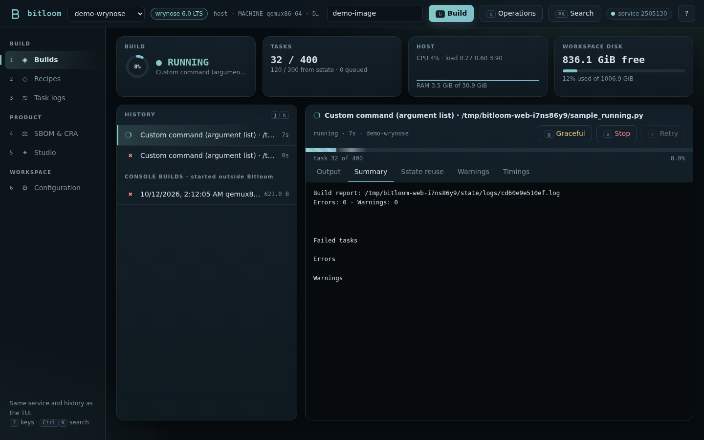
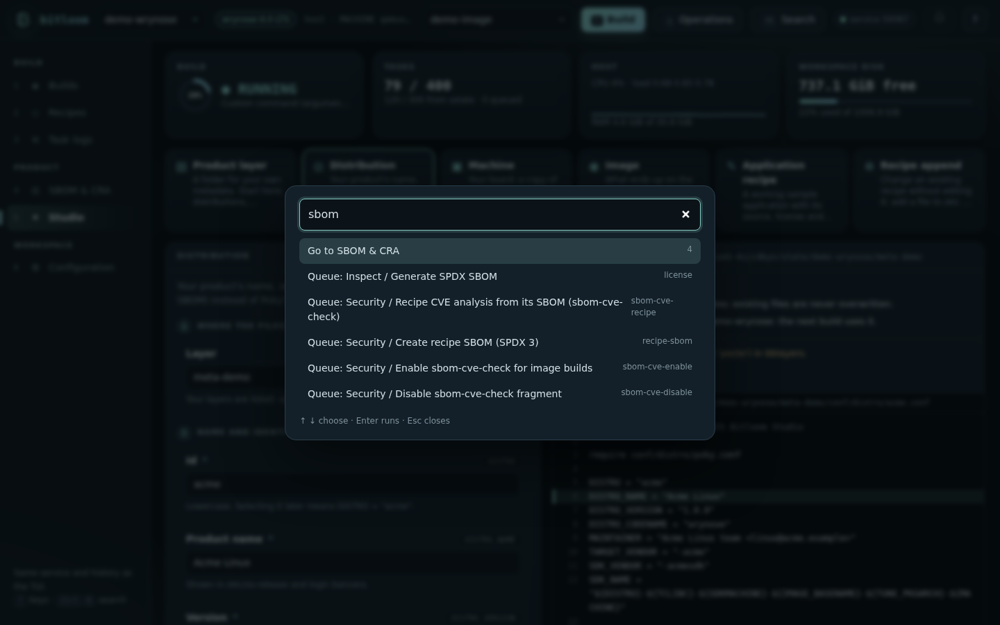
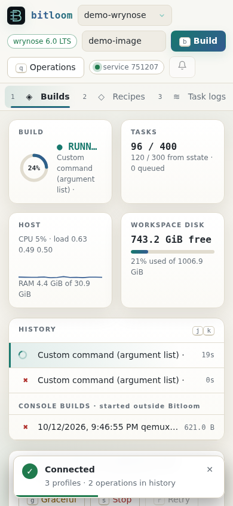

# Web dashboard

`bitloom --web` serves a browser dashboard for the same build service the TUI uses. Builds queued from the browser and from the terminal share one serial queue and one history, so you can start a build in the TUI, follow it on a laptop or phone, and retry it from either place.


## Start it

```bash
bitloom --web                              # loopback only, opens a browser
bitloom --web --no-browser --port 9000     # pick the port; 0 chooses a free one
bitloom --web --config .bitloom/profiles.json --state .bitloom
```

The command prints a URL such as `http://127.0.0.1:8765/#token=…`. The token lives in the URL fragment: it is never sent in requests, the page keeps it for the browser tab and sends it as an `X-Bitloom-Token` header. Ctrl+C stops the web server only; builds keep running in the service. `--state` must match the TUI to see the same history.

The dashboard needs only the Python standard library. It is not a multi-user server: anyone holding the URL can queue builds for your profiles.

### Remote access

Keep the default loopback address and tunnel it:

```bash
ssh -L 8765:127.0.0.1:8765 build-server
```

`--host 0.0.0.0` listens on every interface and prints a warning; use it only on a trusted network. On loopback the server also checks the `Host` header, which defeats DNS-rebinding attacks.

## Sections

| Key | Section | What it shows |
| --- | --- | --- |
| `1` | Builds | History with live spinners, the selected job with an animated progress bar (stripes while running, indeterminate until BitBake reports task counts), streaming output, search with context, errors-only filter, stop, graceful stop and retry. Console builds started outside Bitloom appear under the history. |
| `2` | Recipes | Recipes, appends, classes, layers and kas files, filtered as you type. |
| `3` | Task logs | `tmp/work/*/temp/log.*` files with search and an errors-only view. Only indexed task logs can be read. |
| `4` | SBOM & CRA | Release support, SBOM quality gauges, VEX status, vulnerabilities from cve-check, sbom-cve-check and Grype, CRA readiness checks, the regulation timeline and every SBOM option with its explanation. See [SBOM, CRA and releases](compliance.md). |
| `5` | Studio | Create a product layer, distribution, machine, image, recipe or append with a live preview. See [Studio](studio.md). |
| `6` | Configuration | Projects (recent, new, clone), guided project setup, health checks, setup checks and literal `local.conf` values. See [Projects](projects.md). |

The build detail has Toaster-style tabs computed from the stored log: **Summary** (errors, warnings, failed tasks), **Sstate reuse**, grouped **Warnings**, observed task **Timings** and **Compare** with the previous run of the same command. A running build shows its ETA next to the task count.



## Notifications and animations

The bell button in the top bar turns on browser notifications for builds that end while the tab is in the background; the build service's own desktop and webhook notifications are configured in Configuration (see [Daily helpers](guide.md#daily-helpers)). Toasts slide in for every state change of a job: started, succeeded, failed (with a button that opens the summary) and cancelled. Hover a toast to pause its countdown; failures stay longer. Cards count up, rings and meters animate, the CPU card draws a live sparkline, and views fade in. With the operating system's *reduce motion* setting, all animations are disabled.

## Keyboard

The dashboard works without a mouse.

| Key | Action |
| --- | --- |
| `1` – `6` | Switch section |
| `Ctrl+K` | Command palette: sections, every operation, profile switching and recent builds |
| `/` | Focus the search field of the section |
| `Esc` | Leave a field or close a dialog |
| `j` / `k`, `↓` / `↑` | Next / previous operation |
| `b` / `q` / `t` | Build the target / queue any operation / edit the target |
| `s` / `g` / `r` | Force stop / graceful stop / retry the selected operation |
| `e` | Errors only |
| `o` `u` `w` `m` `d` | Output, Summary, Warnings, Timings, Compare tab |
| `?` | Keyboard help |



The operation dialog lists every non-interactive operation grouped like the TUI command center, previews the exact command and refuses operations your Yocto release does not provide, naming the alternative.

## Phone and narrow windows

The layout collapses to one column, the navigation becomes a scrolling bar and toasts move to the bottom.



## API

The page uses a small JSON API that scripts can use too (all calls need the `X-Bitloom-Token` header):

| Method and path | Purpose |
| --- | --- |
| `GET /api/state` | Profiles (with detected release), service status, history, host metrics |
| `GET /api/actions` | Operation catalogue with release windows |
| `POST /api/preview`, `POST /api/jobs` | Preview or queue `{profile, action, values}` |
| `GET /api/jobs/<id>/log?offset=N`, `?q=…&errors=1` | Incremental output or filtered search |
| `GET /api/jobs/<id>/report` | Summary, sstate, warnings, timings |
| `POST /api/jobs/<id>/stop`, `/retry` | `{mode: graceful|force}` / retry with the original profile |
| `GET /api/console`, `/api/console/log`, `/api/console/report` | Builds started outside Bitloom |
| `GET /api/compliance` | SBOM summaries, CRA checks, timeline, SBOM options |
| `GET /api/vulnerabilities`, `POST /api/vulnerabilities/scan` | Findings with filters; Grype scan of the newest SPDX SBOM |
| `GET /api/vulnerabilities/export?format=md` | The filtered findings as `md`, `html`, `csv`, `json` or `sarif` (attachment) |
| `GET /api/jobs/<id>/compare` | Comparison with the previous run of the same command |
| `GET`/`POST /api/notifications` | Build notification settings |
| `GET /api/workusage` | tmp/work usage per recipe |
| `/api/projects…`, `/api/setup…` | Projects and guided setup, see [Projects](projects.md#api) |
| `GET /api/studio/fields`, `POST /api/studio/preview`, `/create` | Studio |
| `GET /api/metadata`, `/api/tasklogs`, `/api/tasklog`, `/api/health` | Read-only views |


